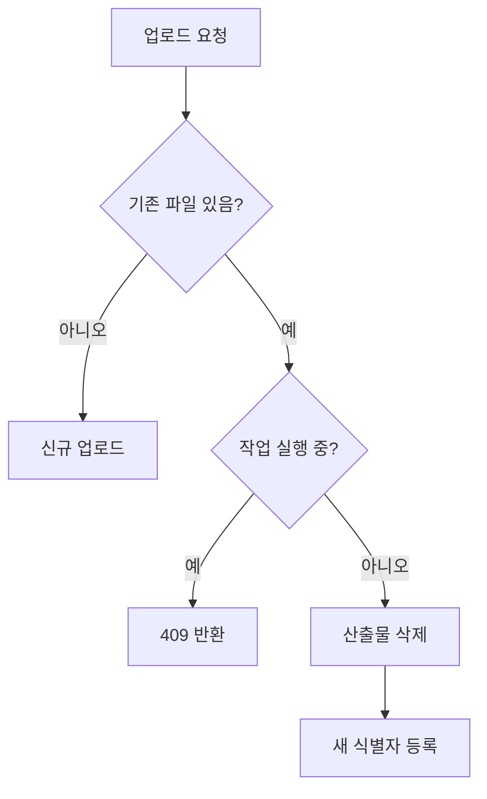

## 문제와 배경

PDF AI 분석 서비스는 사용자가 올린 PDF를 파싱하고, 청크로 나눠 임베딩한 뒤, LLM으로 요약과 번역을 만듭니다. 한 문서의 처리는 여러 단계를 거치고, 단계마다 결과물이 다른 저장소에 쌓입니다.

| 단계 | 하는 일 | 결과물이 남는 곳 |
|---|---|---|
| `COLLECTING` | 원본을 객체 스토리지에 저장하고 메타데이터 등록 | S3, PostgreSQL |
| `PARSING` | pdfplumber로 페이지별 텍스트 추출 | PostgreSQL (페이지 테이블) |
| `INDEXING` | 청크 분할, 임베딩, 벡터 저장 | Elasticsearch |
| `LLM_PROCESSING` | 요약·번역 생성 | PostgreSQL (요약·번역 테이블) |
| `COMPLETED` | 결과 캐시, 완료 알림 | Redis |

처음 설계는 「한 번 올리면 끝까지 간다」는 전제였습니다. 검증 환경과 운영 환경에서 이 전제가 맞지 않는 경우가 세 가지 나왔습니다.

1. **파싱이 실패한 문서를 다시 돌릴 수 없었습니다.** 작업 레코드가 `FAILED`로 남아 있으면 같은 문서에 새 작업이 만들어지지 않았습니다.
2. **프롬프트를 바꾼 뒤 특정 문서만 다시 요약할 방법이 없었습니다.** 요약 단계만 따로 되돌리는 경로가 없었습니다.
3. **같은 파일을 다시 올리면 새 레코드가 생기고 이전 결과는 그대로 남았습니다.** 중복 검사 로직은 만들어져 있었지만 업로드 핸들러에서는 꺼져 있었습니다. 그래서 이전 페이지·번역·요약·벡터가 주인 없이 쌓였습니다.

결국 문서 하나를 다시 처리하려면 여러 테이블과 검색 인덱스를 손으로 지워야 했습니다. 검증 환경에서 테스트 데이터를 정리할 때도 마찬가지였습니다.

## 접근

`force_reinit` 옵션이 켜졌을 때 업로드 요청이 타는 분기를 그림으로 보면 다음과 같습니다.



### 상태는 두 층으로 나눠 봅니다

처리 상태를 한 컬럼으로만 보면 「지금 어느 단계인가」와 「그 단계를 실행 중인가, 실패했는가」가 섞입니다. 이 구조에서는 둘을 나눠 두었습니다.

- **파일의 진행 단계**: 파일 레코드에 둡니다. `UPLOADING → … → COMPLETED`처럼 문서가 어디까지 왔는지를 나타냅니다. 실패 시에는 오류 메시지를 함께 남깁니다.
- **작업의 실행 상태**: 작업(job) 레코드에 둡니다. `RUNNING`, `FAILED`, `DONE`처럼 워커가 그 작업을 지금 잡고 있는지를 나타냅니다.

재처리의 출발점은 두 상태를 모두 「처음」으로 돌리는 것입니다. 진행 단계는 업로드 직후로, 작업은 아예 없는 상태로 되돌립니다.

### 부분 재처리 대신 전체 초기화를 고릅니다

실패한 단계부터 이어서 돌리는 방식도 생각할 수 있습니다. 하지만 그러려면 단계마다 「이전 단계 결과가 온전한가」를 판단해야 하고, 단계 사이의 의존 관계가 상태 머신에 그대로 새어 나옵니다. 그래서 업로드 API에 `force_reinit` 옵션을 하나 두고, 켜면 그 문서의 모든 산출물을 지운 뒤 처음부터 처리하기로 했습니다.

규칙은 네 가지입니다.

| 규칙 | 이유 |
|---|---|
| 옵션이 꺼져 있으면 기존 동작 그대로 | 기본 경로의 동작을 바꾸지 않습니다 |
| 같은 내용의 기존 파일이 없으면 일반 업로드로 처리 | 클라이언트가 「있는지」 먼저 물어볼 필요가 없습니다 |
| 실행 중(`RUNNING`)인 작업이 있으면 409 Conflict | 워커가 쓰는 도중에 데이터를 지우면 반쯤 지워진 결과가 남습니다 |
| 산출물 삭제 후 새 식별자로 다시 등록 | 이전 식별자를 참조하는 레코드가 남을 여지를 없앱니다 |

같은 파일인지는 파일 이름이 아니라 내용 해시로 판단합니다. 이름은 사용자가 바꿀 수 있지만 내용 해시는 같은 바이트에 대해 늘 같습니다.

### 식별자를 재사용할지, 새로 발급할지

계획 단계에서 이 부분은 결정이 필요한 항목으로 남겨 두었고, 양쪽 장단점은 다음과 같았습니다.

- **기존 식별자 재사용**: 클라이언트가 같은 식별자로 진행 상태를 계속 조회할 수 있습니다. 대신 외래 키로 묶인 하위 레코드를 지우는 순서와 재등록 시점을 신경 써야 합니다.
- **새 식별자 발급**: 기존 레코드를 통째로 지우고 새로 만들면 되므로 구현이 단순합니다. 대신 클라이언트는 응답으로 받은 새 식별자로 갈아타야 합니다.

계획의 권장안은 새 식별자 발급이었습니다. 클라이언트 쪽 부담은 응답에 이전 식별자와 새 식별자를 함께 돌려주는 것으로 줄이는 방향입니다. 아래 코드도 이 권장안을 따릅니다.

## 구현

### 핵심 코드

API 계층은 FastAPI의 `Form` 파라미터 하나만 늘립니다. 기본값이 `False`라서 기존 클라이언트는 아무것도 바꿀 필요가 없습니다.

```python
from fastapi import APIRouter, Depends, File, Form, UploadFile

router = APIRouter()


@router.post("/v1/upload")
async def upload(
    file: UploadFile = File(...),
    force_reinit: bool = Form(default=False),
    service: UploadService = Depends(get_upload_service),
):
    content = await file.read()
    if not force_reinit:
        return await service.register(file.filename, content)
    return await service.reinitialize_and_register(file.filename, content)
```

서비스 계층에서 초기화 순서를 정합니다. 실행 중인 작업을 먼저 확인하고, DB 산출물은 한 트랜잭션 안에서 지웁니다. 벡터 삭제가 실패하면 DB 삭제까지 롤백되도록 벡터 삭제를 트랜잭션 안쪽 마지막에 둡니다.

```python
import hashlib


class JobRunningError(Exception):
    """처리 중인 작업이 있어 초기화할 수 없을 때 발생합니다."""


class UploadService:
    def __init__(self, db, vector_store, storage):
        self.db = db
        self.vector_store = vector_store
        self.storage = storage

    async def reinitialize_and_register(self, filename: str, content: bytes) -> dict:
        content_hash = hashlib.sha256(content).hexdigest()
        previous = await self.db.find_file_by_hash(content_hash)
        if previous is None:
            return await self.register(filename, content)

        async with self.db.transaction() as tx:
            if await tx.has_running_job(previous.id):
                raise JobRunningError(previous.id)

            # 하위 테이블부터 지워 외래 키 제약을 피합니다.
            for table in ("jobs", "summaries", "translations", "pages", "chat_messages"):
                await tx.delete_by_file_id(table, previous.id)
            await tx.delete_file(previous.id)

            # 여기서 예외가 나면 위의 DB 삭제가 모두 롤백됩니다.
            await self.vector_store.delete_by_file_id(previous.id)

        registered = await self.register(filename, content)
        return {
            "file_id": registered["file_id"],
            "reinitialized": True,
            "previous_file_id": previous.id,
        }
```

`JobRunningError`는 예외 처리기에서 409로 바꿉니다.

```python
from fastapi import Request
from fastapi.responses import JSONResponse


@app.exception_handler(JobRunningError)
async def job_running_handler(request: Request, exc: JobRunningError):
    return JSONResponse(
        status_code=409,
        content={"error_code": "JOB_RUNNING", "message": "처리 중인 작업이 있습니다."},
    )
```

응답 모양은 다음과 같습니다.

```json
{
  "file_id": 1042,
  "reinitialized": true,
  "previous_file_id": 987
}
```

### 확인할 시나리오

구현 전에 시나리오를 먼저 표로 정해 두었습니다.

| 시나리오 | 기대 결과 |
|---|---|
| 옵션 끔, 일반 업로드 | 기존 동작 그대로 |
| 옵션 켬, 기존 파일 없음 | 신규 업로드로 처리 |
| 옵션 켬, 기존 파일 처리 완료 | 산출물 삭제 후 새 식별자로 재처리 |
| 옵션 켬, 작업 실행 중 | 409 반환, 아무것도 지우지 않음 |
| 옵션 켬, 벡터 삭제 실패 | 롤백, 오류 반환 |

## 함정과 트레이드오프

### DB와 검색 인덱스는 한 트랜잭션이 아닙니다

PostgreSQL 삭제는 트랜잭션으로 묶을 수 있지만 Elasticsearch 삭제는 그 밖에 있습니다. 계획의 목표는 「벡터 삭제가 실패하면 롤백하고 오류를 돌려준다」였습니다. 위 코드처럼 DB 삭제를 커밋하기 전에 벡터 삭제를 호출하면, 벡터 삭제가 실패했을 때 DB는 그대로 남고 클라이언트는 같은 요청을 다시 보내면 됩니다.

다만 이 방식도 반대 방향의 실패는 막지 못합니다. 벡터 삭제는 성공했는데 그 뒤 DB 커밋이 실패하면, 레코드는 남고 벡터만 사라진 문서가 생깁니다. 이 경우를 어떻게 알아채고 복구할지(예: 재초기화를 다시 요청하게 하거나, 벡터가 없는 완료 문서를 찾는 점검)를 고려해야 합니다.

### 「실행 중인가」 검사는 경쟁 조건을 품고 있습니다

`RUNNING` 작업이 없는 것을 확인한 직후 워커가 작업을 집어 갈 수 있습니다. 검사와 삭제 사이의 틈을 줄이려면 파일 행을 잠근 상태에서 검사하는 방식을 고려해야 합니다. 이때 워커도 작업 상태를 바꿀 때 같은 행을 잠그거나 조건부 갱신(`UPDATE ... WHERE status = 'PENDING'`)을 써야 잠금이 의미를 가집니다. 한쪽만 잠그면 다른 쪽은 그 잠금을 모른 채 지나갑니다.

### 작업 메시지가 큐에 남아 있을 수 있습니다

DB에서 작업 레코드를 지워도 이미 큐에 들어간 메시지는 그대로입니다. 워커가 그 메시지를 꺼냈을 때 작업 레코드가 없으면 조용히 버리도록 하는 처리를 고려해야 합니다. 메시지를 신뢰하지 않고 DB 상태를 다시 읽는 습관은 [2편](/blog/2026/01/14/worker-job-queue-to-db.html)에서 다루는 「상태는 DB에, 큐는 전달만」 원칙과 같은 이야기입니다.

### 전체 초기화는 비용을 숨깁니다

모든 단계를 다시 돌리므로 임베딩과 LLM 호출도 처음부터 다시 나갑니다. 프롬프트만 바꿨는데 파싱과 임베딩까지 다시 하는 셈입니다. 재처리 요청이 잦아지면 「요약만 다시」 같은 단계별 초기화를 따로 두는 것도 고려해야 합니다.

## 정리

- 문서 처리 파이프라인은 「한 번에 끝까지 간다」는 전제를 깨는 경우가 반드시 생깁니다. 실패, 프롬프트 변경, 테스트 데이터 정리가 모두 재처리 요구로 돌아옵니다.
- 진행 단계(파일)와 실행 상태(작업)를 나눠 두면, 재처리는 두 상태를 처음으로 돌리는 일로 정리됩니다.
- 재처리 옵션은 기본값을 끈 채로 추가해 기존 동작을 지키고, 실행 중인 작업이 있으면 409로 거절합니다.
- DB와 검색 인덱스처럼 트랜잭션이 갈라지는 저장소는 벡터 삭제를 커밋 전에 호출해 실패 시 롤백되게 하되, 커밋 자체가 실패하는 반대 경우의 복구 방법도 고려해야 합니다.
- 「실행 중인가」 검사는 경쟁 조건을 품고 있으므로 행 잠금이나 조건부 갱신을 API와 워커 양쪽에 두는 것을 고려해야 합니다.
