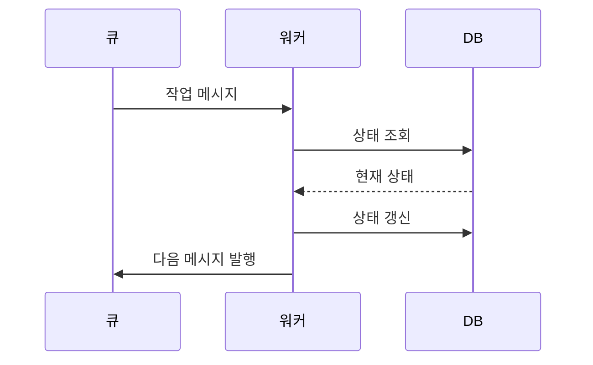

## 문제와 배경

PDF를 업로드하면 수집 → 파싱 → 색인 → 요약·번역 → 완료까지 여러 단계를 거치는 파이프라인을 둡니다. 각 단계는 별도 워커가 맡고, 단계 사이는 메시지 큐로 넘깁니다. 이때 "메시지 자체에 지금 처리 단계를 실어 보내면 워커가 DB를 다시 조회할 필요가 없어 빠르다"는 방식도 생각해 볼 수 있습니다. 메시지 payload에 현재 상태를 함께 담아 두면, 다음 워커는 그 값만 보고 바로 다음 단계로 넘어갈 수 있기 때문입니다.

이 방식은 택하지 않았습니다. 메시지 큐는 "최소 한 번 전달"만 보장할 뿐([1편](/blog/2026/01/13/rabbitmq-idempotency.html)에서 다룬 멱등 처리와 같은 전제입니다), 전달된 메시지가 지금 이 순간의 상태와 같다는 것까지 보장하지는 않습니다. 같은 메시지가 재전달되거나 워커가 재시작 중에 처리 중이던 메시지를 다시 받으면, 메시지에 실려 온 상태가 그 사이 바뀐 실제 상태와 어긋날 수 있습니다. 이미 끝난 작업이 메시지에 적힌 과거 단계 그대로 재처리되거나, 아직 처리 중인 작업에 새 요청이 끼어들 틈이 생길 수 있습니다.

메시지 큐만으로는 이 판단을 내리기 어렵다는 점이 더 뚜렷하게 드러난 자리가 있었습니다. 같은 파일을 처음부터 다시 처리하는 기능을 추가하면서 "이미 처리 중인 작업이 있으면 재처리 요청을 거부한다"는 조건이 필요했습니다. 그런데 "처리 중"이라는 판단을 메시지 큐 쪽에서 내리기는 어려웠습니다. 큐는 지금 메시지가 몇 개 쌓여 있는지는 보여줘도, 특정 파일 하나가 지금 어느 단계인지는 보여주지 않기 때문입니다.

## 접근

워커가 메시지를 받은 뒤에도 그 내용을 그대로 믿지 않고 DB를 다시 확인하는 흐름은 다음과 같습니다.



원칙은 단순합니다. 큐 메시지는 "무엇을 해야 한다"는 신호만 전달하고, "지금 어떤 상태인가"는 DB 테이블 하나에만 둡니다. 워커는 메시지를 받으면 내용을 그대로 믿지 않고 먼저 DB에서 해당 작업의 현재 상태를 다시 읽습니다. 처리할 수 있는 상태일 때만 진행하고, 결과를 DB에 쓴 다음에야 다음 단계로 넘어가는 메시지를 새로 보냅니다.

이 구조에서는 저장소마다 역할이 하나씩으로 좁혀집니다.

| 저장소 | 역할 | 상태의 근원인가 |
|---|---|---|
| PostgreSQL | 메타데이터, 텍스트, 처리 상태 | 예 (SSOT) |
| Redis(Celery) | 작업 큐 전달, 캐시 | 아니오 — 전달에 실패해도 상태는 DB에 남습니다 |
| Elasticsearch | 벡터 인덱스 검색 | 아니오 — 색인 결과일 뿐입니다 |
| S3 | 원본 파일 저장 | 아니오 |

메시지를 가볍게 둘수록 이 구조는 지키기 쉬워집니다. 메시지에는 작업을 식별할 키 하나만 담고, 그 키로 DB 레코드를 다시 읽게 합니다.

## 구현

### 핵심 코드

작업 상태를 DB 컬럼 하나로 관리하고, 재처리 요청이 왔을 때 "처리 중"인지 여부를 DB에서만 판단하도록 만든 부분입니다.

```python
class JobStatus(str, Enum):
    PENDING = "PENDING"
    RUNNING = "RUNNING"
    DONE = "DONE"
    FAILED = "FAILED"


async def reinit_document(doc_id: str, db: AsyncSession) -> None:
    job = await db.get(DocumentJob, doc_id)
    if job is not None and job.status == JobStatus.RUNNING:
        raise ConflictError("처리 중인 작업이 있습니다.")  # 큐가 아니라 DB를 보고 판단

    async with db.begin():
        await delete_derived_data(doc_id, db)   # 파생 데이터만 삭제, 원본은 유지
        job = DocumentJob(doc_id=doc_id, status=JobStatus.PENDING)
        db.add(job)

    enqueue(ParseTask(doc_id=doc_id))   # 메시지에는 doc_id만 담는다
```

워커 쪽도 메시지를 "지금 뭘 해야 하는지"로 바로 쓰지 않고, DB에서 다시 읽은 상태로 진행 여부를 결정합니다.

```python
async def handle_parse_task(task: ParseTask, db: AsyncSession) -> None:
    job = await db.get(DocumentJob, task.doc_id)
    if job is None or job.status != JobStatus.PENDING:
        return  # 메시지가 중복 전달됐거나 이미 다른 경로로 처리됨

    job.status = JobStatus.RUNNING
    await db.commit()

    result = parse_document(task.doc_id)

    job.status = JobStatus.DONE if result.ok else JobStatus.FAILED
    await db.commit()

    if result.ok:
        enqueue(IndexTask(doc_id=task.doc_id))
```

메시지가 중복으로 와도 `job.status != PENDING` 분기에서 조용히 멈춥니다. 워커가 재시작돼 같은 메시지를 다시 받아도 마찬가지입니다.

## 함정과 트레이드오프

- **DB 왕복이 늘어납니다.** 단계마다 상태를 읽고 쓰므로, 메시지만 보고 바로 처리하던 방식보다 쿼리가 늘어납니다. 상태를 메시지에 실어 왕복을 줄이고 싶은 유혹이 있지만, 그 대가로 재전달·재시작에서 상태가 어긋나는 문제를 다시 떠안게 됩니다.
- **상태 전이는 트랜잭션으로 묶어야 합니다.** "조회 후 판단, 판단 후 쓰기"를 하나의 트랜잭션으로 묶지 않으면, 두 요청이 동시에 들어왔을 때 둘 다 `RUNNING`이 아니라고 판단하고 동시에 진행할 수 있습니다. 위 예제의 삭제·재생성도 하나의 트랜잭션 안에서 처리해야, 삭제는 됐는데 재생성이 실패하는 중간 상태를 피할 수 있습니다.
- **Redis가 큐와 캐시를 겸하면 역할이 섞이기 쉽습니다.** 큐 전달이 실패했는지, 캐시가 비어서 못 찾는 것인지 구분하기 어려운 경우가 있어, 큐잉 실패와 상태 조회 실패는 로그에서부터 구분해 두는 편이 낫습니다.
- **상태의 근원을 하나로 모은다고 메시지가 필요 없어지는 것은 아닙니다.** 큐는 여전히 "지금 할 일이 생겼다"는 신호를 비동기로 전달하는 역할을 맡습니다. 역할을 나눈 것이지, 어느 한쪽을 없앤 것이 아닙니다.

## 정리

- 메시지 큐에 처리 상태까지 실어 보내는 방식도 생각할 수 있지만, 재전달이나 재시작 상황에서 메시지 속 상태와 실제 상태가 어긋날 수 있습니다.
- 메시지 큐는 "최소 한 번 전달"만 보장할 뿐 상태의 근원이 될 수 없습니다. 상태는 DB 테이블 하나에만 두고, 큐 메시지는 식별 키만 담은 가벼운 트리거로 좁혔습니다.
- 워커는 메시지를 그대로 믿지 않고 DB에서 현재 상태를 다시 읽은 뒤에만 진행하며, 조회·판단·쓰기는 트랜잭션으로 묶습니다.
- 저장소마다 역할을 하나로 좁히면(상태는 DB, 전달은 큐, 검색은 ES, 원본은 S3) 한 저장소의 장애가 다른 저장소의 데이터를 오염시키지 않습니다.
