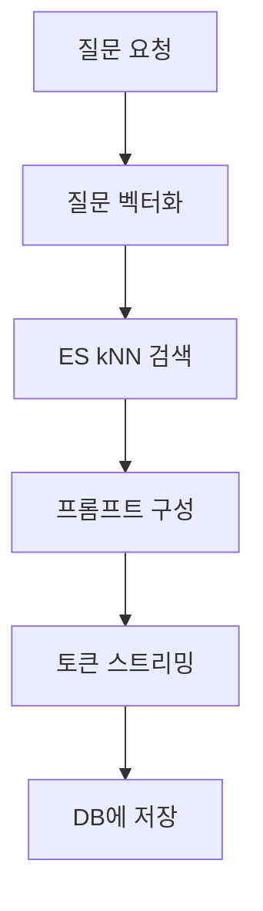

## 문제와 배경

PDF 문서를 업로드받아 청크 단위로 쪼개고 임베딩한 뒤, 그 벡터로 유사 청크를 찾아 RAG(Retrieval-Augmented Generation) 챗봇에 넘기는 파이프라인이 있었습니다. 초기 구성은 벡터 검색을 인메모리 벡터 라이브러리와 Elasticsearch 두 곳에 나눠 두는 형태였습니다.

문제는 두 가지였습니다.

- 인메모리 벡터 라이브러리에서 메모리 누수가 있었습니다.
- 벡터 저장소가 Elasticsearch와 별도로 하나 더 있다 보니 색인 로직도 장애 대응 절차도 저장소 수만큼 따로 챙겨야 했습니다.

벡터 검색 자체는 한 가지 일인데, 메모리 누수가 있는 엔진을 끼고 있다는 이유만으로 운영 부담이 늘어나고 있었습니다. 메타데이터(원문, 요약, 채팅 이력)는 처음부터 PostgreSQL을 단일 소스로 쓰고 있었으므로, 인메모리 엔진을 걷어내고 벡터 쪽도 Elasticsearch 하나로 모으는 쪽을 택했습니다.

## 접근

결정은 단순합니다. 인메모리 벡터 엔진을 걷어내고, 벡터 검색을 Elasticsearch 하나로 모읍니다.

- **벡터는 Elasticsearch에만 둡니다.** `dense_vector` 필드에 임베딩을 저장하고 kNN(k-최근접 이웃) 쿼리로 검색합니다.
- **메타데이터는 그대로 PostgreSQL에 둡니다.** 원문·요약·번역·채팅 이력의 SSOT(Single Source of Truth)는 바꾸지 않고, Elasticsearch는 검색 전용 인덱스로만 씁니다. 둘을 하나의 저장소로 합치지는 않습니다 — 트랜잭션과 전문 검색은 역할이 다릅니다.
- **임베딩은 사내 GPU 임베딩 API를 호출해 1024차원 고정 벡터로 받습니다.** 모델이 바뀌어도 서비스 쪽 벡터 차원 설정은 건드리지 않도록 차원을 고정값으로 둡니다.
- **저장 공간을 줄이기 위해 벡터를 Int8로 압축해 저장합니다.** Elasticsearch의 `dense_vector`는 `element_type: byte`로 지정하면 8비트 정수로 양자화해 저장합니다. float32 대비 저장 공간이 크게 줄어듭니다.

## 구현

### 인덱스 매핑

청크 단위로 한 문서씩 저장하는 인덱스를 만듭니다. 이름은 역할을 그대로 드러내는 `pdf_chunks`로 둡니다.

```json
PUT /pdf_chunks
{
  "mappings": {
    "properties": {
      "document_id": { "type": "keyword" },
      "chunk_text": { "type": "text" },
      "chunk_vector": {
        "type": "dense_vector",
        "dims": 1024,
        "element_type": "byte",
        "index": true,
        "similarity": "cosine"
      },
      "created_at": { "type": "date" }
    }
  }
}
```

`element_type: byte`가 Int8 압축을 켜는 지점입니다. 임베딩 API가 돌려주는 값은 float이므로, 색인 전에 양자화 범위(-128~127)에 맞춰 스케일링해 줘야 합니다.

### 색인

```python
from elasticsearch import Elasticsearch, helpers

es = Elasticsearch(ES_HOSTS)

def index_chunks(document_id: str, chunks: list[str], embed_fn):
    actions = []
    for chunk_text in chunks:
        vector = embed_fn(chunk_text)  # 사내 GPU 임베딩 API 호출, 1024차원 float 리스트
        actions.append({
            "_index": "pdf_chunks",
            "_source": {
                "document_id": document_id,
                "chunk_text": chunk_text,
                "chunk_vector": quantize_int8(vector),
                "created_at": now_iso(),
            },
        })
    helpers.bulk(es, actions)
```

`helpers.bulk`로 묶어 보내는 이유는 단순합니다. 청크 하나당 임베딩 호출 한 번, 색인 요청 한 번씩 따로 보내면 문서 한 건에 수십~수백 번의 왕복이 생깁니다.

### 검색과 RAG 챗봇 플로우

챗봇 요청 하나는 다음 흐름을 탑니다.



kNN 검색 쿼리는 다음과 같은 모양입니다.

```python
def search_similar_chunks(query_vector: list[int], document_id: str, k: int = 5):
    return es.search(
        index="pdf_chunks",
        knn={
            "field": "chunk_vector",
            "query_vector": query_vector,
            "k": k,
            "num_candidates": k * 10,
            "filter": {"term": {"document_id": document_id}},
        },
    )
```

`filter`로 같은 문서 안에서만 검색 범위를 좁히는 점이 포인트입니다. 전체 인덱스를 대상으로 kNN을 돌리면 다른 문서의 청크가 섞여 들어오고, 응답 품질도 떨어집니다.

## 함정과 트레이드오프

| 항목 | 내용 |
|---|---|
| 압축 손실 | Int8 양자화는 손실 압축이라 float32 대비 유사도 계산 정밀도가 떨어집니다. 재현율이 민감한 검색이라면 양자화 전후로 검색 품질을 직접 비교해 봐야 합니다. |
| 임베딩 버전 변경 | 임베딩 API의 모델 버전이 바뀌면 새 벡터와 기존 벡터가 같은 공간에 있지 않게 됩니다. 버전이 바뀌는 시점에는 전체 재색인이 필요하고, 이 비용을 미리 계획에 넣어야 합니다. |
| 샤드 설계 | 운영 환경의 샤드 개수는 기본값을 그대로 쓰지 않고, 예상 데이터량을 분석한 뒤 정했습니다. 샤드를 늘린 뒤 줄이는 작업은 재색인 없이는 안 되므로, 처음부터 여유를 두고 설계하는 편이 유리합니다. |
| 단일 장애점 | 벡터 검색 경로를 하나로 모은 대신, Elasticsearch 자체가 장애 지점이 됩니다. 두 엔진을 운영하던 시절의 복잡도는 사라졌지만, 이제는 이 한 곳의 가용성이 RAG 챗봇 전체의 가용성과 같아집니다. |

## 정리

- 벡터 검색 엔진을 인메모리 엔진과 Elasticsearch로 나눠 운영하면 배포·모니터링·장애 대응이 모두 두 벌로 늘어납니다. 역할이 같은 저장소는 가능하면 하나로 모으는 편이 운영 부담을 줄입니다.
- 메타데이터의 SSOT와 벡터 검색 엔진은 분리해 두되, 벡터 자체는 한 곳에만 둡니다. PostgreSQL은 그대로 메타데이터의 원천으로, Elasticsearch는 검색 전용으로 역할을 나눴습니다.
- Int8 압축과 kNN으로 저장 공간과 응답 속도를 함께 얻을 수 있지만, 압축 손실과 임베딩 버전 변경에 따른 재색인 비용은 그대로 남는 트레이드오프입니다. 샤드 설계도 기본값이 아니라 예상 데이터량을 분석해 정해야 합니다.
