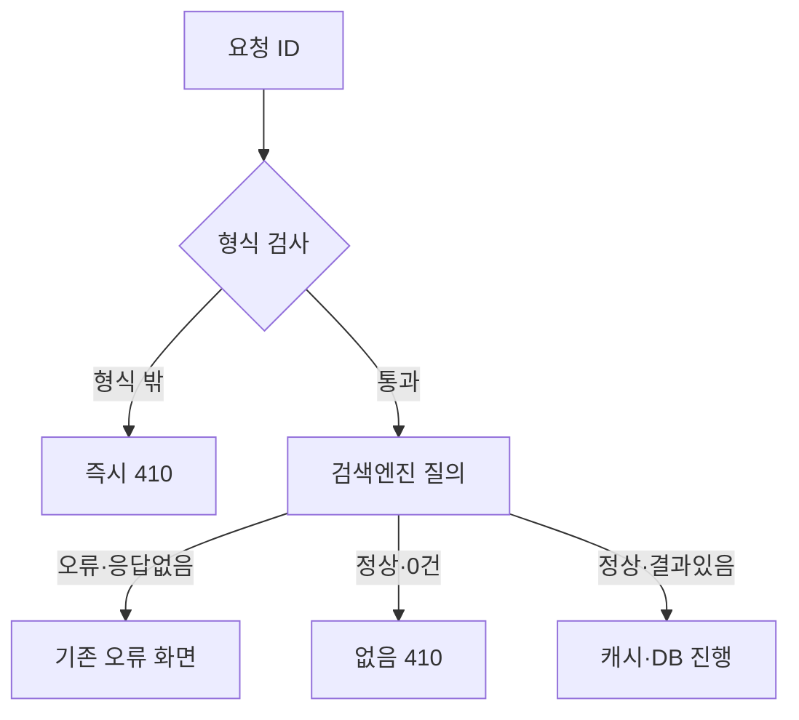

## 문제와 배경

읽기 전용 상세 페이지를 크롤러가 반복해서 훑는 서비스에서, 존재하지 않거나 형식이 애초에 잘못된 ID로 들어오는 요청이 계속 쌓였습니다. 응답은 매번 `200 OK`에 본문이 비어 있는 화면이었습니다. 크롤러 입장에서 `200`은 "이 URL은 유효하다"는 신호이므로, 같은 주소를 다시 찾아오는 것을 막을 이유가 없습니다. 이런 응답을 soft 404라고 부르며, 검색엔진 쪽 공개 문서(Google Search Central의 "Soft 404 errors" 안내)도 이를 크롤링 효율을 떨어뜨리는 요인으로 명시합니다.

문제는 상태 코드만이 아니었습니다. 상세 페이지 조회 진입부에 ID 형식 검사가 없다 보니, 봇이 만든 URL 조각 — 예를 들어 실제 ID 뒤에 다른 경로 조각이 붙은 값 — 도 검색엔진 질의어, 캐시 키, DB 조회 인자로 그대로 내려갔습니다. 형식이 맞지 않는 요청 하나가 들어와도 검색엔진 조회 → 폴백 캐시 조회 → 검색엔진 재조회 → DB 조회까지 전 구간을 다 거친 뒤에야 빈 결과를 돌려준 것입니다. 이 흐름은 코드를 읽어 확인했고, 그중 "저장 프로시저 인자가 특정 길이에서 잘려 변형된 값이 유효한 ID로 오인되는지"는 실측하지 않은 추론입니다.

## 접근

다음 흐름도는 ID 하나가 들어왔을 때 형식 검사와 검색엔진 응답에 따라 410(사라짐)과 조회 실패를 가르는 지점을 보여줍니다.



접근은 세 가지로 나눴습니다.

1. **형식이 잘못된 ID는 조회 자체를 하지 않습니다.** 영문·숫자·일부 기호로 구성된 정해진 길이 안의 값만 ID로 인정하고, 이 형식을 벗어나면 검색엔진·캐시·DB 어디에도 묻지 않고 바로 `410 Gone`을 돌려줍니다.
2. **형식은 맞지만 존재하지 않는 ID는 검색엔진이 "정상 응답했는데 결과가 0건"일 때만 없음으로 판단합니다.** 응답 자체가 오지 않았거나 오류를 담고 있으면 "없음"이 아니라 "지금은 확인할 수 없음"입니다.
3. **이 둘을 같은 분기로 묶지 않습니다.** 검색엔진 장애를 "없음(410)"으로 응답하면, 그 자체가 검색엔진에 실제로 존재하는 문서를 "사라진 것"으로 알리는 셈이 되어 장애가 색인 삭제로 번질 위험이 있습니다. RFC 9110(HTTP Semantics) 15.5.10절은 410을 "리소스가 더는 없고 이 상태가 의도적이며 영구적"이라는 뜻으로 정의합니다 — 일시적인 조회 실패에 쓸 코드가 아닙니다.

## 구현

### 핵심 코드

진입부 형식 검사는 조회 메서드 가장 앞, 외부 호출이 시작되기 전에 둡니다.

```java
private static final Pattern DOCUMENT_ID_FORMAT = Pattern.compile("^[A-Za-z0-9_-]{1,20}$");

@GetMapping("/document/{documentId}")
public ModelAndView detail(@PathVariable String documentId) {
    if (!DOCUMENT_ID_FORMAT.matcher(documentId).matches()) {
        // 검색엔진·캐시·DB 어디에도 묻지 않고 바로 종료합니다.
        throw new DocumentGoneException(documentId);
    }

    DocumentSearchResult result = documentService.findDocument(documentId);
    if (result.isEmptyConfirmed()) {
        throw new DocumentGoneException(documentId); // 410
    }
    // 조회 실패(failed)는 410으로 보내지 않고 기존 오류 화면을 그대로 둡니다
    ...
}
```

"결과 없음"과 "조회 실패"는 검색엔진 응답을 해석하는 단계에서 갈라야, 컨트롤러는 그 결과만 보고 상태 코드를 정할 수 있습니다.

```java
public DocumentSearchResult findDocument(String documentId) {
    JsonNode response = searchClient.query(documentId);
    if (response == null || response.has("error")) {
        // 조회 자체가 실패했습니다 — "없음"이 아니라 "확인하지 못함"입니다.
        return DocumentSearchResult.failed();
    }
    JsonNode hits = response.path("hits");
    if (hits.isObject() && hits.path("total").path("value").asInt() == 0) {
        // 정상 응답인데 0건입니다 — 이것만 "진짜 없음"입니다.
        return DocumentSearchResult.emptyConfirmed();
    }
    return DocumentSearchResult.from(response);
}
```

`failed()`인 경우는 410으로 보내지 않고, 원래 있던 "잠시 후 다시 시도해 주세요" 오류 화면을 그대로 유지했습니다. 410이 아닌 것이 핵심이고, 상태 코드까지 `503`으로 바꾸는 일은 이번 변경 범위에 넣지 않았습니다. MDN의 HTTP 상태 코드 문서는 410과 503을 각각 "리소스가 영구히 사라짐"과 "서버가 일시적으로 요청을 처리할 수 없음"으로 구분하므로, 장애 응답을 더 다듬는다면 503이 맞는 방향입니다.

### 증상과 원인

| 증상 | 원인 |
|---|---|
| 같은 형식 밖 URL을 크롤러가 계속 다시 요청 | 빈 화면이 200으로 나가 "유효한 URL"로 보임(soft 404) |
| 형식이 맞지 않는 요청도 검색엔진·캐시·DB를 전부 거침 | 조회 진입부에 ID 형식 검사가 없음 |
| 검색엔진 장애가 "문서 삭제"로 잘못 전달될 위험 | 조회 실패와 결과 없음을 같은 분기(410)로 처리 |

### 요청별 응답 비교

| 요청 | 변경 전 | 변경 후 |
|---|---|---|
| 형식에 맞지 않는 ID | `200`, 빈 화면 | `410`, 검색엔진·캐시·DB 호출 없음 |
| 형식은 맞지만 존재하지 않는 ID | `200`, 빈 화면 | `410`(검색엔진이 정상 응답한 0건일 때만) |
| 검색엔진 응답 없음·오류 | 오류 안내 화면 | 오류 안내 화면 유지(410으로 보내지 않음) |

## 함정과 트레이드오프

- **형식 검사 정규식이 정상 ID를 걸러낼 위험이 있습니다.** 운영 중인 ID 전수를 다시 조사하지 않고, "정상 ID는 애초에 이 형식을 벗어날 수 없다"는 입력 규격상의 판단으로 범위를 정했습니다. 이 판단이 틀리면 정상 문서가 410으로 막히므로, 적용 전 일반 ID·경계값(빈 문자열, 구분자 포함, 길이 초과)으로 반드시 회귀 테스트가 필요합니다.
- **"없음"과 "실패"를 가르는 조건을 검색엔진 응답 스키마에 의존하게 됩니다.** 여기서는 공식 오류 필드 유무와 히트 객체의 존재로 판단했는데, 이는 사용 중인 검색엔진의 응답 계약에 대한 관찰이지 모든 검색엔진 공통의 표준은 아닙니다. 검색엔진을 바꾸거나 버전이 오르면 이 판단 로직도 다시 봐야 합니다.
- **이미 쌓인 오염된 캐시 키는 이 변경으로 바로 없어지지 않습니다.** 형식 검사는 새로운 오염을 막을 뿐이고, 기존 키는 각자의 캐시 수명이 끝나야 사라집니다. 즉시 정리하려면 별도의 키 삭제 작업이 필요하며, 대량 삭제 자체도 위험이 있어 이번 범위에는 넣지 않았습니다.
- **410은 검색엔진에 "지워도 된다"는 신호로 읽힙니다.** 그래서 이 상태 코드는 장애 상황에는 쓰지 않는다는 원칙을 지켜야 합니다. 일시적인 조회 실패를 410으로 내보내면, 장애가 끝난 뒤에도 검색엔진 색인에서는 이미 지워진 뒤일 수 있습니다.

상태 코드와 크롤러의 관계는 URL 정규화를 다룬 글([리디렉션과 크롤러](/blog/2026/09/17/url-normalization-301-side-effects.html))에서도 짚었습니다. 이번 글은 "있는 URL을 다른 주소로 보내는 문제"가 아니라 "없는 URL에 있다고 말하는 문제"를 다뤘습니다.

## 정리

형식이 잘못됐거나 존재하지 않는 상세 페이지에 200과 빈 화면을 돌려주면, 크롤러는 그 URL을 계속 다시 찾아옵니다. ID 형식 검사를 조회 체인의 가장 앞에 두어 형식 밖 요청을 외부 호출 전에 끊고, 검색엔진이 정상 응답한 0건만 "없음(410)"으로, 조회 자체의 실패는 410이 아닌 다른 상태 코드로 분리하면, 장애를 삭제 신호로 잘못 내보내는 일 없이 크롤러에게 "이 주소는 더 찾아올 필요가 없다"는 정확한 신호를 줄 수 있습니다. 다음 글에서는 로그인하지 않은 요청이 왜 로그인 전용 조회까지 함께 실행하고 있었는지를 다룹니다.
