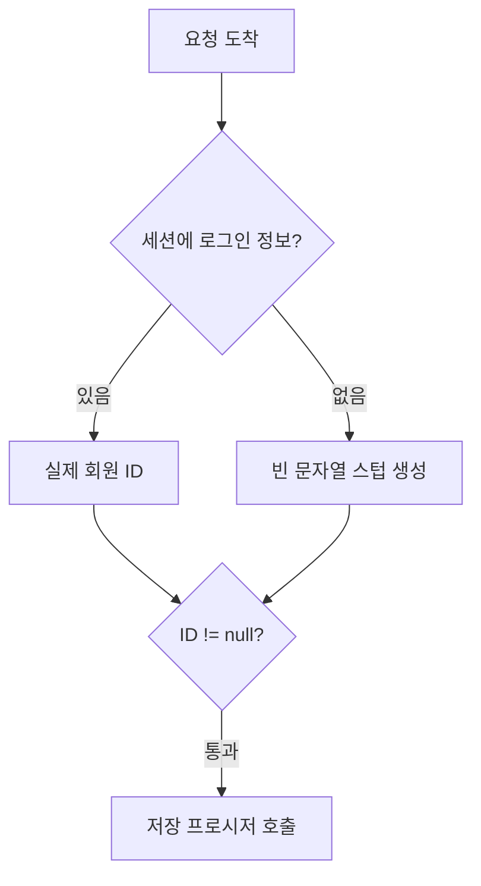

## 문제와 배경

이전 글([(1) 없는 문서에 200 대신 410을 돌려주기](/blog/2026/02/03/soft-404-gone-410-crawler.html))에서는 없는 문서를 가려내는 쪽을 다뤘습니다. 이번 글은 존재하는 문서인데도 로그인하지 않은 요청에서 불필요한 DB 호출이 섞여 들어가던 사례입니다.

문서 상세 화면의 코드를 읽다 보면 이런 조건문을 만날 수 있습니다.

```java
if (userAuth != null && userAuth.getMemberId() != null) {   // 로그인 시에만 동작한다
    bookmark = getBookmark(userAuth.getMemberId(), documentId);
}
```

주석만 보면 미로그인 요청에서는 이 블록이 실행되지 않아야 합니다. 그런데 실제로는 로그인 여부와 무관하게 매 요청마다 실행되고 있었습니다. 원인은 조건문이 아니라 그 위, 세션에 로그인 정보가 없을 때 변수를 채우는 코드에 있었습니다.

```java
if (session.getAttribute("LOGIN_USER") == null) {
    userAuth = new LoginUser();
    userAuth.setMemberId("");   // null이 아니라 빈 문자열
}
```

미로그인 사용자를 `null`로 두지 않고, 필드가 빈 문자열로 채워진 스텁 객체로 대체하고 있었습니다. 그 결과 `userAuth != null`도, `getMemberId() != null`도 둘 다 통과합니다. "로그인 시에만"이라는 주석과 달리 이 게이트는 **스텁이 있는 한 언제나 참**입니다.

## 접근

아래 다이어그램은 요청 하나가 들어와 이 게이트를 통과하기까지의 흐름입니다.



문제는 **null 검사와 "로그인 여부"가 다른 질문**이라는 점입니다. 이 코드베이스는 미로그인 상태를 "객체가 없음"이 아니라 "필드가 빈 값인 객체"로 표현하기로 정했습니다. 그런 설계 자체는 드물지 않습니다 — 호출부마다 null 체크를 반복하지 않도록 기본값을 가진 객체를 돌려주는 null 객체 패턴(null object pattern)은 흔히 쓰입니다. 문제는 그 설계를 하류 코드 전부가 알고 있어야 한다는 점이고, 이 경우 알고 쓴 곳과 모르고 쓴 곳이 한 코드베이스에 섞여 있었습니다. 실제로 같은 화면의 다른 분기는 `getMemberId()`를 공백 포함 여부로 걸러 올바르게 처리하고 있었고, 이 분기만 단순 null 검사로 남아 있었습니다.

같은 모양의 결함이 작성자 페이지에도 있었습니다. 세션에 로그인 정보가 없을 때 `info`를 스텁으로 재할당한 뒤, 아래에서 `if (info != null)`로 분기하는 코드였는데, 재할당 직후이므로 이 분기는 사실상 **항상 참인 죽은 분기**였습니다. 로그인 여부를 가리는 목적의 조건문이 실제로는 아무것도 가리지 못하고 있었던 것입니다.

## 구현

### 핵심 코드

아래는 이 글을 위해 새로 쓴 최소 예시이고, 그대로 실행해 보지는 않았습니다. 수정 전후를 나란히 둡니다.

```java
public class LoginUser {
    private String memberId = "";   // 미로그인 기본값
    // getter/setter 생략
    public String getMemberId() { return memberId; }
}
```

```java
// 수정 전 — null 검사만으로는 스텁을 걸러내지 못한다
if (userAuth != null && userAuth.getMemberId() != null) {
    bookmark = bookmarkService.find(userAuth.getMemberId(), documentId);
}

// 수정 후 — 빈 문자열(공백 포함)까지 걸러낸다
if (userAuth != null && !isBlank(userAuth.getMemberId())) {
    bookmark = bookmarkService.find(userAuth.getMemberId(), documentId);
}

private static boolean isBlank(String value) {
    return value == null || value.trim().isEmpty();
}
```

변경은 조건문 한 줄입니다. 직접 `isBlank`를 작성하는 대신, 이미 프로젝트에 들어와 있는 유틸리티가 있으면 그쪽을 쓰는 편이 일관성이 높습니다. Spring을 쓰는 프로젝트라면 `org.springframework.util.StringUtils.hasText(String)`가 null과 빈 문자열, 공백만 있는 문자열을 모두 걸러 주는 표준 선택지입니다([Spring Framework API 문서](https://docs.spring.io/spring-framework/docs/current/javadoc-api/org/springframework/util/StringUtils.html)).

### 검증 방법

동작을 확인하는 방법은 두 갈래입니다.

- 수정 전후로 미로그인 요청을 같은 조건으로 보내고, SQL Server라면 동적 관리 뷰 `sys.dm_exec_procedure_stats`가 제공하는 `execution_count` 값의 변화를 봅니다(Microsoft Learn 문서에 설명돼 있습니다). 미로그인에서는 호출 횟수가 늘지 않아야 합니다.
- 죽은 분기처럼 조건이 항상 같은 값으로 평가되는 경우는, 스텁을 만드는 코드와 그 변수를 쓰는 조건문을 같이 봐야 드러납니다. 조건문만 읽으면 정상으로 보입니다.

코드 검토 과정에서 관찰한 바로는, 문서 상세 화면 하나가 캐시 히트 상태에서도 거쳐 가는 동기 DB 호출 중 이 호출이 한 자리를 차지하고 있었습니다. 이 비율은 그 화면의 코드를 직접 센 것이고, 별도로 측정하거나 공식 문서로 뒷받침한 수치는 아닙니다. 크롤러 요청은 거의 전부 미로그인 상태로 들어오므로, 이 결함은 크롤러 트래픽에 비례해 불필요한 DB 호출을 더합니다.

## 함정과 트레이드오프

| 증상 | 겉보기 원인 | 실제 원인 |
|---|---|---|
| "로그인 시에만" 주석이 달린 SP가 항상 실행됨 | SP 자체의 버그 | 호출을 막는 조건문이 통과되지 않아야 할 값을 통과시킴 |
| 조건문은 멀쩡해 보임 | 조건식 자체의 로직 오류 | 조건문이 검사하는 변수를 그 위에서 미리 채워 둠 |
| 같은 화면의 다른 분기는 정상 동작 | 우연히 문제없는 입력만 들어옴 | 같은 코드베이스 안에 올바른 패턴과 틀린 패턴이 공존 |

| 검사 방식 | 미로그인 스텁(필드가 빈 문자열) | null을 유지하는 경우 |
|---|---|---|
| `!= null` | 통과(거짓 양성) | 정상 차단 |
| 공백 포함 여부 검사(`isBlank`/`hasText`) | 정상 차단 | 정상 차단 |
| `Optional.ofNullable(...).filter(...)` | 정상 차단(필터 조건에 공백 검사 포함 시) | 정상 차단 |

null 객체 패턴을 쓰기로 했다면, 그 결정은 패턴을 쓰는 이유(뷰 코드에서 null 분기를 줄이기 위해서 등)와 함께 호출부 전체에 전달돼야 합니다. 그렇지 않으면 다음과 같은 모순이 생깁니다.

- **패턴을 아는 코드**: "로그인 여부"를 공백 포함 여부로 올바르게 검사합니다.
- **패턴을 모르는 코드**: null 검사만으로 충분하다고 가정하고, 스텁을 로그인 상태로 오판합니다.

근본적으로는 미로그인을 스텁이 아니라 `null`이나 `Optional`로 표현하는 쪽이 이런 혼동을 원천적으로 없앱니다. 다만 그 스텁 객체가 뷰 쪽까지 내려가 템플릿에서 필드를 직접 참조하는 곳이 있다면, 표현 방식을 바꾸는 변경은 영향 범위가 커집니다. 그래서 당장은 게이트 쪽을 고치고, 표현 방식 자체를 바꾸는 일은 별도 과제로 미루는 선택도 현실적입니다.

### 같은 함정을 다른 곳에서도 찾는 법

이 결함은 한 곳에 머물지 않았습니다. 같은 모양의 조건문이 호출되지 않는 다른 메서드에도 그대로 복제돼 있었습니다(그 메서드는 당시 호출하는 곳이 없어 실행되지는 않았습니다). 코드베이스 전체에서 같은 패턴을 찾을 때는 두 검색을 짝지어 봅니다.

```bash
# 1) 스텁을 만드는 지점
grep -rn 'new LoginUser()' src/main/java

# 2) 그 결과를 null 검사만으로 쓰는 후보
grep -rn 'userAuth != null\b\|getMemberId() != null' src/main/java
```

두 결과를 겹쳐 보고, 1번에서 만들어진 변수가 2번의 조건문에 그대로 들어가는지 확인합니다. 스텁을 만드는 코드가 있다면 그 변수에 대한 `!= null`은 로그인 여부를 가리는 검사가 아닙니다.

## 정리

- null 검사와 "값이 의미 있는가"는 다른 질문입니다. null 객체 패턴으로 미로그인 상태를 표현하는 코드베이스에서는 `!= null`이 로그인 판정이 되지 못합니다.
- 조건문만 읽고 정상이라고 판단하지 않습니다. 그 조건문이 검사하는 변수를 어디서, 어떤 값으로 채우는지까지 같이 봐야 실제 동작을 알 수 있습니다.
- 교정은 조건을 공백 포함 여부 검사로 바꾸는 한 줄이면 되지만, 같은 패턴이 복제된 다른 자리가 있는지는 스텁 생성 지점과 null 검사 지점을 함께 검색해야 드러납니다.
- 더 근본적인 교정은 미로그인을 스텁 대신 `null`/`Optional`로 표현하는 것이지만, 스텁이 뷰까지 내려가 있다면 변경 범위를 먼저 가늠해야 합니다.
