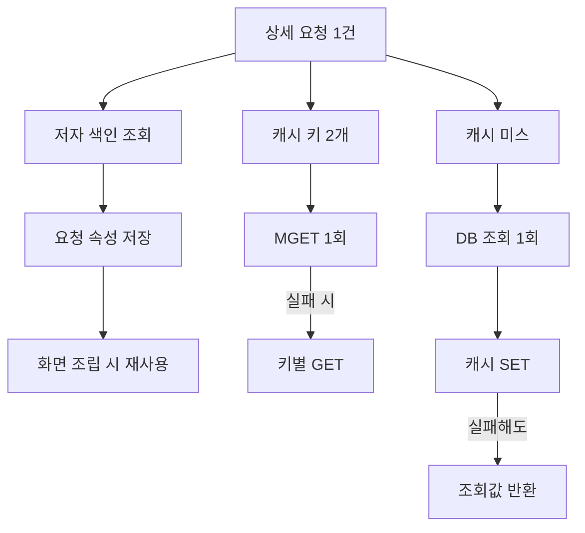

## 문제와 배경

이 시리즈에서 다루는 조회 서비스는 요청마다 Elasticsearch 색인과 Redis 캐시, 관계형 DB 저장 프로시저를 차례로 거쳐 문서 상세 화면을 만듭니다. 크롤러가 같은 상세 경로를 반복해서 두드리는 상황에서 요청당 왕복 수를 줄이는 작업을 하다가, 정작 한 요청 **안에서도** 같은 값을 두 번 읽는 지점이 세 군데 나왔습니다.

- 화면에 쓸 저자 목록을 만들 때, 같은 문서의 저자 색인을 두 번 조회하고 있었습니다. 한 번은 가벼운 경로가 기본 메타 정보를 채우면서, 다른 한 번은 화면이 저자 목록을 다시 요청하면서였습니다.
- 캐시에서 성격이 다른 플래그 두 개(문서 유형 표시값, 추천 여부)를 각각 `GET`으로 따로 읽고 있었습니다.
- 캐시 조회 결과가 없어 DB를 불러 값을 채운 뒤 캐시에 쓰는 과정에서, 그 쓰기(`SET`)가 실패하면 같은 예외 처리 분기로 떨어져 DB 조회를 한 번 더 호출했습니다.

셋 다 개별로는 작은 중복이지만, 상세 요청이 많고 그중 다수가 캐시 미스 없이 반복되는 크롤러 트래픽에서는 요청당 고정 비용으로 그대로 쌓입니다. 이 글은 코드로 확인한 세 중복과, 각각을 접은 방법을 정리합니다.

## 접근

아래는 이번에 손댄 세 지점을 한 요청의 흐름 위에 올린 그림입니다. 왼쪽은 요청 범위 재사용, 가운데는 캐시 키 묶기, 오른쪽은 캐시 쓰기 실패를 읽기 실패와 분리하는 지점입니다.



세 지점은 원인이 서로 다릅니다.

| 증상 | 원인 |
|---|---|
| 같은 문서의 저자 색인을 상세 요청 하나에서 두 번 조회 | 기본 메타 정보를 채우는 경로와 화면용 저자 목록을 만드는 경로가 같은 입력을 각자 다시 조회함 |
| 캐시 키 두 개를 `GET` 두 번으로 조회 | 키마다 별도 메서드로 캐시 접근 로직을 짜 두어 왕복을 묶을 자리가 없었음 |
| 캐시 `SET` 실패 시 DB를 한 번 더 호출 | 공통 캐시 유틸의 읽기 예외와 쓰기 예외가 같은 `catch` 블록에 묶여 있어, 쓰기 실패도 "캐시에 없다"로 취급돼 공급자(DB 조회)를 다시 부름 |

## 구현

### 저자 색인: 요청 범위에서 재사용

Elasticsearch에서 읽은 저자 정보 원본을 요청 속성에 담아 두고, 같은 요청 안에서 다시 필요할 때는 그 속성을 먼저 확인합니다. 서블릿 스펙의 `ServletRequest#setAttribute`/`getAttribute`는 요청 하나의 생애주기 동안만 값을 들고 있으므로, 요청이 끝나면 자동으로 비워지고 다른 요청과 섞이지 않습니다.

```java
public class ArticleAuthorReader {

    private static final String ATTR_PREFIX = "docDetail.authorRaw.";

    // 가벼운 경로가 먼저 읽으면서 원본을 요청 속성에 남긴다
    public List<AuthorRaw> readForSummary(HttpServletRequest req, String articleId) {
        List<AuthorRaw> raw = fetchAuthorIndex(articleId);
        if (req != null) {
            req.setAttribute(ATTR_PREFIX + articleId, raw);
        }
        return raw;
    }

    // 화면 조립 경로는 같은 요청이면 재조회 없이 그대로 쓴다
    public List<AuthorView> readForScreen(HttpServletRequest req, String articleId) {
        Object cached = req == null ? null : req.getAttribute(ATTR_PREFIX + articleId);
        List<AuthorRaw> raw = (cached instanceof List)
                ? (List<AuthorRaw>) cached
                : fetchAuthorIndex(articleId);
        return raw.stream().map(this::toEscapedView).collect(Collectors.toList());
    }
}
```

두 경로가 쓰는 표현이 다릅니다. 요약용은 이스케이프 없는 원본이 필요하고 화면용은 HTML 이스케이프가 필요하므로, 원본을 그대로 공유하지 않고 복사해서 이스케이프만 다시 적용합니다. 요청 속성에 아무것도 없으면 (폴백 경로 등) 평소대로 다시 조회하므로 동작 자체는 바뀌지 않습니다.

### 캐시 키 두 개: `MGET` 한 번과 키별 폴백

두 값은 TTL이 서로 달라 하나의 해시로 묶지는 않고, 키는 그대로 둔 채 조회만 `MGET`으로 묶었습니다. Redis의 `MGET`은 여러 키를 한 번의 왕복으로 조회하고, 값이 없는 키에는 `nil`을 돌려줍니다(Redis 명령어 문서). Spring Data Redis의 `ValueOperations#multiGet(Collection<K>)`도 이 의미를 그대로 따릅니다.

```java
public Optional<List<String>> multiGet(RedisTemplate<String, String> tpl, String... keys) {
    try {
        List<String> values = tpl.opsForValue().multiGet(Arrays.asList(keys));
        // 응답 크기가 요청 키 수와 다르면 신뢰하지 않고 폴백으로 넘긴다
        return (values != null && values.size() == keys.length)
                ? Optional.of(values) : Optional.empty();
    } catch (Exception e) {
        log.warn("multiGet 실패: keys={}", Arrays.toString(keys), e);
        return Optional.empty();
    }
}

public ArticleFlags readFlags(RedisTemplate<String, String> tpl, String articleId) {
    Optional<List<String>> batch = multiGet(tpl, typeKey(articleId), curatedKey(articleId));
    if (batch.isPresent()) {
        List<String> v = batch.get();
        return new ArticleFlags(v.get(0), v.get(1));
    }
    // MGET이 실패하거나 응답이 깨졌을 때만 기존 방식(키별 GET)으로 돌아간다
    return new ArticleFlags(getOne(tpl, typeKey(articleId)), getOne(tpl, curatedKey(articleId)));
}
```

`MGET`은 원자적 동작이 아니라 한 번의 왕복으로 묶인 복수 `GET`이므로, 일부 키만 있고 일부는 없는 상태를 그대로 돌려줍니다. 그래서 값이 없는 키는 캐시 미스로, 응답 자체가 실패하거나 개수가 어긋나면 폴백으로 분기했습니다.

### 캐시 SET 실패와 DB 재호출 분리

기존 캐시 접근 메서드는 읽기 실패와 쓰기 실패를 같은 `catch`로 받아, 쓰기가 실패해도 "캐시에서 못 찾았다"는 분기로 흘러 공급자(DB 조회)를 다시 불렀습니다. 읽기와 쓰기 예외를 나누고, 공급자는 캐시 미스일 때 한 번만 부르도록 바꿨습니다.

```java
public <T> T getOrSetOnce(RedisTemplate<String, T> tpl, Supplier<T> loader, Duration ttl, String key) {
    try {
        T cached = tpl.opsForValue().get(key);
        if (cached != null) {
            return cached;
        }
    } catch (Exception e) {
        log.error("캐시 GET 실패, 기본 경로로 진행: key={}", key, e);
    }

    T value = loader.get(); // 캐시 미스일 때만, 그리고 한 번만 부른다

    if (value != null) {
        try {
            tpl.opsForValue().set(key, value, ttl);
        } catch (Exception e) {
            // SET이 실패해도 loader를 다시 부르지 않고 이미 얻은 값을 그대로 돌려준다
            log.error("캐시 SET 실패, 조회값은 그대로 반환: key={}", key, e);
        }
    }
    return value;
}
```

읽기 실패와 쓰기 실패 모두 캐시를 쓰지 못한 채로 요청을 계속 진행시키는 fail-open 방향은 그대로 유지했습니다. 바뀐 것은 "쓰기 실패가 공급자를 다시 부르는 사유가 되지 않는다"는 점뿐입니다.

### 요청당 동작 비교

| 구간 | 전 | 후 |
|---|---|---|
| 저자 색인 조회 | 요청 하나당 2회 | 요청 하나당 1회(요청 속성 재사용) |
| 캐시 키 2개 조회 | `GET` 2회(왕복 2회) | `MGET` 1회(실패 시만 `GET` 2회로 폴백) |
| 캐시 SET 실패 시 DB 호출 | 공급자 재호출로 DB 1회 추가 | 이미 얻은 값을 그대로 반환, 추가 호출 없음 |

## 함정과 트레이드오프

- **요청 속성 재사용은 같은 요청에서만 유효합니다.** 비동기로 다른 스레드가 같은 자료를 다시 읽는 경로나, 요청이 쪼개져 내부 호출로 전달되지 않는 경로에서는 재사용 조건(속성 존재 여부)이 성립하지 않아 조용히 폴백으로 빠집니다. 폴백이 있는 구조라 동작은 그대로지만, 재사용이 실제로 일어나는지는 별도로 확인해야 합니다.
- **MGET 실패 시 폴백이 다시 2회 왕복이라는 점은 그대로입니다.** 평소에는 왕복이 줄지만, Redis 커넥션이 불안정한 구간에서는 이득이 사라지고 예외 처리 비용만 더해집니다. 폴백 경로 자체도 주기적으로 점검 대상입니다.
- **쓰기 실패와 읽기 실패를 나누는 변경은 공용 유틸이라 영향 범위가 넓습니다.** 같은 메서드를 쓰는 다른 호출부도 전부 "SET 실패 시 재호출 없음"으로 동작이 바뀌므로, 공급자 호출에 부작용(카운터 증가, 로그 적재 등)이 있는 호출부가 있는지 먼저 확인해야 합니다. 이번에는 해당 호출부들이 멱등한 조회였기에 바로 적용했습니다.
- **TTL이 다른 값은 해시로 묶지 않았습니다.** 값 두 개를 하나의 해시 키로 합치면 왕복은 한 번 더 줄지만 TTL을 값 단위로 가져갈 수 없습니다. 이번에는 TTL 차이를 유지하는 쪽을 택해 키 구조는 그대로 두고 조회만 묶었습니다.

## 정리

한 요청 안에서의 중복은 요청 사이의 중복보다 눈에 덜 띄지만, 요청 수가 많을수록 그대로 곱해집니다. 이번에 접은 세 지점은 원인이 각각 재사용 부재, 왕복을 묶지 않은 구조, 읽기·쓰기 예외의 혼동이었고, 고치는 방법도 서로 달랐습니다. 요청 범위 재사용은 서블릿의 요청 속성으로, 캐시 키 조회는 `MGET`과 그 실패에 대한 키별 폴백으로, 캐시 쓰기 실패는 공급자 재호출과 분리하는 것으로 풀었습니다. 공통점은 셋 다 "캐시가 비어 있을 때 무엇을 다시 부를 것인가"를 명시적으로 정했다는 점입니다.

캐시 실패를 조용히 넘기는 fail-open이 언제 문제로 바뀌는지는 [종료 코드가 실패를 삼키는 경우](/blog/2026/10/07/silent-failure-exit-code-fail-open.html)에서 따로 다루고, 이 시리즈 (6)편에서는 판정할 수 없는 상태를 "허용"으로 바꿔 캐시한 사례를 다룹니다.
