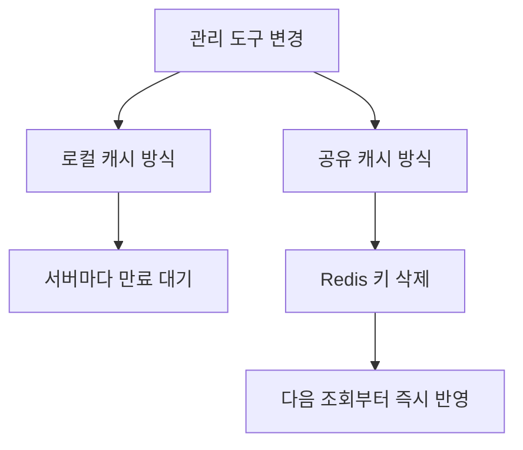

## 문제와 배경

서버 여러 대가 로드밸런서 뒤에서 같은 서비스를 처리하는 구성에서, 기관(테넌트)별 설정값 하나를 각 서버 프로세스 메모리에 캐시해 두고 있었습니다. 관리 도구에서 이 값을 바꾸면 그 변경이 모든 서버에 동시에 반영되지 않았습니다. 캐시를 먼저 갱신한 서버는 새 값을, 아직 캐시가 만료되지 않은 서버는 예전 값을 돌려주는 상태가 캐시 수명만큼 이어졌습니다.

같은 작업에서 작성자 페이지가 진입할 때마다 읽던 분류 코드표 몇 종도 처음에는 로컬 캐시에 담았습니다. 관리자가 화면에서 켜고 끄는 기관별 설정값과, 운영 중 거의 바뀌지 않는 코드표를 같은 방식으로 다루려 한 것이 출발점이었습니다. 결과적으로 설정값은 공유 캐시로 옮기고, 코드표의 로컬 캐시는 철회했습니다. 이 글은 그 두 결정을 가른 기준을 정리합니다.

## 접근

아래 그림은 기관별 설정값이 관리 도구에서 바뀐 뒤 각 서버에 반영되는 경로를 로컬 캐시와 공유 캐시 두 방식으로 비교해 보여줍니다.



Caffeine 같은 로컬 캐시 라이브러리는 설계상 같은 JVM 프로세스 안에서만 동작하는 인프로세스 캐시입니다. 공식 문서(GitHub Wiki)가 제공하는 기능 범위에도 다른 프로세스의 캐시를 함께 비우거나 변경을 전파하는 분산 무효화 기능은 포함돼 있지 않습니다. 그래서 로컬 캐시에 값을 담아 둔 채로 한 서버에서만 삭제하거나 갱신해도 나머지 서버의 캐시는 그대로 남습니다. 서버 대수가 늘수록 "언제 모든 서버가 새 값을 보는가"를 보장하기 어려워집니다.

반대로 Redis 같은 공유 캐시는 여러 서버가 같은 키를 바라보므로, 값을 바꾸는 쪽에서 해당 키를 지우기만 하면 다음 조회부터 모든 서버가 즉시 DB(또는 원천 데이터)를 다시 읽어 새 값을 채웁니다. 대신 캐시 히트 한 번마다 네트워크 왕복이 하나 생기므로, 로컬 캐시보다 지연과 장애 지점이 늘어납니다.

## 구현

### 핵심 코드

아래는 이 글을 위해 새로 쓴 최소 예시이며, 그대로 실행해 본 것은 아닙니다.

전환 전 로컬 캐시 방식은 이런 형태였습니다.

```java
public class TenantSettingServiceImpl {

    // 서버마다 따로 유지되는 로컬 캐시. 관리 도구에서 값을 바꿔도
    // 이 캐시가 비워지기 전까지는 예전 값을 돌려준다.
    private final Cache<String, String> loginRequiredLocalCache = Caffeine.newBuilder()
            .expireAfterWrite(10, TimeUnit.MINUTES)
            .maximumSize(10_000)
            .build();

    public String getLoginRequired(String tenantId) {
        return loginRequiredLocalCache.get(tenantId, id -> {
            String v = settingRepository.findLoginRequired(id);
            return v == null ? "N" : v;
        });
    }
}
```

전환 뒤에는 값을 Redis에 두고, 설정을 바꾸는 쪽에서 해당 키를 지우는 방식으로 바꿨습니다.

```java
public class TenantSettingServiceImpl {

    private static final long LOGIN_REQUIRED_TTL_MINUTES = 10;

    public String getLoginRequired(String tenantId) {
        String key = buildKey(tenantId, "loginRequired", "v1");
        return redisCacheUtil.getOrSetIfAbsent(key, () -> {
            String v = settingRepository.findLoginRequired(tenantId);
            return v == null ? "N" : v;
        }, LOGIN_REQUIRED_TTL_MINUTES, TimeUnit.MINUTES);
    }

    // 관리 도구가 설정을 바꿀 때 호출한다. 키를 지우면
    // 다음 조회가 DB를 다시 읽어 캐시를 새로 채운다.
    public void evictLoginRequired(String tenantId) {
        redisTemplate.delete(buildKey(tenantId, "loginRequired", "v1"));
    }

    private String buildKey(String tenantId, String name, String version) {
        return tenantId + "_" + name + "_" + version;
    }
}
```

TTL은 그대로 10분을 뒀습니다. Redis로 옮긴 핵심 이유는 캐시 수명을 줄이는 것이 아니라, 값이 바뀌는 순간에 모든 서버가 같은 키를 보게 해서 "즉시 반영"이 필요한 경로를 따로 만든 것입니다. 키에 값의 이름과 버전을 함께 넣어 둔 것은, 나중에 캐시 구조를 바꿀 때 기존 키와 충돌하지 않고 새 버전으로 나란히 둘 수 있게 하기 위해서입니다.

### 코드표는 왜 로컬 캐시에서도 뺐는가

코드표는 거의 바뀌지 않으니 로컬 캐시가 잘 맞아 보였습니다. 그런데 검토 과정에서 로컬 캐시는 DB 호출을 없애는 장치이면서 동시에 새로운 운영 약속을 만든다는 지적이 나왔습니다.

- 서버마다 캐시 값과 적재 시점이 달라질 수 있습니다.
- 만료 시간, 코드표가 바뀌었을 때 즉시 비울지 TTL까지 기다릴지를 정해야 합니다.
- 적중률·적재 실패·오래된 값을 진단할 관측 수단이 필요합니다.
- 다음 개발자가 "왜 이 데이터만 로컬 캐시인가"를 이해하고 같은 규칙을 지켜야 합니다.

그래서 이 서비스에서는 서버별 로컬 캐시를 새로 두지 않기로 정했습니다. 코드표는 원래 작성자 페이지 안의 한 모달에서만 쓰는 데이터였으므로, 캐시하는 대신 처음 렌더링하는 경로에서 빼고 사용자가 그 모달을 처음 열 때 전용 API로 한 번만 읽는 지연 로딩(lazy loading)을 다음 단계로 잡았습니다. 대부분의 요청은 모달을 열지 않으므로, 캐시·TTL·무효화 규칙을 만들지 않고도 해당 DB 호출이 사라집니다.

### 두 값을 가른 기준

| 기준 | 기관별 설정값(공유 캐시로 이동) | 코드표(로컬 캐시 철회, 지연 로딩) |
|---|---|---|
| 누가, 언제 바꾸는가 | 관리자가 화면에서 임의 시점에 변경 | 배포나 드문 운영 작업으로만 변경 |
| 바뀌었을 때 지연이 허용되는가 | 아니요, 다음 요청부터 반영돼야 함 | 몇 분 늦어도 무방 |
| 키 공간 | 기관 수만큼으로 제한되고, 기관 로그인 세션에서만 조회됨 | 몇 종의 고정 목록 |
| 모든 요청에 필요한가 | 해당 세션의 상세 요청마다 필요 | 모달을 여는 일부 요청에만 필요 |
| 결론 | Redis + 키 삭제로 즉시 반영 | 처음 렌더링 경로에서 빼고 필요할 때 읽음 |

표의 핵심 질문은 두 가지입니다. "바뀌었을 때 지연이 허용되는가"가 공유 캐시와 로컬 캐시를 가르고, "그 값이 정말 모든 요청에 필요한가"가 캐시 자체가 필요한지를 가릅니다. 코드표는 첫 질문만 보면 로컬 캐시 후보였지만, 두 번째 질문에서 캐시보다 단순한 답이 나왔습니다.

## 함정과 트레이드오프

| 선택 | 얻는 것 | 잃거나 주의할 것 |
|---|---|---|
| 로컬 캐시(Caffeine) | 네트워크 왕복이 없어 조회가 가장 빠름 | 서버 간 조율 수단이 없어 변경 전파가 캐시 수명만큼 늦어짐 |
| 공유 캐시(Redis) + 키 삭제 | 값을 바꾸는 쪽에서 키를 지우면 모든 서버가 다음 조회부터 새 값을 봄 | 캐시 히트마다 네트워크 왕복이 하나 생기고, Redis 장애가 곧 캐시 전체 장애가 됨 |
| 로컬 캐시 + 짧은 TTL로 절충 | 공유 저장소 의존을 추가하지 않음 | TTL을 짧게 잡을수록 "즉시 반영"에 가까워지지만 여전히 보장은 아니고, DB 조회 빈도가 늘어남 |
| 공유 캐시 조회 실패 시 원본 직행 | Redis 장애가 전체 요청 실패로 번지지 않음 | 장애 동안은 캐시 효과가 사라져 DB 부하가 그대로 드러남 — 별도 보호 장치가 필요 |

Redis로 옮기더라도 조회 실패를 어떻게 다룰지는 따로 정해야 합니다. 이번 전환에서는 Redis 조회가 예외를 던지면 원본 조회로 바로 넘어가는 기존 유틸리티를 그대로 재사용했습니다. 다만 이 유틸리티는 캐시 저장(SET)이 실패했을 때 원본 조회 함수를 다시 호출하는 동작이 있어, 조회 비용이 큰 값이라면 저장 실패가 곧 원본을 두 번 부르는 비용으로 이어질 수 있습니다. 이는 소스를 읽어 확인한 동작이고, 이 재호출을 없앤 방법은 [(3)편](/blog/2026/02/11/detail-page-repeated-reads.html)에서 다뤘습니다.

## 정리

- 로컬 캐시(Caffeine 등)는 같은 JVM 안에서만 유효하고, 서버 간 조율이나 무효화 전파 수단이 없습니다. 여러 서버가 같은 값을 공유해야 하고 변경 시 즉시 반영이 필요하다면 이 구조로는 한계가 있습니다.
- 공유 캐시(Redis)로 옮기면 값을 바꾸는 쪽에서 키를 지우는 것만으로 모든 서버가 다음 조회부터 새 값을 보게 할 수 있지만, 캐시 히트마다 네트워크 왕복이 붙고 공유 저장소에 대한 의존이 하나 늘어납니다.
- 판단 기준은 변경 빈도가 아니라 "값이 바뀌었을 때 지연이 허용되는가"입니다. 관리자가 바로 반영되길 기대하는 설정값은 공유 캐시로 옮겼습니다.
- 로컬 캐시는 서버별 불일치·무효화 규칙·관측 수단이라는 운영 약속을 함께 만듭니다. 일부 요청에만 필요한 코드표는 캐시하지 않고 필요할 때 읽도록 경로에서 빼는 편이 더 단순했습니다.
- 다음 글([롱테일 순회에서는 캐시를 걷어내기](/blog/2026/02/19/long-tail-cache-removal.html))에서는 반대 방향의 사례, 즉 캐시를 아예 걷어내는 편이 나은 경우를 다룹니다.
