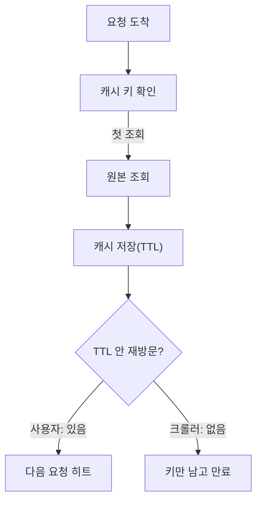

## 문제와 배경

[직전 글](/blog/2026/02/15/local-vs-shared-cache.html)에서는 기관별 설정값 하나를 로컬 캐시에서 공유 Redis로 옮겼습니다. 이번은 반대 방향입니다. 같은 작업에서 문서 상세 화면이 읽는 문서별 플래그 하나도 공유 Redis에 10분 TTL로 캐시했습니다. 개발 환경에서는 두 번째 요청부터 쿼리가 나가지 않아 의도대로 동작했지만, 같은 날 트래픽 분석 결과와 맞춰 보니 이 키는 크롤러 트래픽에서 적중할 기회가 거의 없고 문서 ID별 키만 쌓이는 구조였습니다. 그래서 운영에 내보내기 전에 걷어냈습니다.

원래 이 캐시를 넣은 이유는 명확했습니다. 서버 여러 대가 같은 요청을 나눠 받는 구조에서, 크롤러 트래픽으로 초당 요청 수가 늘자 "자주 조회되는 값을 캐시로 아끼자"는 판단은 합리적으로 보였습니다. 문제는 "자주 조회된다"는 전제가 **크롤러가 같은 문서를 반복해서 요청한다**는 뜻이었는데, 실제 크롤러는 그렇게 움직이지 않았다는 점입니다.

## 접근: 캐시는 재방문이 있어야 이깁니다

아래 그림은 같은 캐시 구조를 일반 사용자 트래픽과 크롤러 트래픽이 각각 어떻게 지나는지 보여줍니다.



캐시가 비용을 아끼는 경로는 `d → e → f`입니다. 같은 키가 TTL이 끝나기 전에 다시 조회돼야 원본 조회 한 번을 아낍니다. 반면 크롤러처럼 **문서 하나하나를 순서대로 훑고 지나가는 접근**(전수 열거형 접근)에서는 같은 키가 TTL 안에 다시 조회될 일이 거의 없습니다. 경로는 매번 `c → d → g`로 끝나고, 원본 조회는 한 번도 줄지 않은 채 캐시 저장과 만료 비용만 더해집니다.

이것은 캐시 구현이 잘못돼서가 아니라 **키 공간과 접근 패턴의 관계** 문제입니다. 캐시 전체(문서 수만큼의 키)가 TTL이 끝나기 전에 몇 번이나 다시 조회되는지가 핵심이고, 전수 열거처럼 키마다 한 번씩만 지나가는 패턴에서는 이 횟수가 구조적으로 1에 가깝습니다. TTL을 늘리거나 캐시가 담을 수 있는 키 수를 늘려도 이 숫자 자체는 바뀌지 않습니다 — 조회 패턴이 "다시 오지 않는 열거"인 이상, 더 오래·더 많이 들고 있어도 다시 불릴 기회가 생기지 않기 때문입니다. 이 판단은 트래픽 분석과 접근 패턴에서 끌어낸 추론이고, 운영에서 적중률을 재어 확인한 수치는 아닙니다.

## 구현: 되돌리기는 호출 하나를 걷어내는 일이었습니다

### 핵심 코드

이 글을 위해 새로 쓴 최소 예시입니다. 실제 캐시 유틸은 더 많은 책임(널 값 처리, 예외 시 재호출 등)을 지지만, 되돌린 변경 자체는 캐시 경유를 걷어내고 원본 호출로 되돌리는 한 메서드 분량입니다.

```java
// 전: 문서별 플래그를 공유 Redis에 10분 캐시
public boolean isFlagEnabled(String docId) {
    String cached = CacheUtils.getOrCompute(
            redisTemplate,
            () -> source.isFlagEnabled(docId) ? "Y" : "N",
            10, TimeUnit.MINUTES,
            docId, "docFlag", "v1");
    return "Y".equals(cached);
}
```

```java
// 후: 캐시를 걷어내고 원본을 직접 호출
public boolean isFlagEnabled(String docId) {
    return source.isFlagEnabled(docId);
}
```

되돌리는 데 추가 설계가 필요하지 않았던 이유는 원래 플래그 조회 자체가 가벼운 판정값이었기 때문입니다 — 조건 몇 개를 보고 Y/N 하나를 돌려주는 수준이지, 무거운 조인이나 외부 호출을 동반하지 않았습니다. 캐시가 없을 때의 요청당 비용은 이 조회의 형태에서 판단한 것이고, 정량으로 측정해 비교한 수치는 아닙니다. 반대로 원본 조회가 무거운 값이었다면 캐시를 걷어내는 결정은 이렇게 간단하지 않았을 것입니다.

이 플래그는 관리 화면에서 끌 수 있는 값이라, 캐시가 있을 때는 끈 뒤에도 최대 TTL만큼(10분) 예전 값이 보일 수 있었습니다. 캐시를 걷어내면서 이 지연도 함께 사라졌는데, 이건 히트율과는 별개의 효과입니다. 캐시를 켜 둔 채 TTL만 줄이는 선택지도 있었지만, 애초에 히트가 나지 않는 캐시라면 지연을 줄이는 쪽으로 손댈 이유가 없었습니다.

## 캐시를 넣기 전에 확인할 것

캐시를 넣을지 말지는 "조회가 잦은가"가 아니라 "같은 키가 TTL 안에 다시 오는가"로 물어야 한다는 것이 이번 일의 결론입니다. 두 질문은 전체 요청 수가 같아도 답이 달라질 수 있습니다.

| 관찰 | 원인 |
|---|---|
| 문서 ID마다 새 키가 생김 | 크롤러 요청이 서로 다른 문서를 가리킴(같은 키를 다시 쓰지 않음) |
| 기대 적중이 거의 없음 | 같은 키가 TTL이 끝나기 전에 다시 조회되지 않음(전수 열거형 접근) |
| 걷어내도 부담이 작음 | 원본 조회가 원래 가벼운 판정값이었음(판단, 측정값 아님) |

캐시를 넣기 전에 따져 볼 선택지를 비교하면 다음과 같습니다. TTL을 늘리거나 캐시 용량을 키우는 쪽은 둘 다 기각했는데, 이유가 같습니다 — 접근 패턴이 "다시 오지 않는 열거"라는 전제 자체를 바꾸지 못하기 때문입니다.

| 선택지 | 기대 효과 | 이번 상황에 맞지 않는 이유 |
|---|---|---|
| TTL 연장 | 반영 지연은 늘어도 적중 기회가 늘 것으로 기대 | 같은 키가 애초에 다시 오지 않아 TTL을 늘려도 적중이 늘지 않음 |
| 캐시 용량 확대 | 더 많은 키를 더 오래 보관 | 보관 기간·개수가 늘 뿐, 재방문이 없으면 적중은 그대로 0에 가까움 |
| 캐시 제거(이번 선택) | 키 증가·만료 비용 자체가 사라짐 | 원본 조회가 가벼운 값일 때만 성립 — 무거운 조회라면 다른 방안이 필요 |

이 표의 앞 두 줄은 이번 사례에만 해당하는 결론이 아니라, "같은 키가 다시 오지 않는 접근(열거형 크롤러, 전수 백업 작업 등)에는 네거티브 캐시나 TTL 조정 같은 손질이 대체로 듣지 않는다"는 더 일반적인 패턴으로 봐도 됩니다. 반대로 사람 사용자처럼 같은 항목을 반복해 보는 트래픽이 섞여 있다면 같은 캐시가 그쪽에서는 여전히 유효할 수 있으므로, 캐시를 걷어낼지는 트래픽 전체가 아니라 **그 캐시가 노리는 접근 패턴** 기준으로 판단해야 합니다.

## 정리

- 캐시가 비용을 아끼려면 같은 키가 TTL 안에 다시 조회돼야 합니다. 문서 하나하나를 한 번씩 훑고 지나가는 크롤러 같은 전수 열거형 접근에서는 이 조건이 구조적으로 성립하지 않습니다.
- TTL을 늘리거나 캐시 용량을 키우는 조치는 "다시 오지 않는 접근"이라는 전제를 바꾸지 못해 히트율을 올리지 못하고, 키 수와 만료 비용만 늘립니다.
- 캐시를 넣기 전에는 "조회가 잦은가"가 아니라 "같은 키가 다시 오는가"를 먼저 묻고, 원본 조회가 가벼운 값인지도 함께 확인합니다. 이번처럼 가벼운 판정값이었다면 캐시를 걷어내는 쪽이 단순하고, 무거운 조회라면 캐시 대신 다른 방식을 찾아야 합니다.
