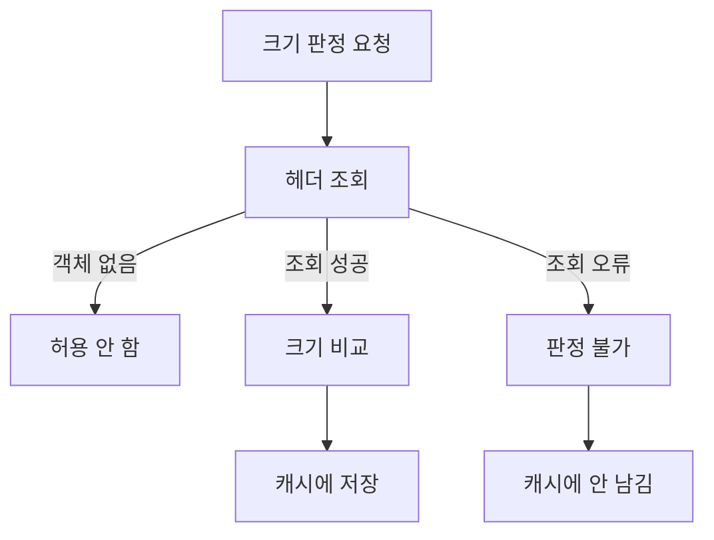

## 문제와 배경

어떤 문서에 달린 후속 기능(문서를 추가로 처리해 보여 주는 기능)을 켤지 끌지는, 그 문서 파일이 오브젝트 스토리지(S3)에서 정해진 크기보다 작은지로 정했습니다. 크기는 매번 재는 대신 가용 여부를 캐시에 담아 재사용했습니다.

크롤러가 상세 페이지를 훑는 경로를 따라 호출을 하나씩 점검하다가 이 판정 코드에서 문제를 찾았습니다. 크기 조회 함수는 객체가 없을 때(404)와 조회 자체가 실패했을 때(권한·통신 오류 등)를 구분하지 않고 둘 다 크기 `-1`을 돌려주고 있었습니다. 호출부는 이 값을 MB로 바꿔 제한과 비교했으므로, `-1`은 언제나 "제한 미만"이 되어 **허용**으로 판정됐습니다. 조회가 실패할수록 기능이 켜지는, 방향이 거꾸로 된 기본값이었습니다.

이 판정은 후속 기능의 가용 여부 캐시에 그대로 저장됐습니다. 그래서 오브젝트 스토리지가 잠깐 오류를 낸 순간의 오판이 오류가 지나간 뒤에도 캐시 수명만큼 남을 수 있는 구조였습니다. 평소에는 조회가 거의 실패하지 않아 드러나지 않지만, 크롤러처럼 평소에 잘 안 열리는 문서까지 훑는 트래픽에서는 이런 경로가 실행될 기회가 늘어납니다. 이 문제는 장애로 드러나기 전에 코드를 읽다가 찾은 것이고, 실제로 잘못 저장된 캐시 항목의 수를 센 것은 아닙니다.

## 접근

판정 불가를 허용·불허 중 하나로 눌러 담지 않고, 별도의 세 번째 상태로 다루기로 했습니다. 아래는 그 흐름입니다.



조회 결과는 세 갈래로 갈립니다. 객체가 아예 없으면 "허용 안 함"이고, 조회에 성공했으면 크기를 비교해 결과를 캐시에 저장합니다. 조회 자체가 오류로 끝나면 이번 요청만 "허용 안 함"으로 답하되, 그 값을 캐시에는 올리지 않습니다. 오류가 복구되면 다음 요청이 다시 정상 경로를 타도록 하기 위해서입니다.

| 증상 | 원인 | 조치 |
|---|---|---|
| 조회가 실패해도 판정은 "허용" | 오류와 "객체 없음"을 같은 `-1`로 합쳤고, `-1`은 항상 제한 미만 | 오류는 null, 객체 없음은 false로 분리 |
| 오류가 그친 뒤에도 "허용"이 남을 수 있음 | 오류 시점의 오판이 TTL만큼 캐시에 고정됨 | 판정 불가는 캐시에 쓰지 않음 |
| 가용 플래그를 참조만 하고 쓰지 않는 화면 코드가 남아 있음 | 예전 판정 방식의 흔적이 호출부에 남음 | 더는 읽지 않는 전달값과 호출부 제거 |

## 구현

### 핵심 코드

판정 함수는 `Boolean`(박싱 타입)을 돌려줘 세 상태를 표현합니다. `true`/`false`는 확정된 판정이고, `null`은 판정 불가입니다.

```java
/** 객체 크기가 제한 미만인지 판정한다. 조회 오류로 알 수 없으면 null. */
Boolean judgeSizeAllowed(String key, long limitBytes) {
    Long size;
    try {
        size = storage.headObjectSize(key); // 404는 별도 처리, 그 외 오류는 던짐
    } catch (StorageException e) {
        log.warn("크기 조회 실패: key={}, {}", key, e.getMessage());
        return null;
    }
    if (size == null) {
        return false; // 객체 없음
    }
    return size < limitBytes;
}
```

호출부는 `null`을 별도로 처리합니다. 응답은 그 요청에 한해 "허용 안 함"으로 내려주지만, 캐시에는 쓰지 않습니다.

```java
Boolean judged = judgeSizeAllowed(key, LIMIT_BYTES);
if (judged == null) {
    // 이번 요청만 불가로 답하고, 캐시에는 남기지 않는다(허용이 고착되는 것을 막는다)
    return false;
}
boolean allowed = judged;
cache.set(cacheKey, allowed, TTL);
return allowed;
```

예전에는 이 판정 값이 화면 쪽 스크립트 변수로도 그대로 내려가고 있었는데, 실제로 그 값을 읽는 코드가 없었습니다. 판정 함수를 세 상태로 바꾸면서 이 죽은 전달 경로와, 결과를 쓰지 않던 호출부 메서드 하나를 함께 지웠습니다. 남겨 둬 봤자 다음에 같은 함수를 고칠 때 "이 값도 영향받나" 하는 확인거리만 늘릴 뿐이었습니다.

갈래마다 테스트를 하나씩 둬서, 분기 하나가 조용히 합쳐지는 일을 막았습니다.

```java
@Test
void 객체가_없으면_허용하지_않는다() {
    given(storage.headObjectSize(KEY)).willReturn(null);
    assertThat(judge.judgeSizeAllowed(KEY, LIMIT)).isFalse();
}

@Test
void 제한_미만이면_허용한다() {
    given(storage.headObjectSize(KEY)).willReturn(LIMIT - 1);
    assertThat(judge.judgeSizeAllowed(KEY, LIMIT)).isTrue();
}

@Test
void 제한_이상이면_허용하지_않는다() {
    given(storage.headObjectSize(KEY)).willReturn(LIMIT + 1);
    assertThat(judge.judgeSizeAllowed(KEY, LIMIT)).isFalse();
}

@Test
void 조회_오류면_판정_불가를_돌려준다() {
    given(storage.headObjectSize(KEY)).willThrow(new StorageException("timeout"));
    assertThat(judge.judgeSizeAllowed(KEY, LIMIT)).isNull();
}
```

네 번째 테스트가 핵심입니다. 이 테스트가 없었다면 `catch` 블록을 고치다가 실수로 다시 `false`나 `true` 하나로 합쳐도 아무도 알아채지 못합니다.

## 함정과 트레이드오프

| 선택 | 얻는 것 | 잃거나 주의할 것 |
|---|---|---|
| 판정 불가를 `null`(세 번째 상태)로 분리 | 오류가 허용으로 굳지 않음 | 호출부마다 `null` 분기를 추가해야 함, 박싱 타입이라 `NullPointerException` 위험이 생김 |
| 판정 불가를 캐시에 쓰지 않음 | 오류 복구 후 다음 요청이 바로 정상 판정을 받음 | 오류가 계속되는 구간에서는 매 요청이 조회를 다시 시도함(캐시로 아낄 부하를 못 아낌) |
| 죽은 호출부 제거 | 다음 변경에서 확인할 대상이 줄어듦 | 지우기 전에 실제로 읽는 곳이 없는지 호출 지점을 끝까지 확인해야 함 |

이 조치는 한 수단의 판정이 하류로 전달되고 캐시까지 거치는 경로에만 해당합니다. [다른 글](/blog/2026/10/07/silent-failure-exit-code-fail-open.html)에서 다루듯, 가용성이 걸린 폴백이라면 오류가 났을 때 일단 열어 두고 뒤쪽 경로로 넘기는 fail-open이 맞는 경우도 있습니다. 반면 이번처럼 한 번 내린 판정이 캐시에 저장돼 이후 요청에 계속 영향을 주는 경우에는, 판정 불가를 허용 쪽으로 밀어 넣으면 오류가 지나간 뒤에도 그 효과가 TTL만큼 남습니다. 결과가 그 자리에서 끝나는지, 아니면 저장돼 다음 요청에 전달되는지가 두 선택을 가르는 기준입니다.

## 정리

- 판정 함수가 "조회 실패"와 "조건 미충족"을 같은 반환값으로 합치면, 호출부는 오류를 정상적인 "아니오"로 읽을 수밖에 없습니다.
- 판정 불가는 참·거짓과 나란한 세 번째 상태로 두고, 그 상태는 캐시에 올리지 않습니다. 이번 요청만 보수적으로 답하고, 다음 요청이 다시 정상 판정을 시도하게 둡니다.
- 가용성을 지키는 fail-open과 판정 결과를 저장해 두는 fail-safe는 다른 질문입니다. 결과가 캐시나 다른 저장소로 전달돼 다음 요청에 영향을 준다면, 판정 불가를 허용으로 바꾸지 않는 쪽이 안전합니다.
- 판정 불가 분기는 테스트로 따로 고정해 둡니다. 없으면 다음 리팩터링에서 조용히 다시 합쳐질 수 있습니다.
