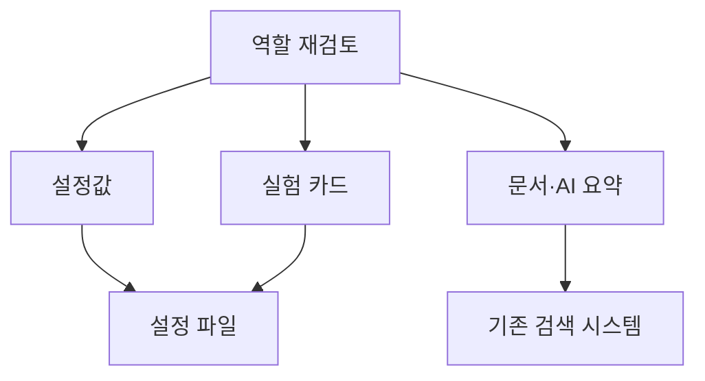

## 문제와 배경

기존 검색 시스템(Elasticsearch) 위에서 문서를 찾아 비교해 주는 작은 FastAPI 서비스("비교 검색")가 있습니다. 찾고 비교할 문서 자체는 이미 그 검색 시스템에 있었습니다. 그런데 이 서비스의 저장소 안에는 그와 별도로 전용 PostgreSQL 인스턴스 하나가 떠 있었습니다. SQLAlchemy 비동기 엔진과 asyncpg 드라이버, 스키마 변경을 관리하는 Alembic 마이그레이션까지 갖춘 구성이었습니다.

그 DB가 들고 있던 것은 두 가지뿐이었습니다. 문서 매칭에 쓰는 셀렉터 설정값과, 공개 기능을 소개하는 실험 카드 목록입니다. 둘 다 사람이 관리 화면이나 관리 키로 가끔 고치는 데이터이고, 읽기 쪽 조회는 "전체 목록" 아니면 "식별자 하나로 찾기" 둘뿐이었습니다. 조인도, 복잡한 조건절도, 트랜잭션 여러 개를 묶어야 하는 작업도 없었습니다.

그래서 이 DB를 완전히 들어내기로 했습니다. 설정값은 파일로 옮기고, 문서 데이터와 일부 AI 요약 데이터는 기존 검색 시스템 쪽으로 온전히 넘기는 쪽입니다. 이 글은 무엇을 어디로 옮겼는지, DB가 공짜로 주던 것 중 서비스 코드가 대신 떠안은 부분은 무엇인지, 그리고 그 대가로 포기한 것은 무엇인지를 정리합니다.

## 접근

RDB를 걷어내기로 하면서 가장 먼저 한 일은 "이 DB가 실제로 하는 일"을 역할별로 나누는 것이었습니다. 아래 그림은 전용 PostgreSQL이 맡던 역할이 각각 어디로 갔는지를 보여줍니다.



설정값과 실험 카드는 둘 다 변경 빈도가 낮고 양이 적어 파일 하나로 묶기로 했습니다. 문서 본문과 AI 요약 데이터는 애초에 검색이 주 용도이므로 기존 검색 시스템에 그대로 두거나 그쪽으로 적재를 마치기로 했습니다. 이렇게 나누고 나니 전용 PostgreSQL에 남는 역할이 없었고, 그래서 DB 자체를 지우는 쪽으로 정리됐습니다.

같은 판단은 요청 빈도 제한에도 이어졌습니다. 서버가 한 대라는 전제 위에서, 차단 이력 같은 남용 대응 테이블도 DB와 함께 없애고 요청 빈도 제한은 별도 저장소 없이 프로세스 메모리로 처리하기로 했습니다. 그 구현과 한계는 [(3)편](/blog/2026/03/16/in-memory-sliding-window-rate-limit.html)에서 다룹니다.

## 구현

### 핵심 코드

아래 코드는 이 글을 위해 일반화한 이름으로 새로 쓴 예시이며, 그대로 실행해 본 것은 아닙니다.

먼저 설정값을 읽는 쪽입니다. DB 접속 정보 대신 파일 경로와, 그 파일을 다시 읽을 주기를 설정으로 둡니다.

```python
from pathlib import Path
from pydantic_settings import BaseSettings


class ApiSettings(BaseSettings):
    feature_cards_path: Path
    feature_cards_cache_seconds: int = 30
```

파일이 정본인 저장소입니다. 매 요청마다 파일을 다시 읽지 않도록 수정 시각(mtime)을 보고, 설정한 주기 이상 지났을 때만 다시 읽습니다.

```python
import time


class FeatureCardStore:
    """파일이 정본. mtime 과 TTL 로 재읽기 시점을 정합니다."""

    def __init__(self, path: Path, cache_seconds: int) -> None:
        self._path = path
        self._cache_seconds = cache_seconds
        self._mtime: float | None = None
        self._checked_at: float = 0.0
        self._cache: list[FeatureCard] = []

    def list_public(self) -> list[FeatureCard]:
        self._reload_if_stale()
        return [c for c in self._cache if c.is_public]

    def _reload_if_stale(self) -> None:
        now = time.monotonic()
        if now - self._checked_at < self._cache_seconds:
            return
        self._checked_at = now
        mtime = self._path.stat().st_mtime
        if self._mtime is None or mtime != self._mtime:
            self._cache = _parse(self._path.read_text())
            self._mtime = mtime
```

마지막으로, DB의 `UNIQUE` 제약과 `CHECK` 제약이 하던 일입니다. 이제는 서비스 계층이 직접 검사합니다.

```python
import re

CARD_ID_PATTERN = re.compile(r"^[a-z0-9][a-z0-9-]{1,49}$")


def create_card(cards: list[FeatureCard], new_card: FeatureCard) -> FeatureCard:
    if not CARD_ID_PATTERN.fullmatch(new_card.card_id):
        raise InvalidCardIdError(new_card.card_id)
    if any(c.card_id == new_card.card_id for c in cards):
        raise DuplicateCardError(new_card.card_id)
    return new_card
```

라우터와 서비스 계층에서는 `AsyncSession` 의존성이 사라지고 파일 저장소 의존성으로 바뀌었습니다. 파일 읽기·쓰기가 로컬 I/O라 `await`가 필요 없어지면서, 비동기였던 서비스 메서드도 대부분 동기 함수로 바뀝니다. 다만 동시에 여러 요청이 같은 파일에 쓰려고 할 때 무엇이 막아 주는지는 또 다른 문제이고, 이 저장소 코드 자체(읽기 TTL, 쓰기 직렬화, 원자적 교체)는 다음 글에서 다룹니다.

## 함정과 트레이드오프

DB가 맡던 역할이 어디로 갔는지 정리하면 다음과 같습니다.

| 역할 | DB에서 | 이관 대상 |
|---|---|---|
| 설정값(매칭 셀렉터, 실험 카드) | 전용 PostgreSQL 테이블 | 파일(JSON) |
| 문서 본문·AI 요약 데이터 | 일부만 자체 테이블 | 기존 검색 시스템 |
| 형식·중복 검사(`UNIQUE`, `CHECK` 제약) | DB 제약조건 | 서비스 계층 코드 |
| 비동기 DB 세션(SQLAlchemy + asyncpg) | ORM·드라이버 | 제거 |

그리고 이 선택으로 얻은 것과 잃은 것입니다.

| 얻은 것 | 잃은 것 |
|---|---|
| 전용 DB 인스턴스·Alembic 마이그레이션 운영 부담 제거 | DB가 보장하던 동시성 제어·제약조건·인덱스 |
| 배포 의존성 하나 감소(드라이버·마이그레이션 도구) | `psql`로 즉석에서 던지는 임의 조회 |
| 설정 변경이 재배포 없이 파일 교체만으로 반영 | 여러 테이블에 걸친 조인과 트랜잭션 격리 |

가장 크게 잃은 것은 "DB가 공짜로 보장해 주던 것"입니다. `UNIQUE` 제약, 형식을 검사하는 `CHECK` 제약, 갱신 시각을 자동으로 채우던 트리거는 모두 서비스 계층 코드가 대신해야 했습니다. 파이썬 공식 문서는 `os.replace()`가 같은 파일시스템 안에서는 원자적 교체를 보장한다고 명시하므로, 쓰기 자체가 깨진 상태로 남는 일은 막을 수 있습니다. 다만 "요청 A가 읽고 → 중복인지 보고 → 쓴다"는 흐름을 여러 프로세스나 여러 서버가 동시에 밟을 때 무엇이 순서를 보장하는지는 파일 교체의 원자성과는 별개 문제이고, 이 저장소가 한 대라는 전제가 이 설계의 전제이기도 합니다.

또 하나, 이 선택이 맞았던 것은 조회 패턴이 단순했기 때문이라는 점을 분명히 해 둘 필요가 있습니다. 같은 판단을 조회 조건이 다양하거나 데이터 양이 많은 도메인에 그대로 옮기면, 파일을 매번 전부 읽어 메모리에 올리는 비용이나 부분 조회를 코드로 다시 구현해야 하는 비용이 DB를 쓰는 비용보다 커질 수 있습니다.

## 정리

- 작은 API 서비스가 전용 PostgreSQL을 쓰고 있었지만, 실제로 담은 데이터는 설정값과 실험 카드뿐이었고 조회는 전체 목록과 식별자 조회 둘뿐이었습니다.
- 역할을 나눠 보니 문서·요약 데이터는 기존 검색 시스템에, 설정값·실험 카드는 파일에 두는 것으로 DB의 역할이 모두 사라졌습니다.
- `UNIQUE`·`CHECK` 제약과 갱신 시각 기록처럼 DB가 공짜로 주던 것은 서비스 계층 코드가 떠안았습니다.
- 얻은 것은 운영·배포 부담 감소이고, 잃은 것은 DB의 동시성 제어·즉석 조회·트랜잭션입니다. 이 선택은 조회 패턴이 단순하고 서버가 한 대라는 전제 위에서 성립합니다.
- 파일을 정본으로 쓰는 저장소가 동시 쓰기를 어떻게 막는지는 다음 글(2편)에서 다룹니다.
