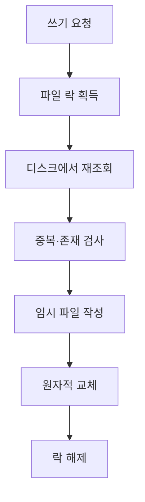

## 문제와 배경

[이전 글](/blog/2026/03/04/api-without-relational-db.html)에서 관계형 DB를 걷어낸 결정을 다뤘습니다. 설정값은 파일로, 본문 데이터는 기존 검색 엔진으로 옮겼지만, 남은 것이 하나 있었습니다. 운영자가 관리 키로 직접 등록·수정하는 카드 목록, 이 글에서는 "실험 카드"라고 부르는 자원입니다. 이 목록은 읽기만 하는 것이 아니라 **쓰기 API가 그대로 남아야** 했습니다. 서버가 한 대뿐이고 값이 바뀌는 빈도도 낮아서, DB가 주는 트랜잭션·UNIQUE 제약·인덱스 중 실제로 쓰는 것이 거의 없었습니다. 그런데 쓰기가 있다는 점이 설정 파일과는 다릅니다. 설정 파일은 배포로만 바뀌지만, 이 카드는 요청이 들어오는 순간 파일 내용이 달라집니다.

파일을 정본으로 쓰기로 정한 뒤 바로 막힌 지점은 세 가지였습니다. 쓰는 도중 프로세스가 죽으면 반쯤 쓰인 파일을 읽는 요청이 생기는지, 여러 워커가 동시에 같은 파일에 쓰면 어떻게 되는지, UNIQUE 제약이 없는데 중복 등록을 무엇으로 막을지입니다. DB가 조용히 해결해 주던 문제를 이번에는 애플리케이션 코드가 떠안아야 했습니다.

## 접근

아래는 쓰기 요청 한 건이 거치는 경로입니다. 잠금을 쥔 뒤에야 파일을 다시 읽고, 임시 파일을 거쳐 원자적으로 교체합니다.



DB가 하나의 트랜잭션 안에서 맡아 주던 일을 어디로 옮겼는지 추리면 이렇습니다.

| DB가 하던 일 | 파일 저장소가 맡은 방식 |
|---|---|
| 트랜잭션 경계 (커밋·롤백) | 잠금을 쥔 블록 하나가 경계. 블록 안에서 예외가 나면 파일에 쓰지 않음 |
| UNIQUE 제약 | 쓰기 전 애플리케이션이 직접 조회해 같은 키가 있는지 검사 |
| IDENTITY·시퀀스 | 문서 안에 다음 번호를 같이 저장하고, 삭제된 번호는 재사용하지 않음 |
| `updated_at` 트리거 | 서비스 계층이 수정마다 타임스탬프를 직접 채움 |
| 행 단위 잠금 | 문서 전체에 거는 잠금 하나. 행 단위보다 거칠지만 쓰기 빈도가 낮으면 체감되지 않음 |
| 깨진 커밋 복구(WAL 등) | 파일을 직접 깨뜨리지 않는 교체 절차로 대체 (아래 핵심 코드) |

읽기 쪽은 더 단순합니다. 매 요청마다 파일을 다시 읽으면 디스크 I/O가 응답 경로에 끼어들기 때문에, 파일의 수정 시각(mtime)과 크기를 캐시 신선도 판단에 쓰고 일정 시간(TTL)마다만 다시 확인합니다. mtime과 크기가 그대로면 다시 파싱하지 않고 캐시된 객체를 돌려줍니다. 같은 프로세스가 방금 쓴 직후에는 캐시를 즉시 무효화해 자신이 쓴 값을 바로 읽게 하지만, 다른 워커 프로세스는 TTL만큼 늦게 따라옵니다. 멀티 워커 구성에서 "방금 등록한 카드가 다른 워커로 간 요청에는 아직 안 보이는" 짧은 창이 생긴다는 뜻이고, 이는 설계상 받아들인 지연이지 버그가 아닙니다.

## 구현

### 핵심 코드

아래는 이 글을 위해 새로 쓴 최소 예시입니다. 원본 코드를 옮긴 것이 아니며, 이 형태 그대로 실행해 본 것은 아닙니다.

```python
import fcntl
import json
import os
import tempfile
import time
from contextlib import contextmanager
from pathlib import Path


class JsonFileStore:
    """단일 JSON 파일을 정본으로 쓰는 저장소. 읽기는 캐시, 쓰기는 잠금 아래 원자 교체."""

    def __init__(self, path: Path, cache_seconds: int = 5) -> None:
        self._path = path
        self._cache_seconds = cache_seconds
        self._cached: dict | None = None
        self._stamp: tuple[int, int] | None = None  # (mtime_ns, size)
        self._checked_at: float = 0.0

    def read(self) -> dict:
        now = time.monotonic()
        if self._cached is not None and now - self._checked_at < self._cache_seconds:
            return self._cached
        stamp = self._stat()
        if stamp == self._stamp and self._cached is not None:
            self._checked_at = now
            return self._cached
        data = json.loads(self._path.read_text(encoding="utf-8")) if stamp else {"items": []}
        self._cached, self._stamp, self._checked_at = data, stamp, now
        return data

    def _stat(self) -> tuple[int, int] | None:
        try:
            st = self._path.stat()
        except OSError:
            return None
        return (st.st_mtime_ns, st.st_size)

    @contextmanager
    def edit(self):
        lock_path = self._path.with_suffix(self._path.suffix + ".lock")
        with open(lock_path, "w") as lock_file:
            fcntl.flock(lock_file.fileno(), fcntl.LOCK_EX)
            try:
                # 잠금을 쥔 뒤에는 캐시를 믿지 않고 디스크에서 다시 읽는다
                document = json.loads(self._path.read_text(encoding="utf-8")) if self._path.exists() else {"items": []}
                yield document
                self._write(document)
            finally:
                fcntl.flock(lock_file.fileno(), fcntl.LOCK_UN)

    def _write(self, document: dict) -> None:
        payload = json.dumps(document, ensure_ascii=False, indent=2)
        fd, tmp_name = tempfile.mkstemp(dir=self._path.parent, suffix=".tmp")
        with os.fdopen(fd, "w", encoding="utf-8") as handle:
            handle.write(payload)
            handle.flush()
            os.fsync(handle.fileno())
        os.replace(tmp_name, self._path)  # 같은 파일시스템 안에서만 원자적
        self._cached, self._stamp, self._checked_at = document, self._stat(), time.monotonic()
```

몇 가지는 문서에 근거가 있어 그대로 썼고, 몇 가지는 관찰을 근거로 판단했습니다.

- **`os.replace`의 원자성은 Python 공식 문서에 명시돼 있습니다.** 같은 파일시스템 위의 교체는 원자적이라, 읽는 쪽은 교체 전 파일 전체이거나 교체 후 파일 전체만 보고 둘이 섞인 상태를 보지 않습니다. 그래서 임시 파일은 반드시 목적 파일과 같은 디렉터리에 만들어야 합니다. 다른 파일시스템(예: 별도로 마운트한 디스크)에 임시 파일을 두면 이 보장이 깨집니다.
- **`fcntl.flock`은 권고적(advisory) 잠금입니다.** 역시 공식 문서가 밝히는 바이며, 커널이 강제하는 것이 아니라 잠금을 확인하는 코드끼리만 서로를 막습니다. 이 저장소에 쓰는 모든 코드 경로가 `edit()`을 거치지 않으면, 예를 들어 운영자가 같은 파일을 직접 편집기로 열어 저장하면 이 잠금은 그 변경을 막지 못합니다.
- **왜 데이터 파일이 아니라 옆의 `.lock` 파일에 거는지는 `os.replace`의 동작에서 따라 나오는 결론입니다.** 교체는 inode를 바꾸는 연산이라, 데이터 파일 자체에 잠금을 걸어 두면 교체 직후에는 그 잠금이 이제 아무도 참조하지 않는 옛 inode에 남습니다. 다음 쓰기 요청이 잠그는 대상은 새 inode이므로 서로를 막지 못합니다. 경로가 고정인 별도 파일에 걸어야 교체와 무관하게 같은 잠금 대상을 가리킵니다.
- **쓰기 블록을 동기 I/O로 둔 것은 관찰에 근거한 판단이지, 문서가 보장하는 동작은 아닙니다.** 파일 크기가 작고 로컬 디스크라서 이벤트 루프를 막는 시간이 무시할 수준이라고 보고 그렇게 뒀습니다. 파일이 커지거나 네트워크 스토리지 위에 있다면 이 가정은 다시 따져야 합니다.

## 함정과 트레이드오프

| 선택 | 얻는 것 | 잃거나 주의할 것 |
|---|---|---|
| mtime+TTL 캐시 읽기 | 매 요청 디스크 I/O를 피함 | 다른 워커는 TTL만큼 늦게 따라옴 |
| `.lock` 파일 + `os.replace` | 반쯤 쓰인 파일을 읽을 일이 없음 | 잠금은 권고적이라 외부 편집을 막지 못함 |
| 애플리케이션 단 중복 검사 | DB 없이도 같은 키 중복 등록을 막음 | 잠금 블록 밖에서 검사하면 경합이 생김. 반드시 블록 안에서 재조회해야 함 |
| 교체 전 백업 파일 남기기 | 손으로 되돌릴 수 있음 | 세대 수 제한을 두지 않으면 디스크가 계속 참 |

이 설계가 깨지는 지점은 대체로 같은 가정 하나로 모입니다. **서버가 한 대라는 전제**입니다.

- 서버를 여러 대로 늘리면 각 호스트가 로컬 디스크에 따로 파일을 들고 있는 구조에서는 `.lock`도 각 호스트 안에서만 유효합니다. 호스트를 넘나드는 동시 쓰기는 이 방식으로 막을 수 없고, 공유 파일시스템이나 별도의 분산 잠금이 필요합니다.
- 쓰기 빈도가 올라가면 문서 전체에 거는 굵은 잠금이 체감되기 시작합니다. 운영자 몇 명이 가끔 등록하는 정도에서는 문제가 안 됐지만, 쓰기가 잦아지면 잠금을 쥐는 시간 동안 다른 쓰기 요청이 차례를 기다리는 지연이 쌓입니다.
- 문서가 커지면 매 쓰기마다 전체를 다시 쓰는 비용도 커집니다. 수십~수백 건 규모를 벗어나는 자원이라면 파일 하나에 전부 담는 접근 자체를 다시 봐야 합니다.

## 정리

- DB를 걷어낸 뒤에도 쓰기 API가 남은 자원이 있다면, DB가 묶어서 해 주던 원자성·직렬화·중복 검사·채번을 각각 무엇으로 대체할지 따로 정해야 합니다.
- `os.replace`의 원자 교체(같은 파일시스템 한정)로 반쯤 쓰인 파일을 막고, 옆에 둔 `.lock` 파일의 `flock`으로 동시 쓰기를 직렬화합니다. 두 메커니즘 모두 공식 문서에 근거가 있지만, `flock`이 권고적이라는 점은 이 저장소를 거치지 않는 접근 경로가 있으면 깨집니다.
- 읽기는 mtime+TTL로 캐시해 디스크 I/O를 아끼되, 멀티 워커 구성에서는 다른 워커가 늦게 따라오는 지연을 설계로 받아들여야 합니다.
- 이 방식은 단일 호스트, 낮은 쓰기 빈도, 작은 문서 크기라는 전제 위에서만 성립합니다. 다음 글에서는 같은 원칙(표준 라이브러리만으로, DB 없이)을 쓰기가 아니라 호출 빈도 제한에 적용하는 과정을 다룹니다.
