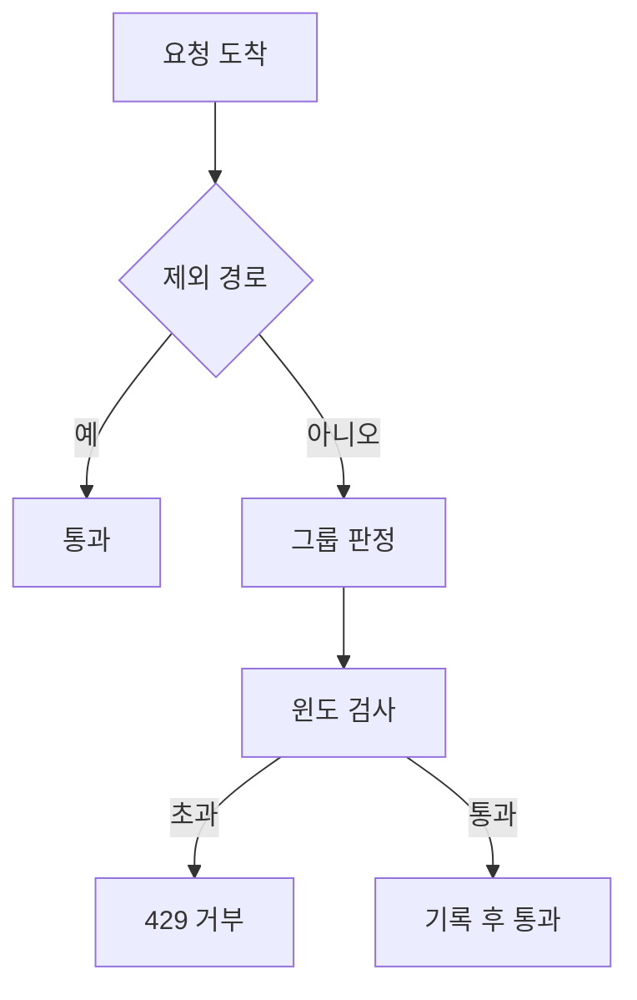

## 문제와 배경

이 시리즈의 (1)에서 다뤘듯, 관계형 DB를 걷어내면서 그 DB에 있던 abuse 차단 테이블과 집계 테이블도 함께 사라졌습니다. 그런데 서비스에는 애초에 막아야 할 호출이 두 종류 있었습니다. 하나는 다른 클라이언트가 백그라운드에서 자동으로 반복 호출하는 문서 매칭 API이고, 다른 하나는 사람이 버튼을 눌러야 발생하는 비교 검색 API입니다. DB가 있을 때는 차단 여부와 누적 횟수를 그 테이블에 적재하고 정책값도 테이블에서 읽어 왔지만, DB가 사라진 뒤에는 이 전체를 애플리케이션 프로세스 안에서 처리해야 했습니다.

설계 문서가 처음 지목한 후보는 FastAPI 생태계에서 흔히 쓰는 rate limit 라이브러리였습니다. 코드를 보니 이 라이브러리는 라우트에 붙이는 데코레이터 단위로 "요청 1건 = 1회"만 세는 구조였습니다. 경로 그룹마다 성격이 다른 한도를 ASGI 미들웨어 한곳에서 판단하려는 목적과는 맞지 않았고, 결국 이 라이브러리도 내부적으로는 더 저수준의 카운터 라이브러리를 직접 호출하고 있었습니다. 서버가 한 대뿐이고 저장소를 프로세스 메모리로 한정한다는 전제에서 필요한 것은 슬라이딩 윈도 카운터 하나뿐이었으므로, 의존성을 늘리지 않고 직접 구현하기로 했습니다.

같은 문제를 외부 저장소로 푼 사례도 있습니다. [페이지 열람 어뷰징을 Redis TTL 윈도로 막은 글](/blog/2026/07/21/page-view-abuse-rate-limit-redis.html)이 그것인데, 거기서는 여러 서버가 카운터를 공유해야 해서 Redis가 필요했습니다. 이번에는 서버가 한 대라는 전제 자체가 다르므로, 외부 저장소 없이 프로세스 메모리만으로 같은 문제를 풉니다.

## 접근

요청이 들어와 그룹을 판정하고 윈도를 검사해 통과시키거나 거부하기까지의 흐름은 다음과 같습니다.



경로 그룹마다 한도의 성격이 다릅니다. 문서 매칭은 클라이언트가 자동으로 호출하므로 거부당해도 사람이 알아채지 못하고 재시도 수단도 없는 "조용한 실패"가 됩니다. 반대로 비교 검색은 사람이 버튼을 눌러야 발생하고 결과를 읽는 데 시간이 걸리므로, 거부당해도 바로 알아채고 다시 누르면 됩니다. 이 차이를 분당 한도와 시간당 한도의 배분에 반영했습니다.

| 그룹 | 호출 주체 | 분당 한도 | 시간당 한도 | 분당을 넉넉히/조이는 이유 |
|---|---|---|---|---|
| 실험 카드 조회 | 누구나 | 120 | - | 공개 조회라 한도만 걸어 두고 시간당은 두지 않습니다 |
| 실험 카드 관리 | 운영 키 | 60 | - | 키 단위라 IP 공유 문제가 없습니다 |
| 문서 매칭 설정 조회 | 클라이언트 | 60 | - | 설정만 읽는 가벼운 호출입니다 |
| 문서 매칭 호출 | 클라이언트(자동) | 40 | 600 | 화면 여러 개가 동시에 부르는 순간 버스트를 흡수하도록 분당은 넉넉히 두고, 호출 1건이 검색 엔진을 여러 번 부르는 비용 때문에 시간당을 조입니다 |
| 비교 검색 | 사람(클릭) | 10 | 100 | 사람이 재시도 가능하므로 분당은 조여도 되고, 응답이 커서 시간당 총량도 별도로 둡니다 |

수치는 설계 단계에서 잡은 기본값이고 실제 운영값은 환경변수로 조정합니다. 핵심은 절대값이 아니라 "자동 호출은 순간 버스트를 넉넉히 받아 주고 누적 비용으로 조이고, 사람의 호출은 순간을 조이고 재시도에 맡긴다"는 배분 원칙입니다.

## 구현

### 핵심 코드

아래는 이 글을 위해 새로 쓴 최소 예시이며, 실제로 띄워서 돌려 본 코드는 아닙니다. 윈도별 요청 시각을 `deque`에 담아 두고 윈도 밖으로 나간 값을 앞에서부터 버리는 방식입니다. 고정 윈도 카운터(분 단위로 리셋되는 카운터)는 경계 구간에서 한도의 최대 두 배가 통과하는 허점이 알려져 있어, 그 대신 슬라이딩 윈도를 썼습니다.

```python
import time
from collections import defaultdict, deque


class SlidingWindowCounter:
    """키별 요청 시각을 들고 있다가 윈도 밖을 버리는 카운터."""

    def __init__(self) -> None:
        self._hits: dict[str, deque[float]] = defaultdict(deque)

    def check(self, key: str, limit: int, window: int, now: float) -> tuple[bool, float]:
        """판정만 하고 세지는 않습니다. 통과를 확정한 뒤 record를 따로 불러야 합니다."""
        bucket = self._hits[key]
        cutoff = now - window
        while bucket and bucket[0] <= cutoff:
            bucket.popleft()
        if len(bucket) >= limit:
            return False, bucket[0] + window
        return True, now + window

    def record(self, key: str, now: float) -> None:
        self._hits[key].append(now)
```

`check`와 `record`를 나눈 이유는 한 그룹에 윈도가 둘 이상(분당·시간당)일 때 한쪽만 통과하고 다른 쪽은 거부되는 상황을 막기 위해서입니다. 모든 윈도를 먼저 `check`하고, 전부 통과했을 때만 각 윈도에 `record`합니다. 거부된 요청은 어느 윈도에도 쌓이지 않아야 다음 번 판정이 꼬이지 않습니다.

```python
def evaluate(counter: SlidingWindowCounter, key_prefix: str,
             limits: list[tuple[int, int]], now: float) -> bool:
    keys = [f"{key_prefix}:{window}" for _, window in limits]
    verdicts = [
        counter.check(k, count, window, now)
        for k, (count, window) in zip(keys, limits)
    ]
    if any(not ok for ok, _ in verdicts):
        return False
    for k in keys:
        counter.record(k, now)
    return True
```

멀티 워커 환경에서는 프로세스 메모리 카운터가 워커마다 따로 돕니다. gunicorn의 워커 모델(prefork)은 요청을 워커 프로세스별로 나눠 처리하므로, 같은 IP의 요청이 두 워커에 번갈아 들어가면 각 워커가 독립적으로 한도를 다 채울 때까지 통과시킵니다. 즉 워커가 N개면 사실상 한도가 N배로 느슨해집니다. 이를 바로잡으려고 설정값을 워커 수로 나눠 각 워커의 로컬 한도로 썼습니다.

```python
import math


def scale_for_workers(limits: list[tuple[int, int]], workers: int) -> list[tuple[int, int]]:
    # 나눈 값이 0이 되면 전부 거부로 떨어지므로 최소 1은 보장합니다.
    return [(max(math.ceil(count / workers), 1), window) for count, window in limits]
```

이 보정은 워커 수가 바뀌면 같이 바꿔야 하는 수동 설정이라는 한계가 있습니다. 워커 수가 환경변수와 실제 배포 설정에서 어긋나면 집계만 맞고 합계 한도는 어긋납니다.

미들웨어는 Starlette의 `BaseHTTPMiddleware`가 아니라 순수 ASGI 애플리케이션으로 직접 구현했습니다. `BaseHTTPMiddleware`는 응답을 한 번 더 감싸는 방식이라 스트리밍 응답이나 컨텍스트 전파에서 부작용이 있다고 Starlette 이슈 트래커에 보고돼 있고, 응답 헤더에 한도 정보를 그대로 얹는 정도의 일이라면 저수준 ASGI 인터페이스로 처리하는 편이 그 부작용을 피할 수 있었습니다.

```python
async def rate_limit_app(scope, receive, send, app, counter, groups):
    if scope["type"] != "http":
        return await app(scope, receive, send)

    group = resolve_group(scope["path"], scope["method"])
    if group is None:
        return await app(scope, receive, send)

    key = f"{group}:{resolve_subject(scope, group)}"
    now = time.monotonic()
    if not evaluate(counter, key, groups[group], now):
        return await send_429(send)

    await app(scope, receive, send)
```

그룹 판정에서 운영 키로 호출하는 관리용 경로는 IP가 아니라 키 자체를 주체로 삼았습니다. 운영자가 같은 사무실 IP를 공유하는 경우가 있어 IP를 기준으로 삼으면 서로가 서로의 한도를 깎아 먹기 때문입니다.

주기적으로 오래된 키를 비우는 정리 루틴도 함께 둡니다. IP를 키로 쓰다 보니 한 번 등장한 키가 영구히 메모리에 남으면 딕셔너리가 계속 자라기 때문에, 가장 긴 윈도보다 오래된 값만 남은 키를 지웁니다. 이 정리는 매 요청마다 돌리지 않고 일정 간격(예: 60초)마다 한 번만 실행해 오버헤드를 줄였습니다.

계약을 확인하는 테스트는 공용 테스트 클라이언트 대신, 한도를 작은 값으로 바꿔 올린 별도 앱 인스턴스로 검증했습니다. 공용 클라이언트는 기본적으로 rate limit을 꺼 둔 설정을 쓰기 때문에 같은 설정으로는 한도 초과 동작 자체를 재현할 수 없었습니다.

## 함정과 트레이드오프

| 선택 | 얻는 것 | 잃거나 주의할 것 |
|---|---|---|
| 외부 저장소 없이 프로세스 메모리 | 의존성이 하나도 늘지 않습니다 | 서버가 한 대라는 전제가 깨지면(수평 확장) 서버마다 따로 한도가 적용됩니다 |
| 슬라이딩 윈도 카운터 | 고정 윈도의 경계 구멍이 없습니다 | 키마다 타임스탬프를 들고 있어 메모리를 씁니다. 한도가 분당 수백 수준이면 문제되지 않지만 한도를 훨씬 키우면 다시 따져야 합니다 |
| check/record 분리 | 다중 윈도에서 부분 통과가 남지 않습니다 | 호출이 한 단계 늘어 구현이 살짝 복잡해집니다 |
| 워커 수로 한도 나누기 | 멀티 워커에서도 합계 한도를 맞출 수 있습니다 | 워커 수 설정과 실제 배포가 어긋나면 자동으로 들키지 않습니다. 수동으로 맞춰야 하는 값입니다 |
| DB의 차단·집계 테이블을 들고 오지 않음 | 구현이 작고 외부 의존이 없습니다 | 자동 차단 이력과 위반 누적 집계가 사라지고, 위반은 접근 로그의 429 기록으로만 남습니다. 호출 비용 기반의 전역 예산(이 시리즈 (4)에서 다룹니다)도 이번 1차 구현에는 넣지 않았습니다 |

마지막 두 행은 서로 다른 종류의 트레이드오프입니다. 앞의 것들은 구현 방식 안에서의 선택이고, DB 관련 행은 DB를 걷어내는 결정 자체가 이 기능에 미친 영향입니다. 자동 차단과 위반 집계가 필요해지면, 그 요구는 프로세스 메모리 카운터로는 채울 수 없고 다시 외부 저장소나 DB가 필요한 지점입니다.

## 정리

- DB를 걷어내면 그 안에 있던 rate limit 정책 테이블과 차단·집계 테이블도 함께 사라지므로, 남은 요구 사항을 어디까지 애플리케이션이 떠안을지부터 정해야 합니다.
- 후보 라이브러리가 데코레이터당 1회만 세는 구조라 그룹별 다중 윈도를 한곳에서 다루기 어려웠고, 서버 1대·프로세스 메모리라는 좁은 전제에서는 슬라이딩 윈도 카운터 하나만 직접 구현하는 편이 의존성도 늘지 않고 더 단순했습니다.
- 호출 주체(자동 호출 vs 사람의 클릭)에 따라 분당·시간당 한도의 배분을 반대로 둘 수 있습니다. 자동 호출은 순간 버스트를 넉넉히 받고 누적 비용으로 조이고, 사람의 호출은 순간을 조이고 재시도에 맡깁니다.
- 멀티 워커 환경에서는 프로세스 메모리 카운터가 워커별로 따로 돌므로, 설정값을 워커 수로 나눠 합계 한도를 맞춰야 합니다. 이 보정은 워커 수 변경 시 같이 바꿔야 하는 수동 설정이라는 한계를 남깁니다.
- 외부 저장소로 같은 문제를 푼 사례와 비교하면, 서버가 여러 대이거나 자동 차단·위반 집계까지 필요해지는 순간 프로세스 메모리 방식의 전제가 깨집니다.
