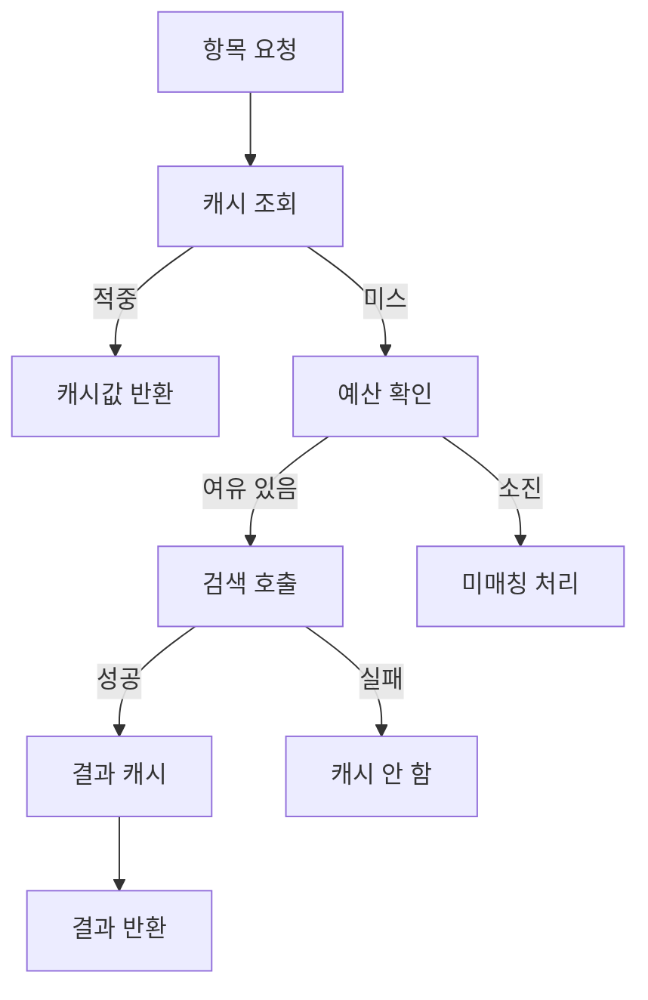

## 문제와 배경

[이전 글](/blog/2026/03/16/in-memory-sliding-window-rate-limit.html)에서 경로별 요청 수를 세는 슬라이딩 윈도 제한을 붙였습니다. 사람이 실수로 연타하거나 자동화 스크립트가 과도하게 부르는 경우는 이것으로 걸러집니다.

그런데 이 서비스의 핵심 기능 하나는 요청 한 건이 끝이 아닙니다. 문서 하나를 비교·매칭하는 요청은 내부적으로 여러 후보를 돌며 외부 검색 엔진을 그만큼 여러 번 호출합니다. 요청 제한은 "분당 몇 번 불렀는가"만 보기 때문에, 호출자가 제한 안에서 정상적으로만 써도 뒷단 검색 클러스터에는 요청 수의 몇 배가 되는 부하가 그대로 들어갑니다. 검색 클러스터는 이 API만 쓰는 것도 아니라서, 이 서비스 혼자 안전 상한을 넘겨서는 안 됩니다.

필요한 것은 요청을 세는 제한이 아니라 **실제로 검색을 때린 횟수**를 세는 두 번째 장치였습니다.

## 접근

아래는 항목 하나가 들어왔을 때 캐시와 예산을 거쳐 검색 호출로 이어지거나 미매칭으로 끝나는 흐름입니다.



핵심은 예산을 **요청 진입 시점이 아니라 캐시 미스가 확정된 뒤, 검색을 부르기 직전**에 확인한다는 점입니다. 캐시가 적중하면 예산을 전혀 쓰지 않으므로, 같은 항목을 반복해서 묻는 호출은 뒷단에 전혀 부하를 주지 않습니다. 두 장치의 역할을 표로 나누면 이렇습니다.

| 구분 | 요청 단위 제한 (이전 글) | 호출 단위 예산 (이 글) |
|---|---|---|
| 세는 단위 | 들어오는 요청 수 | 캐시를 빠져나가 실제로 검색을 때린 횟수 |
| 적용 시점 | 요청이 들어올 때 | 캐시 미스가 확정된 뒤, 검색 호출 직전 |
| 초과 시 동작 | 429로 요청 전체 거부 | 그 항목만 미매칭, 나머지 응답은 정상 반환 |
| 지키는 대상 | 이 서비스의 처리 능력 | 여러 서비스가 함께 쓰는 검색 클러스터 |

예산은 두 겹입니다. 호출자 하나가 혼자 몰아 쓰는 것을 막는 호출자별 한도와, 호출자 전체를 합쳐 검색 클러스터가 받는 총량을 막는 전역 한도입니다. 둘 다 같은 슬라이딩 윈도 카운터(이전 글 참고)를 재사용했고, 어느 한쪽이라도 소진되면 그 항목은 검색을 타지 않습니다.

## 구현

### 핵심 코드

캐시는 결과가 아니라 정규화한 키(제목·식별자 등)를 기준으로 둡니다. 매칭 결과와 미매칭 결과를 서로 다른 TTL로 저장하는 이유는 아래 표에 정리했습니다.

```python
import time
from dataclasses import dataclass


@dataclass
class CacheEntry:
    value: dict | None
    expires_at: float


class MatchCache:
    """정규화 키 기준 TTL 캐시. 매칭 여부에 따라 TTL이 다릅니다."""

    def __init__(self, max_entries: int, matched_ttl: int, unmatched_ttl: int) -> None:
        self.max_entries = max_entries
        self.matched_ttl = matched_ttl
        self.unmatched_ttl = unmatched_ttl
        self._store: dict[str, CacheEntry] = {}

    def get(self, key: str) -> CacheEntry | None:
        entry = self._store.get(key)
        if entry is None or entry.expires_at <= time.monotonic():
            self._store.pop(key, None)
            return None
        return entry

    def set(self, key: str, value: dict | None) -> None:
        if len(self._store) >= self.max_entries:
            self._store.pop(next(iter(self._store)), None)  # 가장 오래된 항목부터 비웁니다
        ttl = self.matched_ttl if value is not None else self.unmatched_ttl
        self._store[key] = CacheEntry(value=value, expires_at=time.monotonic() + ttl)
```

예산은 호출자별 한도와 전역 한도를 각각 독립된 슬라이딩 윈도로 관리하고, 둘 다 통과해야 소비됩니다.

```python
class SearchBudget:
    """캐시 미스 1건당 1 코스트. 호출자별 한도와 전역 한도를 모두 통과해야 통과입니다."""

    def __init__(self, counter: SlidingWindowCounter,
                 per_caller: tuple[int, int], global_: tuple[int, int]) -> None:
        self.counter = counter
        self.per_caller = per_caller  # (한도, 윈도 초)
        self.global_ = global_

    def try_consume(self, caller_key: str) -> bool:
        now = time.monotonic()
        caller = f"budget:caller:{caller_key}"
        ok_global, _ = self.counter.check("budget:global", *self.global_, now)
        ok_caller, _ = self.counter.check(caller, *self.per_caller, now)
        if not (ok_global and ok_caller):
            return False
        self.counter.record("budget:global", now)
        self.counter.record(caller, now)
        return True
```

둘을 엮는 조회 함수는 캐시 적중, 예산 소진, 검색 실패를 각각 다르게 처리합니다.

```python
def resolve_match(item: dict, caller_key: str, cache: MatchCache, budget: SearchBudget) -> dict | None:
    key = normalize_key(item)
    cached = cache.get(key)
    if cached is not None:
        return cached.value

    if not budget.try_consume(caller_key):
        return None  # 미매칭으로 내립니다. 429가 아닙니다.

    try:
        result = search_client.find_candidate(item)
    except SearchBackendError:
        return None  # 실패는 캐시하지 않습니다.

    cache.set(key, result)
    return result
```

예산 소진과 검색 실패가 함수 바깥에서는 똑같이 `None`(미매칭)으로 보이지만, 캐시에 올라가는 것은 검색이 실제로 끝난 결과뿐입니다. 예산 때문에 검색을 아예 안 부른 경우와 검색이 실패한 경우를 캐시에 넣으면, 다음 요청이 같은 항목을 물을 때도 검색을 다시 시도하지 못하고 그 미매칭이 TTL 동안 굳어 버립니다.

캐시 결과별로 TTL을 다르게 둔 근거는 이렇습니다.

| 결과 | 캐시 여부·TTL(예시) | 근거 |
|---|---|---|
| 매칭됨 | 캐시, 긴 TTL(예: 수 시간) | 한 번 매칭된 관계는 잘 안 바뀌어 길게 둬도 안전합니다 |
| 매칭 안 됨 | 캐시, 짧은 TTL(예: 1시간) | 대상 문서가 뒤늦게 검색 색인에 들어올 수 있어, 다음 질의에서 다시 찾아보게 짧게 둡니다 |
| 검색 실패 | 캐시 안 함 | 백엔드 장애를 "미매칭"으로 굳히지 않기 위해서입니다 |

## 함정과 트레이드오프

- **캐시 키에 요청 고유 값을 섞지 않습니다.** 요청 ID나 호출자 식별자가 키에 들어가면 같은 항목이라도 캐시가 공유되지 않아 예산을 아낄 수 없습니다. 키는 항목을 가리키는 정규화된 값(제목·식별자)만으로 구성해야, 서로 다른 호출자의 요청이 같은 캐시를 나눠 쓰며 뒷단 부하가 실제로 줄어듭니다.
- **미매칭을 "조용한 실패"로 내리는 대가가 있습니다.** 429는 호출자가 바로 알아채고 다시 시도할 수 있지만, 예산 소진으로 인한 미매칭은 검색 실패로 인한 미매칭과 구분되지 않은 채 응답에 섞여 나갑니다. 호출부가 이 둘을 구분해야 한다면 응답에 사유를 담는 필드를 따로 둬야 합니다. 이번에는 그 구분이 꼭 필요하지 않아 생략했는데, 호출자가 "왜 이 항목만 비었는지" 물어오면 로그에서 추적하는 수밖에 없습니다.
- **전역 한도의 근거는 이 서비스 혼자 정할 수 없습니다.** 검색 클러스터를 다른 서비스와 같이 쓰므로, 전역 상한은 클러스터를 운영하는 쪽이 감당 가능하다고 확인해 준 여유분 안에서 정해야 합니다. 이 서비스 쪽 트래픽 패턴만 보고 숫자를 정하면 다른 서비스의 몫을 침범할 수 있습니다. 이번에는 검색 클러스터 쪽 부하 시험에서 나온 안전 상한과 평소 최대 부하 사이의 여유분을 근거로 정했고, 그 수치는 이 글에 옮기지 않습니다.
- **프로세스가 여럿이면 예산도 프로세스별로 나뉩니다.** 이전 글의 요청 제한과 같은 제약입니다. 전역 한도를 인메모리 카운터로 지키려면 워커 수만큼 한도를 나눠야 하고, 그마저도 워커 사이에 쏠림이 생기면 합계가 설정값을 넘을 수 있습니다. 엄격한 전역 상한이 필요하다면 공유 저장소로 옮겨야 하지만, 그 경우 이 서비스가 DB를 걷어내며 지킨 "외부 저장소 없음" 전제가 깨집니다([(1)편](/blog/2026/03/04/api-without-relational-db.html) 참고). 지금은 프로세스별 분할로 타협했습니다.

## 정리

- 요청 단위 제한은 호출자의 요청 빈도를 막을 뿐, 요청 하나가 내부에서 검색 호출을 몇 번 일으키는지는 보지 못합니다.
- 캐시를 빠져나간 횟수만 비용으로 세고, 호출자별·전역 두 겹의 예산으로 검색 클러스터를 보호했습니다. 캐시 적중은 비용이 들지 않습니다.
- 예산을 넘긴 항목은 429로 요청 전체를 거부하지 않고 그 항목만 미매칭으로 내려, 나머지 항목의 응답은 정상적으로 돌려줍니다.
- 캐시 키에 요청 고유 값을 섞지 않아야 예산을 아낄 수 있고, 검색 실패는 캐시하지 않아야 장애가 미매칭으로 굳지 않습니다.
- 전역 한도는 공유 자원의 여유분을 운영 측과 맞춰 정한 값이고, 여러 프로세스로 뜨면 그 한도도 프로세스별로 나뉜다는 한계는 그대로 남습니다.
