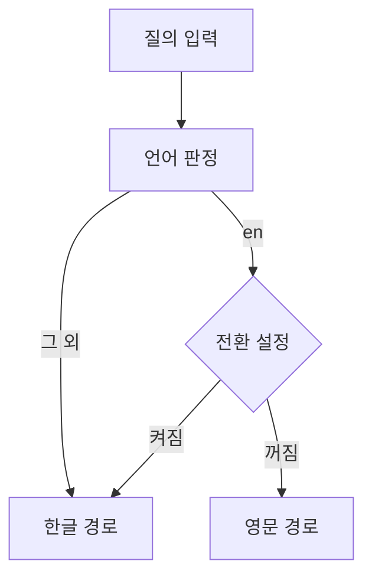

## 문제와 배경

작은 FastAPI 서비스 하나가 외부 소유의 Elasticsearch 클러스터 위에서 문서 검색 기능을 목업 대신 실데이터로 연동하는 중이었습니다. 검색 질의를 만드는 로직은 이 서비스가 기대고 있는 원 시스템(같은 문서 집합을 서비스하는 기존 검색 시스템)의 것을 그대로 포팅했습니다. 원 시스템은 질의 언어를 판정해 한국어면 한글 형태소 분석기(공개 Elasticsearch Nori 플러그인)와 한글 필드를, 영어면 영문 분석기와 영문 필드를 쓰도록 나뉘어 있었습니다.

포팅하면서 걸린 것은 분석기가 아니라 집합의 구성이었습니다. 이 서비스가 다루는 문서는 대부분 한국어로 쓰였으므로, 영문 질의를 영문 분석기와 영문 필드로만 찾으면 대부분의 문서를 처음부터 놓치게 됩니다. 원 시스템에서는 영문 경로가 영어 문서 비중만큼 몫을 하지만, 이 서비스에서는 영문 경로를 따로 유지할 이득이 작다고 판단했습니다.

이 글은 그 상황에서 내린 두 가지 결정을 정리합니다. 하나는 영문 질의를 영어 경로 대신 한글 경로로 보내는 라우팅 결정이고, 다른 하나는 같은 작업에서 같이 들어온 하이브리드(키워드 + kNN 벡터) 검색을 실패에 안전하게 만드는 구현입니다. 코드는 이 글을 위해 새로 쓴 예시이며, 그대로 실행해 보지는 않았습니다.

## 접근

아래는 질의가 들어왔을 때 언어 경로를 고르는 흐름입니다.



질의 자체를 만드는 모듈은 원 시스템과 동일하게 유지했습니다. 바뀐 것은 그 앞단, 언어를 판정한 뒤 어느 경로로 보낼지 정하는 한 줄뿐입니다. 판정 결과가 `en`이고 전환 설정이 켜져 있으면 한글 경로로 바꿔치기합니다. 이렇게 분리해 둔 이유는 두 가지입니다.

| 선택 | 얻는 것 | 잃거나 주의할 것 |
|---|---|---|
| 질의 생성 로직은 원 시스템과 동일하게 유지 | 원 시스템의 변경을 그대로 반영할 수 있고, 회귀가 한 곳에서만 생김 | 이 서비스만의 보정(언어 전환)을 질의 생성 쪽에 못 넣음 |
| 언어 전환은 질의 생성 바깥, 설정값 하나로 분리 | 전환을 끄면 즉시 원 시스템과 같은 동작으로 되돌릴 수 있음 | 전환 자체가 또 하나의 암묵 규칙이라, 왜 켜져 있는지 코드만 봐서는 안 드러남(주석 필요) |

## 구현

### 핵심 코드

언어 판정과 전환은 분리된 함수 하나로 충분했습니다.

```python
# search_routing.py
def resolve_language(query: str, force_korean_for_english: bool) -> str:
    """질의 언어를 판정하고, 설정이 켜져 있으면 영문 질의를 한글 경로로 돌립니다."""
    lang = detect_language(query)
    if lang == "en" and force_korean_for_english:
        return "ko"
    return lang
```

하이브리드 검색을 쓸지는 질의 길이와 언어로 정했습니다. 라틴 문자 기준 단어 수, 한글·한자 기준 글자 수로 임계값을 따로 둔 것은 공백으로 단어를 나눌 수 없는 언어가 있기 때문입니다.

```python
# hybrid_decision.py
MIN_WORDS_LATIN = 3
MIN_CHARS_CJK = 4

def should_try_hybrid(query: str, lang: str, hybrid_enabled: bool) -> bool:
    if not hybrid_enabled:
        return False
    if lang in ("ko", "ja"):
        return len(query.replace(" ", "")) >= MIN_CHARS_CJK
    return len(query.split()) >= MIN_WORDS_LATIN
```

임계값을 넘겨도 임베딩이 실패하면 키워드 검색으로 조용히 내려가야 했습니다. 임베딩 서버(공개 Text Embeddings Inference 류의 서버 가정)는 세 가지 응답 모양 중 하나를 주고, 연결 실패·시간 초과·차원 불일치는 모두 같은 실패로 취급했습니다.

```python
# embedding_client.py
class EmbeddingClient:
    def __init__(self, url: str, dims: int, timeout: float = 10.0,
                 connect_timeout: float = 2.0, cooldown: float = 60.0) -> None:
        self._url = url
        self._dims = dims
        self._cooldown = cooldown
        self._blocked_until = 0.0

    async def embed(self, text: str) -> list[float] | None:
        if not self._url or time.monotonic() < self._blocked_until:
            return None
        try:
            response = await self._client.post(self._url, json={"inputs": text})
            response.raise_for_status()
            vector = parse_vector(response.json())
        except (HttpError, ValueError):
            return self._fail()
        if vector is None or len(vector) != self._dims:
            return self._fail()
        return vector

    def _fail(self) -> None:
        self._blocked_until = time.monotonic() + self._cooldown
        return None
```

실패 뒤 일정 시간 동안 아예 호출하지 않는 쿨다운을 둔 이유는, 임베딩 서버가 내려가 있는 동안 질의마다 연결 시간 초과를 새로 기다리게 하지 않기 위해서입니다. `connect_timeout`을 `timeout`보다 짧게 둔 것도 같은 이유입니다. 서버가 아예 응답하지 않을 때 연결 단계에서 빨리 포기해야, 검색 요청 하나가 임베딩 때문에 오래 묶이지 않습니다.

## 함정과 트레이드오프

| 생길 수 있는 증상 | 원인 |
|---|---|
| 영문 질의가 대부분의 문서를 놓침 | 대상 문서가 대부분 한국어라 영문 경로의 분석기·필드가 맞는 문서를 찾지 못함 |
| 하이브리드 검색 점수가 이상하게 섞임 | 질의 임베딩을 색인 때 쓴 모델과 다른 서버로 만듦 |
| 임베딩 서버 장애 중에도 매 요청이 느려짐 | 실패 후 쿨다운 없이 매번 재시도해 연결 시간 초과를 새로 기다림 |

두 번째 행은 별도로 짚어 둘 만합니다. 벡터 검색은 질의와 문서를 같은 임베딩 모델로 같은 공간에 투영했다는 전제 위에서 동작합니다(Elasticsearch의 근사 kNN 검색은 이 전제를 문서화하고 있습니다). 질의 쪽만 다른 모델로 임베딩하면 예외 없이 요청은 성공하지만, 두 벡터가 가리키는 의미 공간이 다르므로 코사인 유사도가 사실상 무작위에 가깝게 나옵니다. 이는 공식 계약이 아니라 임베딩 모델의 일반적인 성질에서 나오는 추론이고, 실패처럼 보이지 않아 알아채기 더 어렵습니다.

영문 질의를 한글 경로로 통일한 결정에도 대가가 있습니다.

| 선택 | 얻는 것 | 잃는 것 |
|---|---|---|
| 언어별 경로 유지(원 시스템과 동일) | 영어로 쓰인 문서·질의에 최적화된 결과 | 희귀한 영어 경로를 별도로 유지하는 비용, 이 서비스 집합에서는 이득이 작음 |
| 영문 질의를 한글 경로로 통일 | 분석기 한 벌만 관리, 절대다수인 한국어 문서에서 결과가 안정적 | 영어로 쓰인 문서를 영어 그대로 찾는 질의의 정확도는 떨어질 수 있음 |

이 트레이드오프는 집합의 언어 구성이 바뀌면 다시 따져야 합니다. 영어 문서 비중이 늘어나는 방향으로 수집 대상이 바뀐다면, 전환 설정을 끄는 것만으로 원 시스템과 같은 언어별 분기로 되돌릴 수 있도록 설계해 둔 것이 그래서입니다.

원래 문서 매칭의 검색 호출 예산((4)편)은 키워드 검색만 쓴다는 전제로 정한 값입니다. 같은 클러스터에 kNN 질의까지 보내기 시작했다면, 예산도 그 비용을 반영해 다시 정해야 합니다.

## 정리

- 언어별로 분석기·필드를 나누는 설계는 두 언어의 문서가 고르게 섞여 있다는 전제를 깔고 있습니다. 집합이 한쪽 언어로 치우쳐 있으면, 질의 언어가 아니라 **문서 집합의 언어 구성**을 기준으로 경로를 고르는 편이 결과가 안정적입니다.
- 질의를 만드는 로직 자체는 원 시스템과 동일하게 두고, 언어를 고르는 한 지점만 설정값으로 분리해 두면 전환을 끄는 것만으로 원래 동작으로 되돌릴 수 있습니다.
- 하이브리드 검색은 임베딩 실패를 예외가 아니라 `None`으로 돌려받는 계약으로 설계해, 호출부가 항상 키워드 검색으로 내려갈 수 있게 했습니다. 실패 뒤에는 쿨다운을 둬 장애 중 연결 대기가 매 요청에 반복되지 않게 했습니다.
- 질의 임베딩과 색인 임베딩이 다른 모델에서 나오면 요청은 성공하지만 유사도 점수는 사실상 의미가 없어집니다. 이 실패는 응답 코드로 드러나지 않으므로, 임베딩 서버 주소가 색인 때 쓴 모델과 같은지는 별도로 확인해야 합니다.
