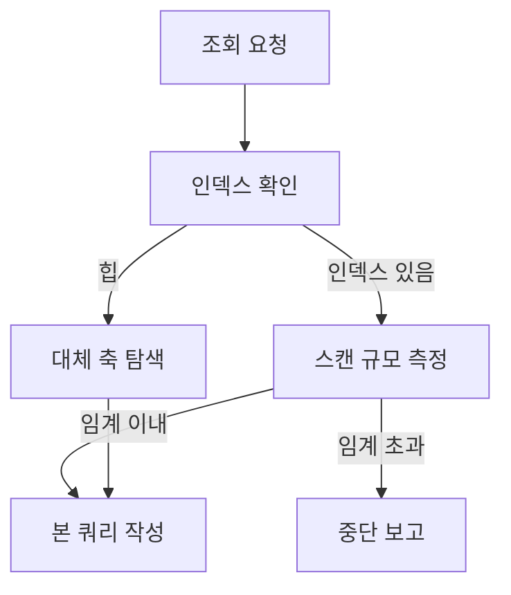

## 문제와 배경

운영 SQL Server에서 조건에 맞는 사용자 목록을 큰 범위로 뽑아 달라는 요청을 받았습니다. 조건 자체는 단순했고, 쿼리 한 줄로 끝날 것처럼 보였습니다. 그런데 실행 전에 대상 테이블의 구조를 확인하면서, 생각보다 많은 테이블이 클러스터드 인덱스 없는 힙(heap)이라는 사실을 알게 됐습니다. 기본 키(PRIMARY KEY)는 있었지만 그 키는 비클러스터드였고, 테이블 자체는 힙이었습니다.

힙 테이블에서는 `MAX()`나 `TOP 1 ORDER BY`처럼 가벼워 보이는 문장도 전체 스캔입니다. 운영 서비스가 같은 테이블에 쓰기를 계속하는 시간대에 이런 쿼리를 던지면, 조회 쪽은 느려지는 정도로 끝나지 않고 쓰기 경로까지 끌어들일 수 있습니다. 이 조회는 한 번만 쓰고 버리는 코드가 아니라, 실행하는 사람이 그대로 믿고 돌리는 산출물입니다. 그래서 "부하가 걸릴 수 있습니다"라는 코멘트 한 줄로 책임을 넘기지 않고, 실행 전에 실제로 확인할 항목을 정리해 두기로 했습니다.

## 접근: 넘기기 전에 무엇을 확인하는가

아래는 대량 조회 쿼리를 작성할 때 거치는 판단 순서입니다.



확인 순서는 두 갈래로 갈립니다. 대상 테이블이 힙이면 그 조건을 그대로 쓰는 대신, 다른 테이블에서 선두 키로 쓸 수 있는 축을 먼저 찾아 대상 목록을 좁힙니다. 인덱스가 있는 조건이면 본 쿼리를 쓰기 전에 건수부터 재서, 예상보다 큰 범위면 쿼리를 작성하지 않고 그 사실부터 알립니다.

실제 작업에서 자주 어긋난 항목은 두 가지였습니다.

| 항목 | 확인하는 것 | 어긋났을 때 벌어지는 일 |
|---|---|---|
| 대상에 인덱스가 있는가 | 형상 DDL에서 `PRIMARY KEY`와 별도로 `CREATE CLUSTERED INDEX`가 있는지 | 기본 키만 보고 인덱스가 있다고 오판하면, 힙 전체 스캔을 그대로 넘기게 됩니다 |
| 스캔 규모를 먼저 재는가 | 본 쿼리 전에 `COUNT(*)`로 범위를 먼저 확인 | 규모를 모른 채 본 쿼리부터 던지면, 실행 중에야 범위를 알게 됩니다 |
| 정확값인가 근사치인가 | 카탈로그 뷰의 행수 컬럼은 대개 통계 기반 근사치 | 컬럼 이름만 보고 정확한 건수로 오인하게 됩니다 |
| 병렬 CPU를 제한했는가 | `OPTION (MAXDOP n)`으로 병렬도를 낮췄는지 | 운영 서비스가 쓰는 CPU를 조회 쿼리가 병렬로 끌어다 씁니다 |

이 가운데 사전 측정 문장 자체가 무거우면 "먼저 재기"는 의미가 없습니다. 커버링 인덱스만으로 끝나는 `COUNT(*)`를 앞에 두고, 상세 분포는 규모를 확인한 뒤로 미뤘습니다.

## 구현: 사전 측정과 실행 가드를 쿼리 구조로 고정

### 핵심 코드

아래는 이 글을 위해 새로 쓴 최소 예시입니다. 테이블·컬럼 이름은 모두 일반화했고, 실제 운영 스크립트를 그대로 옮긴 것은 아닙니다.

```sql
-- 0단계: 사전 측정. 문장마다 GO로 분리해 따로 실행하고, 결과를 먼저 확인한다.
SELECT COUNT(*) AS target_count
FROM dbo.CustomerProfile
WHERE region_code = @regionCode;
-- 이 값이 50000을 넘으면 본 쿼리를 작성하지 말고 범위부터 다시 논의한다
GO

-- 본 쿼리: 사전 측정을 확인했다는 표시(@confirmed)가 없으면 실행을 막는다
DECLARE @confirmed BIT = 0; -- 실행자가 사전 측정 결과를 확인한 뒤 1로 바꾼다

IF @confirmed = 0
BEGIN
    RAISERROR('사전 측정 결과를 확인한 뒤 @confirmed를 1로 바꾸고 실행하십시오.', 16, 1);
    RETURN;
END

CREATE TABLE #TargetCustomer (
    customer_id BIGINT NOT NULL PRIMARY KEY,
    region_code NVARCHAR(10) COLLATE DATABASE_DEFAULT -- tempdb 기본 정렬 규칙과 충돌 방지
);

INSERT INTO #TargetCustomer (customer_id, region_code)
SELECT DISTINCT customer_id, region_code -- NOLOCK 읽기 중 중복 적재 방지
FROM dbo.CustomerProfile WITH (NOLOCK)
WHERE region_code = @regionCode;

SELECT COUNT(*) AS staged_count FROM #TargetCustomer; -- 단계별 건수 확인

IF (SELECT COUNT(*) FROM #TargetCustomer) > 50000
BEGIN
    RAISERROR('대상 건수가 임계를 넘었습니다. 조건을 좁혀 다시 실행하십시오.', 16, 1);
    DROP TABLE #TargetCustomer;
    RETURN;
END

SELECT c.customer_id, o.order_id
FROM #TargetCustomer c
JOIN dbo.OrderHeader o WITH (NOLOCK) ON o.customer_id = c.customer_id
OPTION (MAXDOP 2); -- 운영 CPU를 병렬로 끌어 쓰지 않도록 제한

DROP TABLE #TargetCustomer;
```

가드와 중간 건수 출력은 선택이 아니라 구조의 일부로 넣었습니다. `@confirmed` 검사는 사전 측정을 건너뛴 실행을 막고, 단계별 건수는 결과가 기대와 다를 때 어느 조건에서 빠졌는지를 재실행 없이 짚을 수 있게 해 줍니다. 임시 테이블 컬럼에 `COLLATE DATABASE_DEFAULT`를 붙인 것은 세션 정렬 규칙이 tempdb 기본값과 다를 때 나는 오류를 피하기 위해서이고, `NOLOCK`으로 읽어 적재할 때 `DISTINCT`를 둔 것은 인덱스 키 이동 중 같은 행이 두 번 읽혀 기본 키 충돌로 적재가 멈추는 상황을 막기 위해서입니다. `WITH (INDEX(...))` 같은 인덱스 강제 힌트는 쓰지 않았습니다. 운영 인덱스 이름이 형상과 달라지면 그 힌트 자체가 오류로 실행을 막기 때문입니다.

## 함정과 트레이드오프

| 선택 | 얻는 것 | 잃거나 주의할 것 |
|---|---|---|
| 사전 측정을 별도 GO 블록으로 분리 | 본 쿼리 실행 전에 범위를 사람이 직접 판단할 수 있음 | 작성자와 실행자가 분리된 환경에서만 의미가 있음(혼자 바로 실행한다면 번거로움만 늘어남) |
| `@confirmed` 가드로 실행 막기 | 사전 측정을 건너뛴 실행을 구조적으로 차단함 | 가드 자체를 주석 처리하고 넘기면 무력화되므로, 리뷰에서 가드 유무를 따로 확인해야 함 |
| `MAXDOP`로 병렬도 제한 | 조회 쿼리가 운영 CPU를 독점하지 않음 | 쿼리 자체의 실행 시간은 늘어날 수 있음 |
| 힙 조건을 다른 축으로 우회 | 전체 스캔을 피함 | 우회에 쓸 선두 키가 있는 테이블을 먼저 찾아야 하고, 없으면 이 방법 자체가 성립하지 않음 |

이 점검표는 어떤 업무에도 매여 있지 않습니다. 사용자 목록 추출이든 정산 대조든 장애 조사든, 운영 테이블을 크게 읽는 조회라면 같은 순서를 적용할 수 있습니다. 다만 대상이 이미 작다면(수백 건 이하) 구간을 나누거나 가드를 겹겹이 두는 일이 오히려 과합니다. 이 구조는 대상 규모가 불확실하거나 큰 경우에 맞춘 것입니다.

## 정리

- 기본 키가 있다는 사실만으로 "인덱스가 있다"고 판단하지 않습니다. 클러스터드 인덱스가 따로 없으면 그 테이블은 힙이고, 가벼워 보이는 집계 함수도 전체 스캔이 됩니다.
- 본 쿼리를 쓰기 전에 가벼운 `COUNT(*)`로 범위부터 잽니다. 사전 측정 문장 자체가 무거우면 먼저 재는 의미가 없으므로, 커버링 인덱스로 끝나는 문장을 고릅니다.
- 사전 측정 → 실행 가드 → 단계별 건수 출력 순서를 쿼리 구조로 고정하면, 다음에 비슷한 요청이 와도 같은 실수를 반복하지 않습니다.
- 작성자와 실행자가 분리된 환경에서는, 실행자가 혼자 판단할 수 있을 만큼 쿼리에 주석이 붙어 있어야 합니다.
