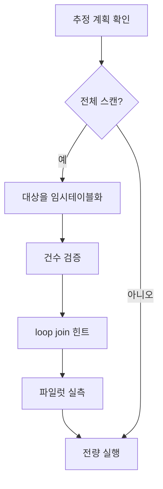

## 문제와 배경

[이전 글](/blog/2026/04/06/prod-db-heavy-query-checklist.html)에서는 대량 조회를 던지기 전에 추정 실행 계획부터 확인하자고 정리했습니다. 이번 글은 그 점검에서 실제로 걸린 사례입니다. 조건만 보면 몇천 건 규모의 조회인데, 추정 실행 계획에 `Clustered Index Scan`이 잡히고 추정 비용이 수천 단위로 나왔습니다.

```text
PhysicalOp="Clustered Index Scan"  EstimatedRowsRead=<테이블 전체 행 수>
EstimateIO=5818.36  StatementSubTreeCost=5834.98
```

실행 계획의 `MissingIndexes` 항목에는 조건으로 쓴 컬럼 조합이 그대로 권고로 올라와 있었습니다. 이 권고는 "지금 인덱스로는 이 조건을 못 찾는다"는 진단과 같습니다.

원인은 두 가지였습니다. 하나는 조건으로 쓴 컬럼이 테이블에 걸린 어느 인덱스의 선두 키에도 없었다는 것이고, 다른 하나는 대상 목록을 CTE로 미리 좁혀도 옵티마이저가 그 효과를 보지 못했다는 것입니다. 테이블에는 인덱스가 네 개 있었지만, 조건으로 쓴 두 컬럼은 포함 열(INCLUDE)로도 걸려 있지 않았습니다.

| 인덱스 | 구성 |
|---|---|
| `pk_record` | CLUSTERED (`record_id`) |
| `idx_entity_id` | (`entity_id`) INCLUDE(`content_id`) |
| `idx_content_id` | (`content_id`) INCLUDE(`entity_id`) |
| `idx_content_status` | (`content_id`, `approval_status`, `is_deleted`) |

INCLUDE 컬럼은 커버링 인덱스에는 쓰이지만 탐색의 시작점은 되지 못합니다. 선두 키가 아니면 seek의 출발점이 될 수 없다는 점은 이 테이블에서도 그대로 적용됐습니다.

## 접근

대상 목록을 CTE로 뽑아 조인하면 조건을 먼저 좁힌 뒤 조인한다고 생각하기 쉽지만, CTE는 참조하는 자리에 인라인으로 펼쳐지므로 옵티마이저는 `DISTINCT`를 적용하기 전 행 수로 카디널리티를 추정합니다. 실제 대상 건수는 그보다 훨씬 적었는데도, 옵티마이저는 실제보다 훨씬 큰 값으로 추정해 loop seek 대신 해시 조인과 전체 스캔을 골랐습니다(SQL Server 카디널리티 추정기의 공개 동작 — CTE·서브쿼리 인라인 확장에 관한 설명은 Microsoft 공식 문서 "Cardinality Estimation (SQL Server)"에 있습니다). 아래는 이 상황을 바로잡는 흐름입니다.



해법은 대상 목록을 세션 임시 테이블로 먼저 구체화하는 것입니다. 임시 테이블에 결과를 적재하면 실제 규모가 고정되고, 거기에 클러스터드 인덱스를 만들면 통계가 생겨 옵티마이저가 그 규모를 근거로 추정할 수 있습니다. CTE와 달리 임시 테이블은 인라인 확장되지 않으므로, 조인 상대 쪽에서 봤을 때 비로소 "작은 쪽"으로 인식됩니다.

## 구현

### 핵심 코드

1단계는 대상을 구체화하고 건수를 확인하는 것입니다. 건수 확인이 검증 지점입니다 — 기대와 다르면 여기서 멈추고 조건을 다시 봐야 합니다.

```sql
IF OBJECT_ID('tempdb..#target') IS NOT NULL DROP TABLE #target;

SELECT DISTINCT m.entity_id
  INTO #target
  FROM dbo.target_log_table m WITH (NOLOCK)
 WHERE m.batch_date = '20260408';   -- 선두 키로 좁히는 조건

CREATE UNIQUE CLUSTERED INDEX ix_target ON #target(entity_id);

SELECT COUNT(*) AS target_count FROM #target;
```

세션 임시 테이블은 연결이 끊기면 사라지므로, 2단계는 반드시 같은 연결에서 이어서 실행해야 합니다.

```sql
SELECT COUNT(*) AS row_count,
       COUNT(DISTINCT r.entity_id) AS entity_count
  FROM #target t
 INNER LOOP JOIN dbo.main_table r WITH (NOLOCK, INDEX(idx_entity_id))
    ON r.entity_id = t.entity_id
 WHERE r.updated_at   >= '2026-04-08T00:00:00'
   AND r.updated_by  <> 'batch_job'
OPTION (MAXDOP 1);
```

`INNER LOOP JOIN`과 `INDEX(...)` 힌트는 둘 다 필요합니다. 하나만 주면 옵티마이저가 다시 해시 조인과 전체 스캔으로 돌아갈 여지가 남습니다. key lookup 자체는 사라지지 않습니다 — 조건 컬럼이 인덱스에 없으니 피할 수 없고, 대상이 수천 건 규모라면 피할 필요도 없습니다. 전체 스캔보다 key lookup 수천 번이 훨씬 쌉니다. `MAXDOP 1`은 운영 부하를 줄이려는 선택이며, loop seek는 직렬로도 충분히 빠릅니다.

실행 전 절차는 다음 순서를 지켰습니다.

| 단계 | 하는 일 | 중단 기준 |
|---|---|---|
| 1 | 추정 실행 계획만 먼저 확인 | 전체 스캔 + 큰 추정 행 수면 실행하지 않음 |
| 2 | 대상을 임시 테이블로 구체화하고 건수 확인 | 기대값과 다르면 멈춤 |
| 3 | 전체 중 일부만 떼어 파일럿 실행 | 환산 소요가 감당 범위를 넘으면 분할·중단 |
| 4 | 전량 실행 | — |

파일럿은 임시 테이블에 `TOP N`을 씌워 만듭니다.

```sql
SELECT r.entity_id
  FROM (SELECT TOP 1000 entity_id FROM #target ORDER BY entity_id) t
```

실행 시간 측정 옵션을 켜 두면 파일럿 소요를 바로 확인할 수 있습니다. 이 사례에서는 1,000건짜리 파일럿이 1초 미만에 끝났고, 전량 실행도 9초 안쪽에 끝났습니다. 대체안의 추정 비용은 원안보다 낮았지만 그래도 낮지 않은 수준이었습니다. 추정만 보고 포기했다면 실행 가능한 경로를 버렸을 것이고, 그래서 3단계 파일럿이 필요합니다 — 판정은 추정이 아니라 실측으로 합니다.

| 구분 | 추정 | 실제 |
|---|---|---|
| 원안 (CTE 인라인) | 전체 스캔, 높은 비용 | 실행하지 않음 |
| 대체안 (임시 테이블 + loop seek) | key lookup 다수, 중간 비용 | 파일럿·전량 모두 수 초 내 완료 |

## 함정과 트레이드오프

| 선택 | 얻는 것 | 잃거나 주의할 것 |
|---|---|---|
| 대상을 임시 테이블로 구체화 | 실제 규모로 추정이 맞춰짐, loop seek 유도 가능 | 임시 테이블 생성·인덱스 생성 비용이 추가됨 |
| `INNER LOOP JOIN` + `INDEX` 힌트 강제 | 옵티마이저가 다시 전체 스캔을 고르는 것을 막음 | 힌트는 조건이 바뀌어도 그대로 남아, 나중엔 오히려 손해가 될 수 있음 |
| 파일럿으로 먼저 실측 | 추정 비용만 보고 포기하지 않음 | 파일럿 결과가 전량에 선형으로 이어진다는 보장은 없음 |
| 반복 조회에도 이 패턴을 계속 씀 | 인덱스 변경 없이 당장 해결 | 반복되는 조회라면 인덱스 추가가 더 맞는 선택 |

이 패턴은 인덱스를 당장 추가할 수 없거나 일회성 점검일 때의 회피책입니다. 같은 조건의 조회가 반복된다면 `MissingIndexes` 권고를 검토해 인덱스를 추가하는 편이 낫습니다. 다만 운영 테이블에 인덱스를 더하는 것은 쓰기 비용과 저장 공간을 늘리므로, 일회성 점검에는 임시 테이블 패턴을, 반복 조회에는 인덱스 추가를 택하는 것이 기준입니다.

## 정리

- 조건 컬럼이 인덱스 선두 키에 없으면, INCLUDE로 걸려 있어도 실행 계획은 전체 스캔으로 떨어집니다.
- CTE로 대상을 좁혀도 인라인 확장 때문에 옵티마이저는 축소 전 행 수로 추정합니다. 실제 규모를 고정하려면 임시 테이블처럼 물리적으로 구체화해야 합니다.
- 임시 테이블에 클러스터드 인덱스를 만들고 `INNER LOOP JOIN` + `INDEX` 힌트를 같이 줘야 seek가 강제됩니다. 하나만 주면 다시 전체 스캔으로 돌아갈 수 있습니다.
- 추정 비용은 과대평가일 수 있으므로, 전체 실행 전에 일부만 떼어 실측하고 그 결과로 판단합니다.
- 반복되는 조회라면 이 회피책 대신 인덱스 추가를 검토합니다.
