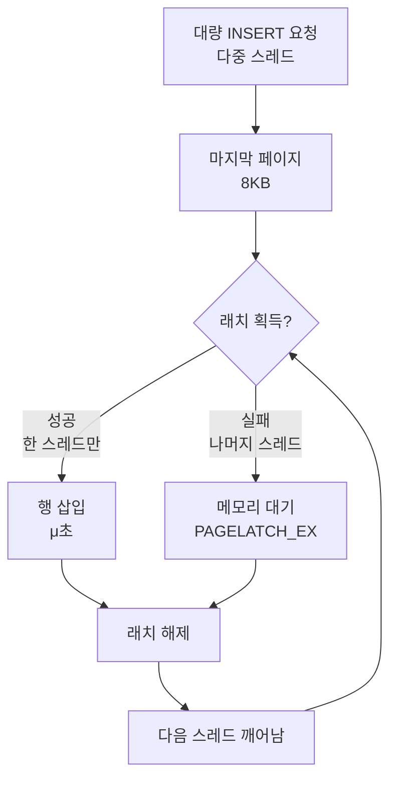

## 문제와 배경

여러 배치 작업이나 실시간 수집 시스템이 같은 테이블에 대량으로 INSERT를 던질 때, 운영 DB에서 순간적이지만 심각한 성능 저하가 발생할 수 있습니다. 특히 기본 키가 IDENTITY나 Sequence 같은 증가하는 키로 설정된 테이블에서 이 문제는 두드러집니다. 운영 중인 시스템에서는 이 현상이 15초 이상 지속되는 블로킹으로만 드러나는데, 로그를 보면 PAGELATCH_EX(쓰기 래치)나 PAGELATCH_SH(읽기 래치) 대기 타입이 반복적으로 기록됩니다.

이 글은 왜 증가 키 테이블에서 이런 경합이 발생하는지, SQL Server의 물리적 저장 구조 관점에서 설명하고, 인덱스 옵션과 실시간 감시 체계로 이 문제에 대응하는 방법을 다룹니다.

## 핵심 원리: 페이지와 래치

SQL Server가 데이터를 관리하는 물리적 구조를 이해하려면 두 가지 개념을 알아야 합니다.

**페이지(Page)**: SQL Server가 디스크와 메모리 간에 데이터를 주고받는 최소 단위입니다. 모든 페이지는 정확히 8KB 크기로 고정됩니다. 데이터를 저장하는 것을 "노트에 글을 쓴다"고 생각하면, 페이지는 그 노트의 "한 장"에 해당합니다. 한 장이 꽉 차면 다음 장으로 넘어갑니다.

**래치(Latch)**: 메모리에 로드된 페이지를 여러 스레드가 동시에 접근할 때 데이터의 물리적 무결성을 지키기 위해 순간적으로 거는 잠금 장치입니다. 트랜잭션 수준의 일관성을 보호하는 Lock(잠금)과 달리, 래치는 SQL Server 엔진이 내부적으로 메모리 구조를 보호하는 수단입니다.

래치의 주요 유형은 다음 두 가지입니다.

| 래치 유형 | 발생 시점 | 특징 |
|---|---|---|
| PAGELATCH_EX (배타적) | INSERT/UPDATE/DELETE 시 | 한 스레드만 소유, 다른 스레드는 대기 |
| PAGELATCH_SH (공유) | SELECT 시 | 여러 스레드가 동시 읽기 가능, 쓰기가 나타나면 대기 |

## 증가 키에서의 경합 메커니즘

IDENTITY 또는 Sequence 기반의 증가 키를 클러스터된 기본 키로 사용하면, 모든 신규 행이 인덱스의 맨 마지막 페이지(8KB)에 집중적으로 저장됩니다. 100개 스레드가 동시에 INSERT를 시도하는 상황을 생각해보면:

1. 스레드 1이 마지막 페이지에 배타적 래치를 획득하고 행 하나를 삽입합니다 (수 마이크로초).
2. 나머지 99개 스레드는 래치를 얻지 못해 메모리에서 대기합니다.
3. 스레드 1이 완료하면 대기 중인 스레드 중 하나가 깨어나 래치를 획득합니다.
4. 이 과정을 100번 반복합니다.

부하가 높을 때는 래치를 획득하고 해제하는 스케줄링 오버헤드만으로도 CPU에 상당한 부담이 됩니다. 읽기 작업이 많은 환경에서는 한 스레드의 쓰기(EX 래치)가 수많은 조회 스레드의 읽기(SH 래치)까지 함께 블로킹합니다.

아래 흐름도는 INSERT 중 발생하는 래치 경합 상황을 보여줍니다.



## 모니터링: Watchdog 시스템

블로킹을 조기에 감지하지 못하면 어느 순간 갑자기 응답 시간이 폭증합니다. 운영 DB에서는 15초 이상 지속되는 블로킹을 자동으로 감시하는 Watchdog 시스템을 구축합니다.

### Watchdog 로그 테이블 생성

```sql
CREATE TABLE dbo.TB_Blocking_Log (
    LogID INT IDENTITY(1,1) PRIMARY KEY,
    LogDate DATETIME DEFAULT GETDATE(),
    Blocked_SPID INT,
    Blocking_SPID INT,
    Wait_Time_Sec DECIMAL(10,2),
    Wait_Type NVARCHAR(60),
    Blocked_Query NVARCHAR(MAX),
    Blocking_Query NVARCHAR(MAX),
    Program_Name NVARCHAR(100)
);
```

### SQL Agent Job으로 실시간 감시

이 쿼리를 SQL Server Agent Job으로 등록하고 1분 주기로 실행합니다.

```sql
INSERT INTO dbo.TB_Blocking_Log
(Blocked_SPID, Blocking_SPID, Wait_Time_Sec, Wait_Type,
 Blocked_Query, Blocking_Query, Program_Name)
SELECT
    req.session_id,
    req.blocking_session_id,
    req.wait_time / 1000.0 AS Wait_Time_Sec,
    req.wait_type,
    SUBSTRING(qt_blocked.text, (req.statement_start_offset/2)+1,
        ((CASE req.statement_end_offset
          WHEN -1 THEN DATALENGTH(qt_blocked.text)
          ELSE req.statement_end_offset END - req.statement_start_offset)/2) + 1),
    qt_blocking.text,
    ses.program_name
FROM sys.dm_exec_requests AS req WITH (NOLOCK)
INNER JOIN sys.dm_exec_sessions AS ses WITH (NOLOCK)
    ON req.blocking_session_id = ses.session_id
CROSS APPLY sys.dm_exec_sql_text(req.sql_handle) AS qt_blocked
OUTER APPLY (
    SELECT text FROM sys.dm_exec_connections c
    CROSS APPLY sys.dm_exec_sql_text(c.most_recent_sql_handle)
    WHERE c.session_id = req.blocking_session_id
) AS qt_blocking
WHERE req.blocking_session_id > 0
  AND req.wait_time > 15000;
```

이 쿼리는 **락에 의해 15초 이상 대기 중인 세션**만 기록합니다. DMV(Dynamic Management View)는 대부분 메모리에 있는 서버 상태를 보여 주므로, 1분 주기 감시 쿼리 자체의 부담은 작은 편입니다. 다만 이는 운영하며 관찰한 결과이고, 감시 주기를 더 촘촘하게 잡으면 다시 따져 봐야 합니다.

### Watchdog 로그 분석

로그가 쌓이기 시작하면 `Wait_Type` 컬럼을 확인합니다.

| Wait_Type | 의미 | 원인 | 대응 |
|---|---|---|---|
| PAGELATCH_EX | 쓰기 래치 대기 | 많은 스레드의 동시 INSERT | 인덱스 옵션 적용 |
| PAGELATCH_SH | 읽기 래치 대기 | INSERT 중 조회 스레드 블로킹 | 인덱스 옵션 적용 |
| LCK_M_* | 일반 잠금 | 트랜잭션 수준 경합 | 트랜잭션 범위 검토 |

## 해결책: OPTIMIZE_FOR_SEQUENTIAL_KEY

SQL Server 2019 이상에서는 순차적 키 삽입 시 래치 경합을 크게 개선하는 인덱스 옵션이 제공됩니다.

### 신규 테이블 생성 시

```sql
CREATE TABLE EventLog (
    EventID BIGINT IDENTITY(1,1) PRIMARY KEY CLUSTERED,
    EventDate DATETIME DEFAULT GETDATE(),
    EventData NVARCHAR(MAX)
) WITH (OPTIMIZE_FOR_SEQUENTIAL_KEY = ON);
```

### 운영 중인 테이블에 적용

사용자가 적은 시간대(새벽, 주말)에 적용합니다.

```sql
ALTER INDEX PK_EventLog ON EventLog
SET (OPTIMIZE_FOR_SEQUENTIAL_KEY = ON);
```

이 옵션은 대기 중인 스레드의 스케줄링 방식을 최적화해서, 래치를 획득하고 해제하는 오버헤드를 크게 줄입니다. 기본 쿼리나 테이블 구조는 변경하지 않으므로, 애플리케이션 코드 수정은 전혀 필요 없습니다.

## 장단점과 주의사항

| 선택 | 얻는 것 | 주의할 점 |
|---|---|---|
| OPTIMIZE_FOR_SEQUENTIAL_KEY 적용 | 래치 대기 시간 대폭 감소, 처리량 증가 | 적용 중 순간적 잠금 발생 가능, 저부하 시간에 적용 필요 |
| Watchdog 1분 주기 감시 | 블로킹 발생 즉시 감지, 원인 로깅 | 로그 테이블 정리 필요(30일 이전 자동 삭제) |
| 배치 크기 조정 | 동시 INSERT 스트림 분산 | 처리 시간 증가 가능 |

인덱스 옵션 적용 전에는 운영 중인 DB의 최대 동시 연결 수와 기존 커넥션 풀 설정을 함께 검토합니다. 옵션 적용은 물리적 저장 방식 내부 변경일 뿐이므로 애플리케이션 배포나 마이그레이션이 필요하지 않습니다.

## 정리

- 증가하는 키의 테이블에서 대량 INSERT 시 모든 신규 행이 마지막 페이지(8KB)에 집중돼 PAGELATCH 경합이 발생합니다.
- 페이지는 SQL Server의 디스크-메모리 최소 단위이고, 래치는 메모리 페이지의 물리적 무결성을 보호하는 순간적 잠금입니다.
- 15초 이상 블로킹을 감시하는 Watchdog 시스템으로 문제를 조기에 감지합니다.
- OPTIMIZE_FOR_SEQUENTIAL_KEY 인덱스 옵션으로 래치 대기 스케줄링을 최적화합니다.
- 옵션 적용은 사용자가 적은 시간대에 수행하고, 애플리케이션 변경은 필요하지 않습니다.
