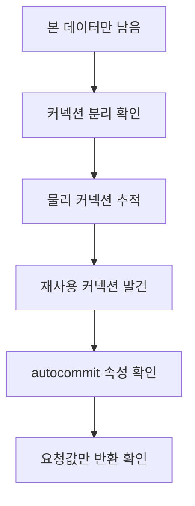

## 문제와 배경

MSSQL에 쓰는 Python 배치에서, 같은 처리 단위 안에 본 데이터 쓰기와 그 처리를 기록하는 이력·진행 상태 쓰기가 섞여 있었습니다. 둘은 서로 다른 커넥션으로, 서로 다른 트랜잭션으로 나가고 있었습니다.

100건을 적재한 실측에서 본 데이터 테이블에는 행이 전부 들어갔지만, 처리 이력 테이블과 진행 상태(워터마크) 테이블, 실행 종료 상태 테이블은 세 가지 모두 비어 있었습니다. 예외는 한 건도 없었고, 배치는 정상 종료로 끝났습니다. 쓰기 직후 돌린 되읽기 검증도 통과한 뒤였습니다.

## 접근: 사라진 쪽만 골라 사라지는 이유부터 좁힙니다

본 데이터는 남고 이력·상태만 사라졌다는 비대칭이 단서였습니다. 아래는 그 비대칭에서 원인을 좁혀 간 순서입니다.



본 데이터를 쓰는 커넥션은 명시적으로 `commit()`을 호출하고 있었고, 그 직후 이력·상태를 쓰는 커넥션은 autocommit 모드로 열고 있었습니다. 풀링을 켜 둔 상태라 커넥션 풀이 물리 커넥션을 재사용하는데, 그 물리 커넥션을 추적해 보니 두 요청이 같은 세션을 돌려받고 있었습니다. 문제는 거기서 시작됐습니다.

| 증상 | 확인한 사실 |
|---|---|
| 본 데이터는 남고 이력·상태만 사라짐 | 본 데이터 쓰기는 명시 커밋, 이력·상태 쓰기는 autocommit |
| 예외 없이 조용히 사라짐 | 암묵 트랜잭션 안에서 실행돼 커넥션 반환 시 롤백됨 |
| 되읽기 검증은 통과함 | 검증도 같은 프로세스라 같은 세션을 돌려받아 자기 미커밋을 봄 |

## 구현: 세션 설정을 비교 없이 되돌립니다

### 핵심 코드

ODBC 드라이버는 autocommit 끄기를 커넥션 객체의 속성이 아니라 세션 설정(암묵 트랜잭션 모드 켜기)으로 구현합니다. 풀이 같은 물리 세션을 돌려주면 그 설정이 그대로 남는데, 커넥션 래퍼 쪽 autocommit 속성은 세션의 실제 상태가 아니라 **connect() 호출에 넘긴 요청값을 그대로 돌려줄 뿐**입니다. 그래서 요청값과 속성값을 비교해 다를 때만 재설정하는 방식은 절대 발동하지 않습니다.

```python
# 틀린 교정: conn.autocommit 은 요청값을 그대로 돌려주므로 이 비교는 늘 거짓이다
if bool(conn.autocommit) != bool(autocommit):
    conn.autocommit = autocommit
```

반대값을 한 번 거쳐 대입해야 드라이버가 세션의 자동 커밋 속성을 실제로 재설정합니다. 비교를 버리고 매 연결마다 무조건 실행합니다.

```python
import pyodbc

def connect(dsn: str, autocommit: bool) -> pyodbc.Connection:
    conn = pyodbc.connect(dsn, autocommit=autocommit)
    # 비교하지 않고 무조건 반대값 -> 목표값 순으로 재설정한다.
    # 풀이 물려준 이전 세션의 트랜잭션 모드를 지우는 것이 목적이다.
    conn.autocommit = not autocommit
    conn.autocommit = autocommit
    if autocommit:
        cur = conn.cursor()
        cur.execute("SELECT @@TRANCOUNT")
        if int(cur.fetchone()[0]) != 0:
            # 세션에 열린 트랜잭션이 남아 있다는 뜻이다. 여기서 쓰기 전에 죽는 편이
            # 쓰고 나서 조용히 사라지는 것보다 낫다.
            raise RuntimeError("autocommit 재설정 실패: 세션에 열린 트랜잭션이 남아 있습니다")
    return conn
```

되읽기 검증은 같은 함정을 한 번 더 가지고 있었습니다. 검증 코드가 같은 프로세스의 새 커넥션으로 읽었는데, 풀이 그 커넥션에도 같은 물리 세션을 돌려주었습니다. 그러면 검증은 자기 자신이 아직 커밋하지 않은 행을 보고 "있다"고 판정합니다. 별도 프로세스로 읽는 순간 그 행은 사라져 있었습니다.

```python
# 틀린 검증: 같은 프로세스의 새 커넥션은 풀링 때문에 같은 세션일 수 있다
def verify_in_process(dsn: str, key: str) -> bool:
    with connect(dsn, autocommit=True) as conn:
        cur = conn.cursor()
        cur.execute("SELECT 1 FROM history_log WHERE job_key = ?", key)
        return cur.fetchone() is not None

# 맞는 검증: 별도 프로세스를 띄워 묻는다
def verify_out_of_process(dsn: str, key: str) -> bool:
    import subprocess
    result = subprocess.run(
        ["python", "verify_worker.py", dsn, key],
        capture_output=True, timeout=30,
    )
    return result.returncode == 0
```

### 근본 조치: 갈라질 수 있는 쓰기를 한 트랜잭션으로 묶기

autocommit 재설정은 증상을 막지만, 더 근본적인 문제는 본 데이터 쓰기와 이력·상태 쓰기가 애초에 서로 다른 트랜잭션이었다는 점입니다. 같은 DB 안에 있다면 둘을 한 트랜잭션으로 묶으면 "본 데이터는 있는데 이력이 없는" 상태 자체가 성립하지 않습니다. 커넥션 수도 줄어 풀링을 다시 켤 여지가 생깁니다.

## 함정과 트레이드오프

| 선택 | 얻는 것 | 잃거나 주의할 것 |
|---|---|---|
| 커넥션 풀링을 끈다 | 세션이 섞이지 않아 증상이 바로 멈춤 | 매 연결마다 핸드셰이크가 붙어, 같은 100건 기준 풀링을 켰을 때 약 6분이던 처리가 풀링을 끄자 19분을 넘겨 3배 이상 늘어났습니다 |
| connect()에서 autocommit을 무조건 재설정 | 풀링을 켠 채로 세션 오염을 막음 | 연결마다 왕복이 한 번 늘고, `@@TRANCOUNT` 확인 분기를 테스트로 고정해 두지 않으면 조용히 다시 죽은 코드가 될 수 있음 |
| 본 데이터·이력 쓰기를 한 트랜잭션으로 묶음 | 두 쓰기가 갈라지는 상태가 구조적으로 불가능해짐 | 트랜잭션이 커지는 만큼 잠금 범위도 늘어나므로, 처리 단위 크기를 함께 조정해야 함 |
| 되읽기 검증을 별도 프로세스로 돌림 | 자기 미커밋 트랜잭션을 보는 오탐을 없앰 | 프로세스 기동 비용이 붙으므로 건마다가 아니라 처리 단위마다 한 번으로 묶는 편이 낫습니다. 잡으려는 사고가 트랜잭션 통째로 유실되는 형태라, 표본 검증이 아니라 기대 건수와 견주는 전수 비교에 가까워야 일부만 남는 상태를 놓치지 않습니다 |

## 정리

- ODBC는 autocommit 끄기를 커넥션 객체 속성이 아니라 세션 설정으로 구현하므로, 드라이버 래퍼의 autocommit 속성은 세션의 실제 상태가 아니라 요청값을 그대로 돌려줄 뿐입니다. 이 속성을 믿고 비교-분기하는 재설정 코드는 발동하지 않습니다.
- 풀링이 물리 커넥션을 재사용하면 이전 세션의 트랜잭션 모드가 남습니다. 재설정은 비교 없이, 반대값을 한 번 거쳐 무조건 실행해야 합니다.
- 커밋 여부를 되읽어 검증할 때는 반드시 별도 프로세스에서 읽습니다. 같은 프로세스의 새 커넥션은 풀링 때문에 자기 자신의 미커밋 트랜잭션을 보고 통과시킬 수 있습니다.
- 풀링을 끄는 것은 증상을 멈추지만 비용이 큽니다. 근본 조치는 갈라지면 안 되는 쓰기를 한 트랜잭션으로 묶어, 그 상태가 아예 나올 수 없게 만드는 쪽입니다.

이 시리즈의 앞선 글([대량 조회를 던지기 전 점검표](/blog/2026/04/06/prod-db-heavy-query-checklist.html), [인덱스 없는 조건을 임시 테이블로 바꾸기](/blog/2026/04/13/temp-table-index-seek.html), [대량 INSERT의 PAGELATCH 경합](/blog/2026/04/20/bulk-insert-pagelatch-blocking.html))이 조회·적재 단계의 함정을 다뤘다면, 이번 글은 그 적재가 "실제로 커밋됐는지"를 어떻게 믿을 수 있는지에 관한 이야기입니다.
