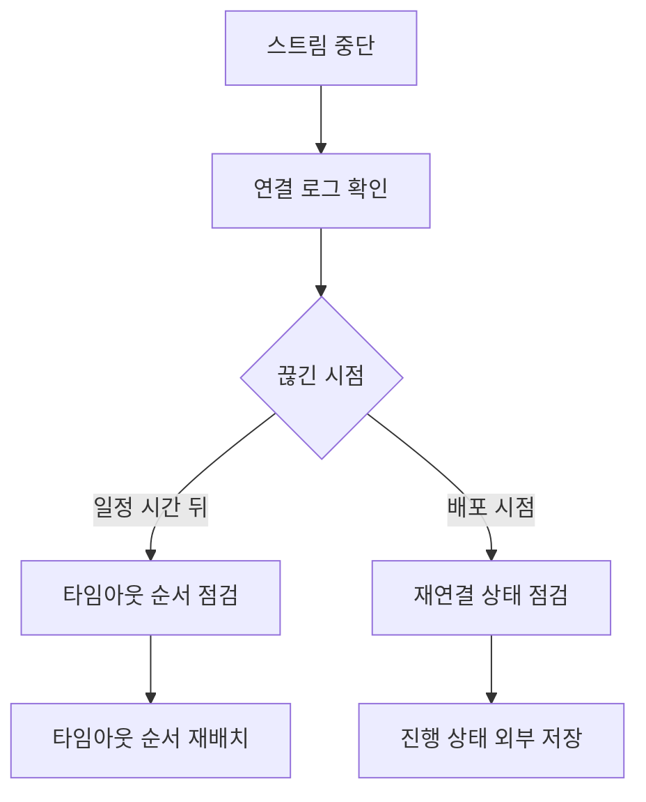

## 문제와 배경

LLM 응답을 토큰 단위로 바로 보여 주는 기능을 SSE(Server-Sent Events)로 구현했습니다. 로컬에서 ASGI 서버를 직접 띄워 테스트할 때는 길게 걸리는 응답도 끝까지 잘 내려왔습니다. 그런데 운영 환경(Gunicorn이 Uvicorn 워커를 띄우고 그 앞에 로드밸런서를 둔 구성)에 올리자, 응답이 끝나기 전에 연결이 끊기는 일이 반복됐습니다. 클라이언트 쪽에는 타임아웃이나 네트워크 오류로만 보였고, 서버 로그에는 예외 스택트레이스가 없었습니다. 요청이 실패한 게 아니라, 누군가 중간에 연결을 그냥 닫아 버리는 모양이었습니다.

원인은 계층마다 따로 설정된 타임아웃 값이 서로 어긋나 있었다는 점이었습니다. 프로세스 매니저의 워커 타임아웃은 기동 명령에 300초로 잡혀 있었는데, LLM 응답 스트림은 길면 840초까지 이어질 수 있었습니다. 워커 타임아웃이 스트림보다 짧으니, 스트림이 정상적으로 진행 중이어도 워커가 "응답이 없다"고 판단해 프로세스를 강제로 종료시켰습니다. 이 종료는 예외가 아니라 워커 자체의 생존 관리 로직이 내린 결정이라, 애플리케이션 로그에는 아무 흔적도 남지 않았습니다. 개발 환경에서는 이 워커 타임아웃 계층 자체가 없어서 재현되지 않았던 것이고, 운영에서만 보이는 구성 차이였습니다.

## 접근: 끊긴 위치부터 가릅니다

증상은 하나(연결이 끊김)지만 원인은 여러 계층에 걸쳐 있어서, 먼저 어느 계층에서 끊겼는지부터 좁혀야 했습니다.



연결이 일정 시간이 지나면 항상 끊긴다면 타임아웃 순서 문제이고, 배포(프로세스 재시작) 시점에 맞춰 끊긴다면 재연결 뒤 상태 복구 문제입니다. 이 글은 두 경우 모두를 다룹니다.

타임아웃은 클라이언트에서 서버까지 여러 계층을 거치는데, 가장 바깥쪽 계층의 유휴 시간이 가장 짧고 안쪽으로 갈수록 길어야 이야기가 맞습니다. 그렇지 않으면 바깥쪽 계층이 안쪽 스트림이 끝나기 전에 연결을 먼저 정리해 버립니다.

| 계층 | 값(예시) | 역할 |
|---|---|---|
| SSE 하트비트 | 15초 | 응답할 데이터가 없을 때도 연결이 살아있음을 알림 |
| 로드밸런서 유휴 타임아웃 | 240초 | 일정 시간 데이터가 없으면 연결을 끊음 |
| 스트림 최대 길이 | 840초 | 이 기능에서 허용하는 가장 긴 응답 시간 |
| 워커(프로세스) 타임아웃 | 900초 | 요청 하나를 처리하는 워커가 살아있다고 보는 한계 시간 |

네 값은 하트비트 < 로드밸런서 유휴 < 스트림 최대 길이 < 워커 타임아웃 순서로 커져야 합니다. 기본값을 그대로 쓰면 이 순서가 깨지기 쉬운데, 특히 워커 타임아웃은 애플리케이션 코드가 아니라 기동 명령에 들어 있어서, 처음 넣은 값(여기서는 300초)이 그대로 남아 있기 쉬워 가장 놓치기 쉬운 지점이었습니다.

## 구현: 순서를 맞추고, 재연결 시 상태를 복구합니다

### 핵심 코드

스트림 쪽은 하트비트 주기를 직접 넣고, 재연결에 쓸 이벤트 `id`를 같이 내려줍니다. 아래는 이 글을 위해 새로 쓴 최소 예시이며, 실제 설정값을 그대로 옮긴 것은 아닙니다.

```python
from sse_starlette.sse import EventSourceResponse

HEARTBEAT_SECONDS = 15
RETRY_MS = 3000

async def stream_response(stream_id: str):
    last_seq = 0
    async for chunk in generate_tokens(stream_id):
        last_seq += 1
        yield {
            "id": f"{stream_id}:{last_seq}",
            "retry": RETRY_MS,
            "data": chunk,
        }

@app.get("/completions/{stream_id}")
async def completions(stream_id: str):
    return EventSourceResponse(
        stream_response(stream_id),
        ping=HEARTBEAT_SECONDS,
    )
```

프로세스 매니저 쪽은 설정 파일이 아니라 기동 명령에 타임아웃을 직접 명시했습니다. 워커 타임아웃을 스트림 최대 길이보다 넉넉히 크게 잡고, 종료 신호를 받은 뒤 정리할 시간도 같이 줬습니다.

```bash
gunicorn app.main:app \
  --worker-class uvicorn.workers.UvicornWorker \
  --timeout 900 \
  --graceful-timeout 30
```

`--graceful-timeout`을 짧게 두면(예: 0.5초) 종료 신호를 보내는 동안 클라이언트가 "스트림이 끝났다"는 이벤트를 받기 전에 연결이 끊겨, 클라이언트가 재연결 대신 그냥 실패로 처리하는 경우가 있었습니다. 종료 처리 쪽에 짧은 대기를 둬서 마지막 이벤트가 나갈 시간을 확보했습니다.

```python
import asyncio

async def on_shutdown_signal(active_streams: set[str]):
    for stream_id in active_streams:
        await notify_shutdown(stream_id)  # 클라이언트에 재연결 유도 이벤트 전송
    await asyncio.sleep(2.0)  # graceful-timeout(30s)보다 훨씬 짧게
```

재시작 중 재연결된 클라이언트는 어디서부터 다시 보여 줘야 할지 알아야 합니다. 진행 상태를 프로세스 메모리가 아니라 외부 저장소에 두고, 재연결 시 거기서 복구했습니다.

```python
PROGRESS_TTL_SECONDS = 3600

async def save_progress(stream_id: str, step: int) -> None:
    await cache.set(f"progress:{stream_id}", step, ex=PROGRESS_TTL_SECONDS)

async def load_progress(stream_id: str) -> int:
    try:
        step = await cache.get(f"progress:{stream_id}")
        if step is not None:
            return step
    except CacheUnavailable:
        pass
    return await db.query_last_step(stream_id)  # 캐시 장애 시 대체 경로
```

캐시가 떠 있지 않을 때를 대비해 더 느린 저장소로 폴백을 뒀습니다. 평소 경로보다 느리지만, 재연결 자체가 실패하는 것보다는 낫다고 판단했습니다.

마지막으로, 응답을 가로채 버퍼링하는 중간 계층(공통 로깅·인증 미들웨어 등)이 있으면 스트림이 토큰 단위가 아니라 한꺼번에 도착하는 문제가 생깁니다. 스트리밍 경로는 이런 미들웨어를 건너뛰게 하고, 필요하면 응답 헤더로 하위 프록시의 버퍼링도 꺼야 합니다.

```python
class BufferingBypassMiddleware:
    async def __call__(self, request, call_next):
        if request.url.path.startswith("/completions/"):
            return await call_next(request)  # 로깅·압축 등 공통 처리 건너뜀
        # ... 기존 공통 처리
```

## 함정과 트레이드오프

| 선택 | 얻는 것 | 잃거나 주의할 것 |
|---|---|---|
| 워커 타임아웃을 스트림 최대 길이보다 크게 둠 | 정상 응답이 중간에 강제 종료되지 않음 | 진짜로 멈춘 요청도 그만큼 오래 붙잡고 있음, 동시 연결 상한을 같이 둬야 함 |
| 하트비트를 짧게 둠 | 유휴 타임아웃보다 먼저 신호를 보내 연결 유지 | 너무 짧으면 트래픽과 로그만 늘어남 |
| 진행 상태를 캐시에 저장 | 재시작·재연결에도 이어서 보여줄 수 있음 | 캐시 장애 시 대체 경로가 없으면 재연결 자체가 막힘 |
| 동시 스트림 수 상한 | 느린 스트림이 쌓여도 DB·커넥션 자원이 바닥나지 않음 | 상한을 넘으면 정상 요청도 거절됨, 상한 값은 자원 여유를 보고 정해야 함 |

스트림 하나하나는 가볍지만, 폴링으로 상태를 확인하는 구조라면 동시 연결 수가 늘수록 그 뒤에 있는 자원(DB 커넥션 등)도 비례해서 늘어난다는 점을 따로 챙겨야 했습니다. 동시 연결 수에 상한을 두고 그 이상은 재시도 가능한 오류로 거절하는 편이, 상한 없이 받다가 뒤쪽 자원이 먼저 바닥나는 것보다 다루기 쉬웠습니다. 이 부분은 실제로 자원이 바닥난 사고를 겪은 것은 아니고, 동시 연결 수와 폴링 주기를 곱해 본 계산에 근거한 예방 조치입니다.

## 정리

- SSE처럼 오래 열어 두는 연결은 하트비트, 로드밸런서 유휴 타임아웃, 스트림 최대 길이, 워커 타임아웃이 서로 어긋나면 예외 없이 조용히 끊깁니다. 네 값은 반드시 이 순서로 커지게 맞춥니다.
- 개발 환경에는 없는 타임아웃 계층(프로세스 매니저, 로드밸런서)이 운영에만 있을 수 있습니다. 운영에서만 재현되는 증상은 이 계층 차이부터 의심합니다.
- 재시작 중에도 이어서 보여 주려면 진행 상태를 프로세스 바깥(캐시 등)에 두고, 그 저장소가 죽었을 때의 대체 경로도 같이 둡니다.
- 동시 연결 수가 늘면 그 뒤의 자원도 비례해서 늘어납니다. 상한을 두고 초과분은 재시도 가능한 오류로 거절하는 편이 안전합니다.
