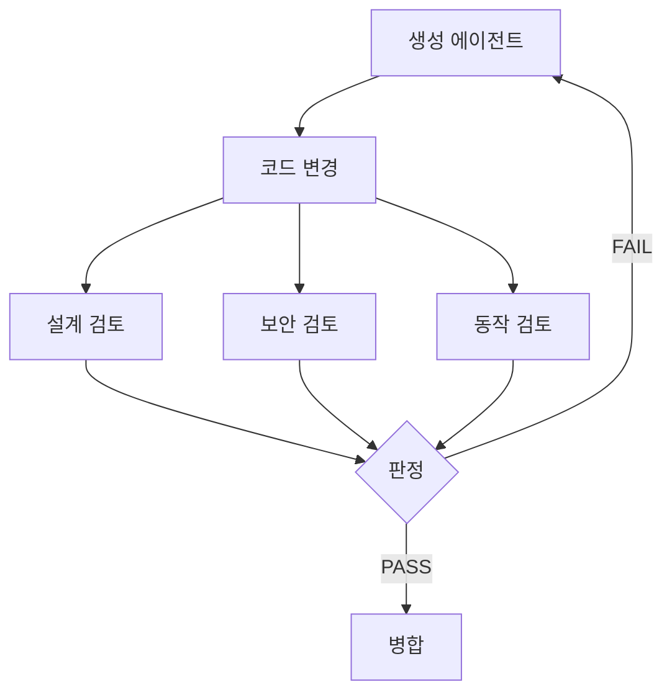

## 문제와 배경

LLM에게 코드 작성을 맡기는 하네스를 운영하다 보면, 같은 세션에 "이제 네가 방금 쓴 코드를 검토해 봐"라고 이어서 시키고 싶어지는 순간이 옵니다. 호출 한 번이 절약되고, 세션이 변경 배경을 이미 알고 있으니 설명을 다시 안 해도 됩니다.

문제는 그 검토가 거의 항상 통과한다는 점입니다. 같은 세션이 생성과 검토를 함께 맡으면, 자신이 방금 내린 설계 선택을 당연한 전제로 깔고 그 위에서만 점검합니다. 엣지 케이스나 예외 처리 누락은 애초에 "이렇게 짜면 될 것"이라고 판단한 지점이라 재검토 대상에서 빠지고, 자신의 관례를 정당화하는 방향으로 판단이 기웁니다. 겉보기엔 리뷰 단계를 거쳤지만 실제로는 같은 판단을 한 번 더 확인하는 것에 가깝습니다. 이 효과는 직접 코드를 비교해 가며 확인한 것이고, 통과율을 정량적으로 측정하지는 않았습니다.

여러 역할을 동시에 맡기면 효과가 더 뚜렷합니다. 레거시 코드를 다루는 하네스에서 같은 세션에 구현과 보안 점검을 함께 시키면, 레거시 환경에서 늘 보던 패턴(예전 방식의 인증 처리, 느슨한 입력 검증)을 "원래 이런 코드다"로 넘기고 지나가는 일이 반복됐습니다. 같은 패턴을 새 세션이 레거시 맥락 없이 보면 바로 짚어 냈습니다.

## 접근: 생성과 검토를 물리적으로 분리하기

판정 주체를 생성 주체와 같은 세션에 두지 않고, 컨텍스트를 공유하지 않는 별도 에이전트 호출로 넘기는 흐름은 다음과 같습니다.



검토 범위를 하나로 뭉치지 않고 계층으로 나눈 이유는, 계층마다 실패를 다루는 방식이 다르기 때문입니다. 설계·컨벤션 문제는 피드백을 들고 생성 에이전트가 다시 고치면 되지만, 보안 문제는 그 자리에서 자동으로 병합을 막아야 하고, 실제 동작 여부는 코드를 눈으로 보는 것만으로는 판정할 수 없습니다.

| 계층 | 검토 범위 | 실패 시 처리 |
|---|---|---|
| 설계 검토 | 의도한 설계와 실제 구현의 차이 | 사유를 들고 생성 에이전트가 재작업 |
| 보안 검토 | 인증·입력 검증·권한 경계 취약점 | 그 자리에서 병합 차단, 사람이 직접 확인 |
| 동작 검토 | 실제로 그 경로가 끝까지 실행되는지 | 재현 절차를 남기고 사람에게 에스컬레이션 |

설계·보안 검토는 코드와 변경 범위만 보고 판정하는 정적 검토이고, 동작 검토는 실제로 그 기능을 실행해 결과를 확인하는 동적 검토입니다. 둘을 같은 계층에 두면 "코드는 맞아 보이는데 실제로는 안 된다"는 경우를 놓칩니다.

## 구현: 역할별로 독립된 호출과 공통 판정 규칙

### 핵심 코드

생성 에이전트가 변경을 끝내면, 오케스트레이터가 계층별 검토 에이전트를 컨텍스트 없이 독립 호출합니다. 호출 하나하나는 생성 세션의 기록을 보지 못하고, 변경 diff와 검토 기준만 받습니다.

```python
from dataclasses import dataclass


@dataclass
class ReviewFinding:
    layer: str
    severity: str  # "critical" | "high" | "medium" | "low"
    message: str
    location: str


def run_review_layer(layer: str, diff: str, is_legacy_path: bool) -> list[ReviewFinding]:
    """컨텍스트가 없는 새 에이전트 세션으로 검토 계층 하나를 실행한다."""
    findings = dispatch_fresh_agent(role=layer, input_diff=diff)
    if is_legacy_path:
        # 레거시 경로는 설계·컨벤션 지적을 기록만 남기고 심각도를 낮춘다.
        # 보안 심각도는 레거시 여부와 무관하게 그대로 둔다.
        findings = [
            f if f.severity == "critical" else downgrade(f)
            for f in findings
        ]
    return findings


def judge(findings: list[ReviewFinding]) -> str:
    if any(f.severity == "critical" for f in findings):
        return "merge_blocked"
    if any(f.severity == "high" for f in findings):
        return "rework"
    return "pass"
```

판정에서 가장 중요한 부분은 "안 됨"이라는 결과만 돌려주지 않는다는 점입니다. 심각도마다 실패 사유와 위치를 같이 남겨서, 생성 에이전트가 재작업할 때 무엇을 고쳐야 하는지 바로 알 수 있게 합니다.

```python
def to_feedback(findings: list[ReviewFinding]) -> str:
    lines = []
    for f in findings:
        if f.severity in ("critical", "high"):
            lines.append(f"[{f.severity}] {f.location}: {f.message}")
    return "\n".join(lines) or "검토 통과"
```

재작업이 세 번을 넘기면 같은 사유가 반복되는지부터 확인합니다. 반복되면 검토 기준 자체가 모호하다는 신호로 보고 자동 재시도를 멈추고 사람에게 넘깁니다.

```python
def should_escalate(attempt_count: int, last_feedback: str, prev_feedback: str) -> bool:
    return attempt_count >= 3 and last_feedback == prev_feedback
```

## 함정과 트레이드오프

| 선택 | 얻는 것 | 잃거나 주의할 것 |
|---|---|---|
| 생성과 검토를 별도 에이전트 호출로 분리 | 자기평가 편향이 줄어듦 | 호출 수가 늘어 지연과 비용이 그만큼 붙음 |
| 레거시 경로의 설계·컨벤션 심각도를 낮춤 | 같은 지적이 반복돼 전부 무시되는 상황을 막음 | 낮출 기준을 사람이 먼저 정해야 함, 보안 심각도는 예외 없이 그대로 둠 |
| 보안 검토 실패를 자동 병합 차단으로 둠 | 기술 검토에서 걸린 취약점이 그냥 지나가지 않음 | "검토 통과 = 배포해도 안전"으로 읽는 과신이 생길 수 있음, 기술 품질과 비즈니스 리뷰는 별개 |
| 3회 반복 실패 시 자동 에스컬레이션 | 같은 재작업이 끝없이 도는 것을 막음 | 기준 자체가 모호한 경우와 생성 쪽이 계속 실수하는 경우를 구분하는 추가 판단이 필요함 |

검토를 별도 에이전트로 떼어낸다고 오탐이 사라지지는 않습니다. 가산 설계를 오독하거나, 패턴 매칭의 맹점으로 실제 문제를 놓치거나, 존재하지 않는 근거를 인용하는 유형의 오탐은 역할을 분리한 뒤에도 남습니다. 그래서 검토 결과를 그 자리에서 바로 받아들이지 않고, 생성 쪽 세션이 실제 코드와 1:1로 대조한 뒤 채택 여부를 정하는 단계를 하나 더 뒀습니다. 검토 에이전트의 판정은 최종 결론이 아니라 후보로 다루는 편이 안전합니다.

이 시리즈의 [이전 글](/blog/2026/05/11/llm-context-cache-thinking-cost.html)에서 다룬 컨텍스트 관리와 이번 분리는 서로 다른 축입니다. 컨텍스트를 아끼는 것과 컨텍스트를 아예 공유하지 않는 것은 반대 방향의 선택이고, 검토처럼 독립적인 판단이 필요한 자리에서는 공유하지 않는 쪽이 맞았습니다.

## 정리

- 같은 세션이 생성과 검토를 함께 맡으면 자신의 설계 선택을 전제로 깔고 그 위에서만 점검하는 자기평가 편향이 생깁니다.
- 검토를 컨텍스트가 없는 별도 에이전트 호출로 분리하면, 생성 쪽이 당연하게 넘긴 지점도 새로 판단합니다.
- 검토 범위를 설계·보안·동작 계층으로 나누고, 계층마다 실패 처리 방식(재작업·병합 차단·에스컬레이션)을 다르게 둡니다.
- 레거시 경로는 설계·컨벤션 심각도를 낮춰 반복되는 지적이 전부 무시되는 상황을 막되, 보안 심각도는 예외를 두지 않습니다.
- 역할을 분리해도 오탐 자체는 남으므로, 검토 결과는 최종 판정이 아니라 후보로 두고 실제 코드와 대조하는 단계를 하나 더 둡니다.

