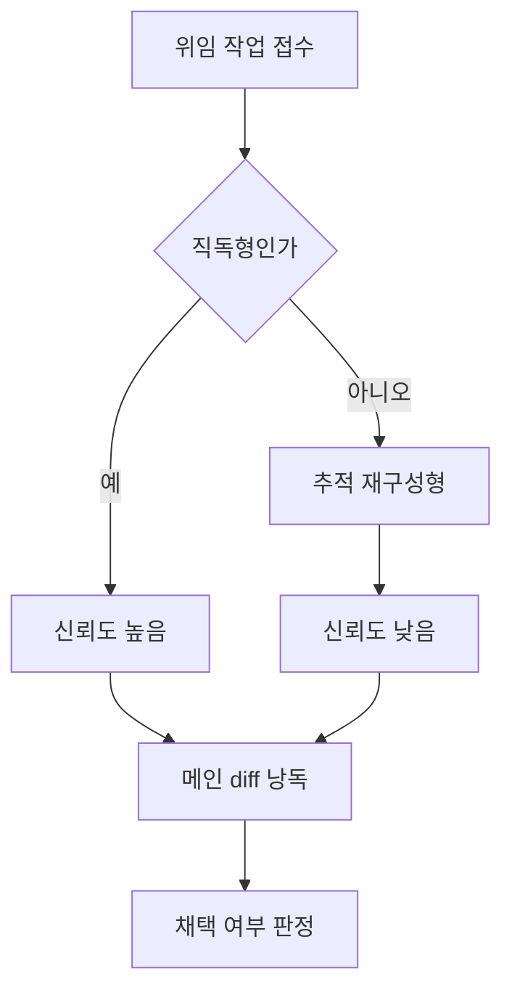

## 문제와 배경

규모가 있는 수정 작업을 서브에이전트 여러 개에 나눠 맡기는 방식을 쓰다 보면, 각 서브에이전트가 끝에 내놓는 "빌드 성공", "설계와 실제 코드 사이 불일치 없음" 같은 보고를 그대로 믿고 다음 단계로 넘어가고 싶어집니다. 보고 문장만 보면 작업이 끝난 것처럼 읽히기 때문입니다.

그런데 그 보고를 그대로 채택한 뒤 메인 세션이 같은 명령을 직접 돌려 보면 다른 결과가 나오는 일이 반복됐습니다. "컴파일 성공"이라고 보고된 코드에서 메인이 직접 빌드하자 오류가 나왔고, "불일치 0건"이라고 보고된 대조 작업에서 메인이 직접 비교하자 놓치면 안 되는 차이가 나왔습니다. 심지어 서브에이전트가 낸 보고서 안에서도 인용한 코드와 결론 문장이 서로 어긋나는 경우가 있었는데, 그럴 때는 인용 쪽이 맞고 결론 쪽이 틀려 있었습니다. 이건 사후에 통계를 낸 수치가 아니라, 반복해서 겪으며 패턴으로 눈에 들어온 것입니다.

이 문제는 서브에이전트가 "능력이 없어서"가 아니라, **위임한 작업의 성격**과 **보고를 검증 없이 채택하는 절차**에서 비롯됐습니다. 이 글은 어떤 위임이 믿을 만하고 어떤 위임이 아닌지, 그리고 "완료" 보고를 어떤 절차로 걸러야 하는지를 정리합니다. 생성 에이전트와 평가 에이전트를 분리해 평가 쪽의 오탐을 줄이는 이야기는 [전 편](/blog/2026/05/16/generator-evaluator-agents.html)에서 다뤘는데, 이번 글은 그 반대 축입니다 — 평가가 아니라 **작업을 수행한 쪽이 있는 결함을 없다고 보고하는** 경우를 다룹니다.

## 접근: 위임의 성격별로 신뢰도를 다르게 둡니다

같은 "서브에이전트에게 조사를 맡긴다"는 행위라도, 작업의 성격에 따라 결과의 신뢰도가 체계적으로 달라집니다. 아래는 위임 종류에 따라 신뢰도를 가르고 이후 채택까지 이어지는 흐름입니다.



지정한 파일을 열어 내용을 그대로 인용하는 **직독형** 위임은 신뢰도가 높아서, 결과를 그대로 받아 써도 대체로 문제가 없었습니다. 반면 호출 경로를 따라가며 이름·버전·구조를 스스로 재구성해야 하는 **추적·재구성형** 위임은 신뢰도가 낮았습니다. 실제로 같은 작업에서 추적형 서브에이전트가 저장소에 없는 식별자를 만들어 보고한 적이 있었고, 같은 세션의 직독형 서브에이전트가 그 오류를 스스로 찾아냈습니다. 두 서브에이전트의 차이는 역량이 아니라 **맡은 작업의 종류**였습니다. 그래서 추적·재구성형 위임은 "재료 수집"까지만 맡기고, 결함 여부나 버전 확정 같은 판정은 메인 세션이 1차 자료와 직접 대조해서 내리는 쪽으로 바꿨습니다.

직독형이라도 "이 식별자는 저장소 어디에도 없다"처럼 **부재를 단정하는 판정**은 따로 한 번 더 확인합니다. 어떤 이름이 현재 트리에 없다고 해서 그 이름이 틀렸다는 뜻은 아닐 수 있고, 과거 버전에서는 쓰이다가 빠진 이름일 수도 있기 때문입니다. 부재 판정을 받으면 그 이름이 버전 이력에서 언제 들어오고 빠졌는지부터 확인하면, "틀렸다"와 "오래됐다"를 구분할 수 있습니다.

| 위임 종류 | 하는 일 | 신뢰도 | 처리 방식 |
|---|---|---|---|
| 직독형 | 지정된 파일·설정을 열어 내용을 그대로 인용 | 높음 | 위임하고 결과를 그대로 사용 |
| 추적·재구성형 | 호출 경로를 따라가며 이름·구조를 재구성 | 낮음 | 재료 수집까지만 맡기고 판정은 메인이 직접 |
| 반증형 | "이 주장을 반박하라"는 지시로 검증 | 편향됨 | 결함이 없어도 "있다" 쪽으로 기울므로 1차 자료로 재확인 |

## 구현: 완료 보고를 채택 전에 거치는 게이트

"보고"를 믿지 않고, 메인 세션이 같은 산출물을 직접 확인하는 절차를 고정했습니다. 핵심은 diff를 요약으로 읽지 않고 **삭제된 줄부터 전부 낭독**하는 순서입니다.

### 핵심 코드

반복적으로 나타난 결함 네 유형 중 가장 흔했던 것이 **식별자 계열 혼동**입니다. 한 도메인에 "유형을 나타내는 코드"와 "개체를 가리키는 식별자"가 함께 있으면, 서로 다른 계열의 값을 비교하는 코드가 나옵니다. 이런 비교문은 문법적으로 완전하고 컴파일도 통과하지만, 실행 시에는 항상 같은 분기로 조용히 흐릅니다.

```java
// 의도: 주문 상태가 "취소"인 건만 환불 대상으로 추린다.
// 결함: orderTypeCode(상태 유형 코드)와 orderId(개체 식별자)를
//       같은 계열로 착각해 비교했다. 컴파일은 통과하고 항상 false가 된다.
if (order.getOrderTypeCode().equals(order.getOrderId())) {
    refundService.refund(order);
}
```

```java
// 수정: 유형 코드는 유형 코드끼리, 식별자는 식별자끼리 비교한다.
if (order.getOrderTypeCode().equals(OrderTypeCode.CANCELLED)) {
    refundService.refund(order);
}
```

이런 결함은 정적 검사로는 걸리지 않기 때문에, 메인 세션이 diff를 직접 읽을 때 "비교문 양쪽이 같은 계열의 값인가"를 질문으로 들고 봅니다. 아래는 그 확인 순서를 간단히 코드로 옮긴 것으로, 실제 판정은 사람이 하고 이 스크립트는 낭독할 범위를 정해 줄 뿐입니다.

```bash
# 삭제된 줄을 전건 낭독 대상으로 뽑는다 (surgical 위반 회귀 확인용)
git diff --unified=0 main feature-branch -- src/ | grep '^-[^-]'

# 비교문·분기만 따로 모아 양변 계열을 확인한다
git diff main feature-branch -- src/ | grep -E '^\+.*(equals|==)'
```

| 결함 유형 | 증상 | 점검 방법 |
|---|---|---|
| 식별자 계열 혼동 | 항상 거짓이 되는 비교가 조용히 잘못된 분기로 흐름 | 비교문 양변이 같은 계열의 값인지 확인 |
| 짝 누락 | 대칭으로 있어야 할 분기·상수 중 한쪽만 추가됨 | 원본에서 같은 역할을 하는 형제를 전수 열거해 대조 |
| 부수 호출 누락 | 신규 분기에서 기존 알림·기록 호출이 빠짐 | 기존 경로와 신규 경로의 호출 목록을 나란히 놓고 셈 |
| surgical 위반 회귀 | 분기를 추가하면서 인접한 기존 조건의 값을 지움 | diff의 삭제(-) 줄을 전건 낭독 |

네 유형 모두 컴파일과 문법 검사를 통과하므로, 서브에이전트의 "빌드 성공" 보고만으로는 걸러지지 않습니다. 채택 게이트는 요약 보고를 읽는 것이 아니라, 메인 세션이 ① 삭제 줄 전건 ② 비교문 양변 ③ 형제 전수 대조 ④ 호출 목록 대조 순서로 diff를 직접 낭독하는 것입니다.

병렬로 여러 서브에이전트를 동시에 띄우는 것은 각자 담당하는 파일 집합이 겹치지 않을 때만 허용했습니다. 두 서브에이전트가 같은 파일을 건드리게 두면, 어느 쪽 변경이 최종본에 남았는지부터 다시 추적해야 해서 검증 비용이 오히려 늘어납니다.

## 함정과 트레이드오프

| 선택 | 얻는 것 | 잃거나 주의할 것 |
|---|---|---|
| 추적·재구성형 위임을 재료 수집까지로 제한 | 존재하지 않는 식별자를 그대로 채택하는 일을 줄임 | 판정을 메인이 직접 하므로 서브에이전트를 쓴 만큼의 속도 이득이 줄어듦 |
| "완료" 보고 대신 메인이 직접 재실행 | 보고와 실제 결과의 괴리를 잡아냄 | 모든 산출물에 대해 같은 검증을 메인이 반복해야 해서 세션이 길어짐 |
| diff를 정해진 순서로 전건 낭독 | 정적 검사를 통과하는 네 유형의 결함을 사람이 직접 잡음 | 변경 범위가 커질수록 낭독에 들어가는 시간이 선형으로 늘어남 |
| 파일 집합이 겹치지 않을 때만 병렬 위임 허용 | 두 서브에이전트의 변경이 충돌·역전되는 일을 막음 | 작업을 파일 단위로 미리 쪼개는 설계 비용이 앞에 붙음 |

이 절차는 서브에이전트의 역량을 의심하는 것이 목적이 아닙니다. 같은 세션 안에서 직독형 위임은 꾸준히 믿을 만했고, 추적·재구성형 위임만 체계적으로 틀렸습니다. 다만 "완료"라는 보고 자체는 어느 위임 종류에서 나왔든 근거가 아니라 **대조해야 할 대상**으로 두는 쪽이, 결과적으로 결함을 더 일찍 잡아냈습니다. 프롬프트를 설정처럼 버전 관리하고 입력을 방어하는 이야기는 [다른 글](/blog/2026/05/20/llm-prompt-token-injection-defense.html)에서 다뤘는데, 그쪽이 LLM에 들어가는 입력을 통제하는 문제라면 이 글은 LLM(또는 LLM 기반 에이전트)이 **내놓은 출력**을 어디까지 믿을지를 다룬다는 점에서 짝을 이룹니다.

## 정리

- 서브에이전트의 "빌드 성공", "불일치 없음" 보고는 근거가 아니라 메인 세션이 같은 명령을 직접 실행해 대조할 대상입니다.
- 지정 파일을 그대로 인용하는 직독형 위임은 신뢰도가 높고, 호출 경로를 따라 이름·구조를 재구성하는 추적형 위임은 신뢰도가 낮아 재료 수집까지만 맡깁니다.
- 반복된 결함 네 유형(식별자 계열 혼동, 짝 누락, 부수 호출 누락, surgical 위반 회귀)은 모두 컴파일과 문법 검사를 통과하므로 정적 검증만으로는 걸리지 않습니다.
- 채택 게이트는 메인 세션이 diff의 삭제 줄부터 정해진 순서로 전건 낭독하는 것이고, 병렬 위임은 파일 집합이 겹치지 않을 때만 허용합니다.
