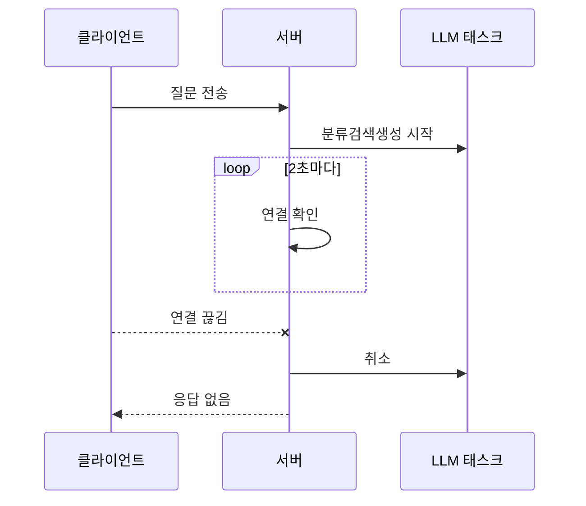

## 이 글에서 다루는 것

한문 원문과 국역문이 짝을 이루는 고전 문헌을 대상으로 한 AI 질의응답 서비스는 두 프로젝트로 이루어져 있습니다. 사용자의 질문을 받아 검색과 LLM 호출을 거쳐 답을 돌려주는 **채팅 API 서버**(FastAPI)와, 문헌을 번역·해설하고 임베딩해 검색 인덱스를 채우는 **배치 프로젝트**(Prefect)입니다. 1·2편에서 LLM API를 백엔드에 붙일 때의 기본기를, 3·4편에서 임베딩과 하이브리드 검색을 다뤘습니다. 이 글은 그 위에서 채팅 API가 운영 중에 부딪힌 문제를 다룹니다. Prefect 배치 파이프라인 연동은 6편에서 이어집니다.

- 수십 초가 걸리는 LLM 요청 중에 사용자가 떠났을 때 무엇을 남길지
- 후속 질문의 「그의」「당시」를 어떻게 풀지
- 서문·부록 같은 비본문 문서가 답변 근거로 끼어드는 것을 어떻게 막을지
- 한자·한문 텍스트를 검색기에 넣을 때 무엇이 깨지는지

독자는 백엔드 개발자이되 LLM·RAG를 실서비스에 붙여 본 경험은 적은 분으로 잡았습니다. 코드는 모두 이 글을 위해 새로 쓴 최소 예시입니다.

## 채팅 API — 긴 LLM 요청을 실서비스에서 다루기

이 절에서 다루는 2겹 이탈 감지 중 1겹(주기 폴링)의 흐름은 다음과 같습니다.



### 요청 한 건의 흐름

채팅 엔드포인트 한 건은 대략 다음 순서로 처리됩니다.

1. 권한과 사용 한도 확인, 대화방 준비
2. 의도 분류(LLM 호출)와 하이브리드 검색(BM25 + kNN). 분류 키워드를 검색에 쓸지에 따라 직렬과 병렬 중 하나를 고릅니다(1편·4편 참고)
3. 분류 결과가 「답할 수 없음」이면 거절 응답을 저장하고 종료
4. 검색된 청크를 컨텍스트로 답변 생성(LLM 호출, 60초 타임아웃)
5. 대화방 갱신, 메시지 저장, 응답 조립

답변은 JSON 한 덩어리로 돌려줍니다. 스트리밍이 아닙니다. 이 선택이 뒤에 나오는 이탈 감지 문제와 직접 연결되므로 먼저 적어 둡니다. LLM 호출이 두 번(분류, 생성) 들어가므로 한 건이 길면 수십 초 걸립니다. 그동안 사용자는 탭을 닫거나 다른 질문을 던질 수 있습니다.

### 사용자가 떠난 뒤에도 답변이 저장되는 문제

증상은 이렇습니다. 사용자가 질문을 보내고 답을 기다리다가 화면을 닫습니다. 서버는 그 사실을 모른 채 LLM 호출을 끝내고 질문과 답변을 DB에 저장합니다. 다음에 사용자가 대화방을 열면 본 적 없는 답변이 들어 있습니다. 사용 횟수에 한도가 있는 서비스라면 보지도 않은 답변이 한도를 소비한 셈입니다.

첫 시도는 Starlette의 `request.is_disconnected()`였습니다. LLM 호출이 끝난 뒤 한 번 확인해서, 끊겼으면 저장을 건너뛰는 방식입니다. 프록시 없이 직접 붙을 때는 동작하는 방식이지만, 운영 환경에서는 거의 항상 `False`가 돌아왔습니다. 앞에 nginx가 있었기 때문입니다.

### nginx 버퍼링과 X-Accel-Buffering

`is_disconnected()`는 ASGI 서버(uvicorn)가 `http.disconnect` 메시지를 보냈는지를 봅니다. 그 메시지는 uvicorn이 쥔 소켓, 즉 nginx와 uvicorn 사이의 연결이 끊겨야 생깁니다. 브라우저가 nginx와의 연결을 끊어도 nginx가 upstream 연결을 그대로 들고 있으면 애플리케이션은 아무것도 모릅니다. 응답 버퍼링(`proxy_buffering`)이 켜진 nginx가 upstream 응답을 끝까지 받아 두려 하는 동작이 여기에 얽힙니다.

흔히 권하는 처방은 응답 헤더 `X-Accel-Buffering: no`입니다. nginx는 이 헤더를 보면 해당 응답에 한해 버퍼링을 끕니다.

```python
from fastapi import APIRouter, Request, Response

router = APIRouter()


@router.post("/chat")
async def chat(req: ChatRequest, request: Request, response: Response) -> ChatResponse:
    # nginx가 이 응답을 버퍼에 모으지 않게 합니다 (SSE·chunked 응답에서는 필수)
    response.headers["X-Accel-Buffering"] = "no"
    return await chat_service.chat(req, http_request=request)
```

다만 이것은 **응답 헤더**입니다. 스트리밍 응답이라면 첫 청크와 함께 헤더가 먼저 나가므로 그 뒤의 전송과 끊김 감지에 영향을 줍니다. 그러나 JSON 한 덩어리를 돌려주는 엔드포인트에서는 LLM 호출이 끝나야 헤더가 나갑니다. 사용자가 떠나는 바로 그 구간, 즉 LLM을 기다리는 동안에는 nginx에 아직 도달하지도 않은 헤더입니다. 실제로 이 헤더를 붙인 뒤에도 이탈이 전파되지 않는 경우가 남았습니다. 이 부분은 공식 문서의 계약이 아니라 직접 관찰한 결과이고, `proxy_ignore_client_abort` 같은 설정과 nginx 버전에 따라 달라질 수 있습니다.

결론은 「프록시가 끊김을 전해 주리라 기대하지 말자」였습니다. 끊김 감지를 두 겹으로 만들었습니다.

### 1겹: LLM 실행 중에 주기적으로 확인

LLM 호출이 끝난 뒤 한 번 확인하는 대신, LLM 태스크를 따로 띄워 두고 2초마다 연결 상태를 봅니다. 끊겼으면 LLM 태스크를 취소합니다.

```python
import asyncio
import contextlib

LLM_TIMEOUT = 60.0
POLL_INTERVAL = 2.0


class ClientAborted(Exception):
    """LLM 실행 중 클라이언트 이탈 또는 취소 요청을 감지했을 때 던집니다."""


async def run_with_abort_watch(coro, request, cancel_check):
    llm_task = asyncio.create_task(asyncio.wait_for(coro, timeout=LLM_TIMEOUT))
    while True:
        done, _ = await asyncio.wait({llm_task}, timeout=POLL_INTERVAL)
        if done:
            # 완료 직후에도 한 번 더 봅니다 — 완료와 이탈이 같은 2초 안에 겹칠 수 있습니다
            if await _aborted(request, cancel_check):
                raise ClientAborted()
            return llm_task.result()
        if await _aborted(request, cancel_check):
            llm_task.cancel()
            with contextlib.suppress(asyncio.CancelledError, Exception):
                await llm_task
            raise ClientAborted()


async def _aborted(request, cancel_check) -> bool:
    try:
        if await request.is_disconnected():
            return True
    except Exception:
        pass  # 확인 자체가 실패하면 연결된 것으로 봅니다
    return await cancel_check()
```

`asyncio.wait`에 타임아웃을 주면 태스크를 취소하지 않고 주기적으로 깨어날 수 있습니다. `asyncio.wait_for`는 타임아웃이 지나면 태스크를 취소해 버리므로 이 용도에는 맞지 않습니다. 완료 직후에 한 번 더 확인하는 줄은 나중에 추가한 것입니다. LLM 완료와 이탈이 같은 폴링 간격 안에 일어나면 `done` 분기로 빠져 저장까지 가 버리는 경우가 있었습니다.

호출하는 쪽은 `ClientAborted`를 받으면 저장 단계를 건너뛰고 빈 응답을 돌려줍니다. 어차피 받을 사람이 없는 응답입니다.

### 2겹: 프록시와 무관한 취소 API

프록시가 끊김을 전해 주지 않는 환경을 위해, 클라이언트가 명시적으로 취소를 알리는 경로를 하나 더 두었습니다.

- 채팅 요청에 클라이언트가 만든 `client_request_id`(UUID)를 실어 보냅니다.
- 서버는 LLM 호출 전에 Redis에 `chat:cancel:{client_request_id}` 키를 등록합니다. 값은 뒤에서 설명할 pending 메시지의 id, TTL은 LLM 타임아웃보다 넉넉한 120초입니다.
- 클라이언트는 화면을 닫을 때 `POST /chat/cancel`을 같은 id로 호출합니다. 긴 요청의 `fetch` abort와 달리 이 호출은 짧게 끝나므로 프록시 동작과 상관없이 서버에 도달합니다.
- 위의 `cancel_check`는 이 키를 읽어 취소 여부를 판단합니다.

```python
CANCELLED = "cancelled"


@router.post("/chat/cancel")
async def cancel_chat(req: CancelRequest, cache: Cache, repo: MessageRepo) -> None:
    key = f"chat:cancel:{req.client_request_id}"
    value = await cache.get(key)
    if value and value != CANCELLED:
        await repo.delete_pending_question(int(value))
    if value:
        # 키를 지우지 않고 덮어씁니다 — 아직 돌고 있는 LLM 태스크가 신호를 읽어야 합니다
        await cache.set(key, CANCELLED, ttl=30)
```

첫 버전은 취소 처리 뒤 키를 지웠습니다. 그러자 진행 중인 LLM 태스크가 「키가 없다」를 「취소되지 않았다」로 읽어 답변을 그대로 저장했습니다. 취소 신호는 취소 API 호출보다 오래 살아 있어야 합니다. 키를 지우는 대신 `cancelled` 값으로 덮어쓰고 짧은 TTL을 남겼습니다.

### 답변 전에 질문부터 저장하기 (pending)

이탈을 감지했다면 무엇을 남겨야 할까요. 두 경우로 나눴습니다.

| 상황 | 이탈 시 남기는 것 | 이유 |
|---|---|---|
| 새 대화방의 첫 질문 | 질문만 | 대화방은 이미 만들어졌는데 메시지가 없으면 빈 방만 남습니다. 사용자는 자기가 던진 질문이 있는 방을 기대합니다. |
| 기존 대화방의 후속 질문 | 아무것도 | 답 없는 질문이 대화 중간에 끼면 히스토리와 LLM 컨텍스트가 어그러집니다. |

「질문만」을 남기려면 질문을 LLM 호출 **전에** 저장해야 합니다. 그래서 메시지 테이블의 `assistant_message` 컬럼을 NULL 허용으로 바꾸고, 저장을 세 단계로 나눴습니다.

```python
class MessageRepo:
    async def save_pending_question(self, session_id: str, chat_id: str, text: str) -> int | None:
        """LLM 호출 전 질문만 저장합니다. 실패해도 채팅을 막지 않습니다."""
        try:
            row = ChatMessage(session_id=session_id, chat_id=chat_id,
                              user_message=text, assistant_message=None)
            self.db.add(row)
            await self.db.commit()
            return row.id
        except Exception as e:
            logger.warning("pending save failed: %s", e)
            return None

    async def complete_pending_question(self, msg_id: int, answer: str, **meta) -> bool:
        """LLM 완료 후 같은 행에 답변과 토큰 수·키워드 등을 채웁니다."""
        ...

    async def delete_pending_question(self, msg_id: int) -> None:
        """LLM 오류·타임아웃·취소 시 정리합니다."""
        ...
```

pending 행이 생기면서 두 군데 조회를 손봐야 했습니다.

- **LLM에 넘기는 히스토리**: `assistant_message IS NOT NULL` 조건을 넣어 pending 행을 제외합니다. 답이 없는 턴을 컨텍스트에 넣으면 모델이 그 질문에 뒤늦게 답하려 듭니다.
- **화면용 메시지 목록**: pending 행은 user 항목만 만들고 assistant 항목을 생략합니다.

pending 저장은 실패해도 채팅을 막지 않습니다(`None` 반환). 사용자 경험을 위한 부가 기능이지 답변 생성의 전제 조건이 아니기 때문입니다.

### 후속 질문의 대명사 — 분류기는 상태가 없다

「어떤 인물은 누구인가요?」에 답한 뒤 「그의 업적은?」이라고 물으면 분류 단계에서 「질문이 모호함」으로 거절됐습니다. 답변 생성 단계는 대화 히스토리를 받지만, 그 앞의 의도 분류기는 질문 문장만 보는 상태 없는(stateless) 호출이었기 때문입니다. 분류기가 거절하면 답변 단계는 실행조차 되지 않습니다.

**1차 시도 — 분류기에도 히스토리를 항상 넘기기.** 분류 호출에 최근 4턴(턴당 300자로 잘라서)을 항상 넘기고, 프롬프트에 「대명사·지시어가 있으면 히스토리에서 가장 최근의 고유명사로 질문을 다시 쓴 뒤 분류하라」는 단계를 넣었습니다. 동작은 했지만 모든 질문의 분류 토큰이 늘고 지연이 눈에 띄게 커졌습니다. 후속 질문은 전체의 일부인데, 대명사가 없는 단발 질문까지 같은 비용을 치르는 구조였습니다. 곧 되돌렸습니다.

**2차 시도 — 정규식 사전 필터.** LLM 호출 앞에 값싼 필터를 두는 쪽으로 바꿨습니다. 질문에 대명사·지시어가 있을 때만 히스토리를 읽고, 그것도 2턴만 넘깁니다. 프롬프트의 「질문 다시 쓰기」 단계는 그대로 두었습니다.

```python
import re

COREFERENCE_RE = re.compile(
    r"(?:"
    r"그(?:의|는|를|에게|와|들|것|때|곳)|그녀|그분|"             # 인칭·지시 대명사
    r"(?:이|저|해당)\s*(?:인물|사건|시기|시대|정책|제도|기록)|"  # 지시어 + 명사
    r"거기|그곳|그것|그때|"                                       # 장소·시간·사물
    r"당시|앞서|앞에서|위\s*(?:인물|사건|기록|내용)|"              # 앞선 턴 참조
    r"좀\s*더|추가로|더\s*자세히"                                 # 이어 묻는 표현
    r")"
)


def needs_history(message: str) -> bool:
    return bool(COREFERENCE_RE.search(message or ""))


async def classify(message: str, session_id: str | None) -> Intent:
    history: list[dict] = []
    if session_id and needs_history(message):
        history = await repo.get_history(session_id, limit=2)
    return await intent_classifier.classify(message, recent_history=history)
```

첫 정규식은 「그/그녀/이·저·해당 + 인물」 정도였습니다. 바로 「당시 정책에는 어떤 영향을 미쳤나요?」가 거절되는 보고가 들어왔습니다. 「당시」는 직전 턴을 가리키는 말인데 목록에 없었습니다. 시점 참조(당시, 앞서), 「위 인물」, 「이 정책·제도」, 이어 묻는 표현(좀 더, 추가로)을 더해 목록이 세 배 가까이 늘었습니다.

이 필터는 **오탐이 무해하도록** 설계돼 있습니다. 「전쟁 당시」처럼 대명사가 아닌데 걸리는 경우는 히스토리를 괜히 읽어 지연이 조금 늘 뿐이고, 분류 결과는 같거나 더 정확합니다. 반대로 놓치면 거절이 나므로, 목록은 넓게 잡고 보고가 들어올 때마다 넓히는 편이 맞습니다.

### 서문·부록 같은 비본문 문서 제외

문헌 XML에는 본문 기사 외에 서문·부록 같은 문서가 섞여 있습니다. 파서는 이들도 문서로 뽑고, 청크 인덱스에도 그대로 색인됐습니다. 검색 결과에 서문 문서가 참고 자료로 올라왔고, 참고 자료 카드의 「원문 보기」 링크가 가리키는 상세 페이지는 본문 기사에만 존재하므로 화면이 깨졌습니다.

두 겹으로 막았습니다.

1. **후처리 필터**: 참고 자료에 날짜·해설 같은 메타데이터를 붙이려고 어차피 기사 인덱스를 조회하므로, 그때 `doc_type`도 같이 읽어 본문 기사가 아니면 버립니다.
2. **쿼리 단계 차단**: 서버 시작 시 기사 인덱스에서 비본문 문서의 ID를 모두 읽어(많아야 수백 개) 모듈 수준 제외 집합에 넣고, 하이브리드 검색의 `must_not` 절에 자동으로 포함되게 했습니다.

```python
# 시작 시 한 번 — 비본문 문서 ID를 검색 제외 집합에 넣습니다
EXCLUDED_ARTICLE_IDS: set[str] = set()


async def load_non_body_ids(es, article_index: str) -> frozenset[str]:
    resp = await es.search(index=article_index, body={
        "query": {"terms": {"doc_type": ["preface", "appendix"]}},
        "_source": False,
        "size": 500,
    })
    return frozenset(h["_id"] for h in resp["hits"]["hits"])


def excluded_clause() -> dict:
    # 청크 검색의 bool.must_not 에 들어갑니다 (kNN·BM25 양쪽 경로 공통)
    return {"terms": {"article_id": sorted(EXCLUDED_ARTICLE_IDS)}}
```

왜 두 겹인가. 쿼리 단계에서 막으면 후보 자리를 비본문 문서가 차지하지 않으므로 검색 품질에도 낫습니다. 그러나 시작 시 읽은 집합은 재시작 전까지 고정이라, 그 사이에 새 비본문 문서가 색인되면 후처리 필터가 받아 줍니다. 근본 해법은 청크 인덱스에 `doc_type`을 같이 싣고 `term` 필터 하나로 거르는 것인데, 매핑 변경은 전체 재색인을 요구해서 이번에는 ID 집합으로 갔습니다. 색인 시점에 비본문 문서를 아예 빼는 것이 가장 깔끔하지만, 이미 색인된 데이터를 고치는 쪽보다 읽는 쪽에서 막는 편이 배포가 빨랐습니다.

### 한자·한문 텍스트를 검색과 청크로 다룰 때

이 서비스의 문헌은 한문 원문과 국역문이 한 기사 안에 짝을 이룹니다. 검색과 임베딩에서 이 둘을 어떻게 다루는지, 형태소 분석기 설정에서 무엇이 깨졌는지를 적습니다.

- **청크는 국역문으로 만듭니다.** 임베딩 모델과 한국어 형태소 분석기 모두 한국어 문장에서 제 성능이 나옵니다. 한문 원문은 띄어쓰기가 없고 문장 경계도 구두점에 기대야 해서 청크 경계를 잡기 어렵습니다. 원문은 참고 자료 카드에서 보여 주는 용도로 두고, 검색 대상은 국역문입니다.
- **청크는 글자 수 기준 슬라이딩 윈도우입니다**(1,000자, 겹침 150자). 토큰 수 기준이 아닙니다. 글자 수 기준이면 임베딩 모델이나 토크나이저가 바뀌어도 청크 경계가 그대로이고, 같은 문서를 다시 청크했을 때 해시가 일치해 재임베딩을 건너뛸 수 있습니다.
- **청크마다 메타데이터를 앞에 붙입니다.** 제목, 시대 구분, 키워드, 해설 앞부분(300자), 그다음에 본문 청크입니다. 청크 하나만 떼어 놓으면 「누가·언제」가 사라지는데, 고전 문헌 질문은 대부분 인물과 시기를 묻습니다. 이 구조는 3편에서 다뤘습니다.
- **국역문 안의 한자는 지우지 않습니다.** 국역문에는 관직명·지명·인명 뒤에 한자가 괄호로 따라옵니다. nori 형태소 분석기는 한자를 `SH` 태그로 토큰화하는데, 이 태그를 stoptags에 넣지 않아 한자로도 검색되게 두었습니다. 한자가 저장 경로 어딘가에서 조용히 `?`로 바뀌는 문제는 [별도 글](/blog/2026/08/05/jdbc-silent-cjk-character-loss.html)에서 다뤘습니다.

### nori stoptags: Elasticsearch 9에서 깨지는 설정

청크 인덱스를 만들 때 다음 오류가 났습니다.

```text
BadRequestError: No enum constant org.apache.lucene.analysis.ko.POS.Tag.E
```

`nori_part_of_speech` 필터의 `stoptags`에 어미 전체를 뜻하는 `E`와 조사 전체를 뜻하는 `J`를 넣어 둔 설정이었습니다. 오랫동안 Elasticsearch 문서의 기본 stoptags 예시에 그대로 있던 태그라 의심하지 않았는데, Lucene 10을 쓰는 Elasticsearch 9부터 이 상위 태그가 사라지고 세부 태그만 남았습니다. `E`는 `EP, EF, EC, ETN, ETM`으로, `J`는 `JKS, JKC, JKG, JKO, JKB, JKV, JKQ, JX, JC`로 풀어 써야 합니다.

```json
{
  "type": "nori_part_of_speech",
  "stoptags": [
    "IC",
    "JKS", "JKC", "JKG", "JKO", "JKB", "JKV", "JKQ", "JX", "JC",
    "SP", "SSC", "SSO", "SC", "SE",
    "XPN", "XSA", "XSN", "XSV",
    "UNA", "NA", "VSV"
  ]
}
```

이 사례에서는 `E`를 세부 태그로 풀지 않고 일단 뺐습니다. 어미를 계속 거르고 싶다면 위 다섯 태그를 넣으면 됩니다. 교훈은 분석기 설정을 예제에서 복사해 올 때 **인덱스 생성 응답을 반드시 읽어야 한다**는 것입니다. 오류 메시지에 거부된 태그 이름이 그대로 나오므로 원인은 바로 보입니다. 더 번거로운 쪽은 이미 운영 중인 인덱스입니다. 분석기 설정은 인덱스 생성 시점에 굳으므로, 고친 설정을 적용하려면 새 인덱스를 만들어 재색인하고 별칭(alias)을 옮겨야 합니다.

## 정리

- 긴 LLM 요청에서 클라이언트 이탈은 프록시가 전해 주리라 기대하지 않습니다. `is_disconnected()` 주기 폴링과 Redis 플래그 기반 취소 API를 겹쳐 두고, 취소 신호는 취소 호출보다 오래 살아 있게 합니다. `X-Accel-Buffering: no`는 스트리밍 응답에는 필수지만 단일 JSON 응답의 대기 구간에는 닿지 않습니다.
- 질문을 LLM 호출 전에 pending 행으로 저장하면 이탈 시 「질문만 남기기」가 가능합니다. 대신 히스토리와 목록 조회가 pending 행을 알아야 합니다.
- 상태 없는 분류기에 히스토리를 항상 주면 모든 요청이 비용을 치릅니다. 대명사·지시어 정규식으로 필요한 요청만 거르고, 오탐은 무해하게 설계합니다.
- 비본문 문서는 쿼리 단계 `must_not`과 후처리 필터로 두 겹 차단합니다.
- 한문 문헌은 국역문을 청크로 만들고, 한자(`SH`)는 거르지 않으며, nori stoptags의 상위 태그 `E`·`J`는 Elasticsearch 9에서 더 이상 받지 않습니다.

## 다음 편 예고

6편에서는 Prefect로 결과가 몇 시간 뒤에 나오는 Gemini Batch API 작업을 flow로 잇는 방법, flow가 flow를 부를 때 파라미터가 어디서 오는지, 그리고 임베딩 책임을 API 서버에서 배치로 옮긴 이유를 다룹니다.
