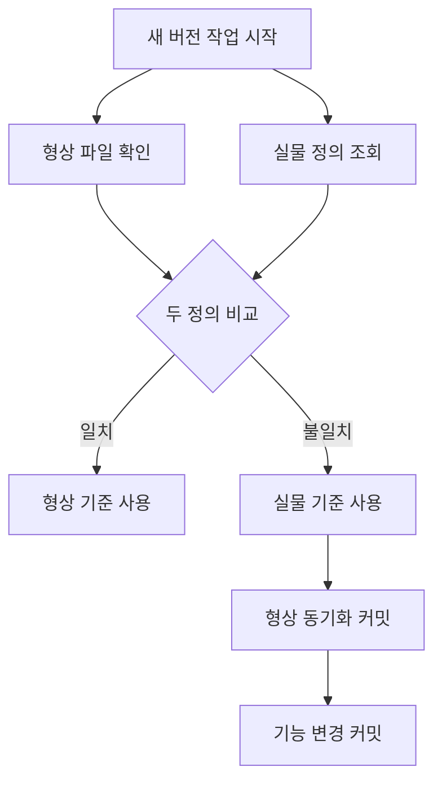

## 문제와 배경

여러 애플리케이션이 같은 데이터베이스의 저장 프로시저와 뷰를 공유해서 쓰는 환경이 있었습니다. 애플리케이션 코드는 Git으로 버전 관리를 하지만, 이 DB 개체들은 별도로 SQL 스크립트 형태로 같은 저장소에 보관하고 있었습니다. 문제는 운영에서 급하게 값 하나를 고쳐야 할 때였습니다. 정식 배포 절차를 타면 새 버전의 개체를 만들고 호출부를 그 버전으로 옮겨야 하는데, 호출부가 여러 곳이라 버전을 올리는 대신 같은 버전의 정의를 `ALTER`로 직접 고치는 방식을 택했습니다.

이 방식 자체는 드문 일이 아닙니다. 문제는 그 다음입니다. 새 버전으로 개체를 떠야 할 다른 변경이 생겼을 때, 작업자는 당연히 Git 저장소에 있는 형상 파일을 시작점으로 삼았습니다. 그런데 그 형상 파일은 운영에서 직접 고친 내용을 전혀 모르는 과거 버전이었습니다. 배포 기록에는 "값 교정 배포"로 남아 있었지만, 배포 기록과 형상 파일이 서로를 강제하지 않다 보니 둘은 조용히 벌어져 있었습니다.

같은 날 같은 방식으로 배포된 다른 개체도 동일한 상태였습니다. 형상 파일만 보고 새 버전을 뗬다면, 이미 원인까지 확인하고 고쳐 둔 계산 오류를 다시 운영에 올릴 뻔했습니다. 되돌아가는 대상이 단순한 "예전 구현"이 아니라 "이미 장애를 겪고 고친 교정"이라는 점이 이 문제를 무겁게 만듭니다.

## 접근: 형상이 아니라 실물을 기준선으로 삼습니다

새 버전을 뜨기 전에 형상 파일을 그대로 믿지 않고, 운영 DB에 올라가 있는 실물 정의를 먼저 확인하는 단계를 끼워 넣기로 했습니다. 아래는 그 판단 흐름입니다.



형상 파일과 실물 정의를 둘 다 가져와 공백을 무시하고 비교합니다. 둘이 같으면 형상 파일 그대로 새 버전을 떠도 안전하지만, 다르면 실물을 기준선으로 삼고 그 차이를 먼저 저장소에 반영합니다. 이때 중요한 것은 형상 동기화 커밋과 실제 기능 변경 커밋을 분리하는 순서입니다. 두 변경을 하나로 묶으면, 나중에 그 저장 프로시저의 이력을 되짚을 때 "언제부터 형상이 어긋나 있었는지"와 "이번에 기능이 왜 바뀌었는지"를 구분할 방법이 없어집니다.

반대 방향의 대책도 같이 세웠습니다. 운영에서 같은 버전으로 직접 고치는 배포(in-place 수정)를 피할 수 없는 상황이라면, 그 수정이 들어가는 커밋에 형상 파일 갱신을 반드시 같은 커밋으로 묶기로 했습니다. 이 규칙이 §1의 문제가 애초에 생기지 않게 하는 유일한 근본 대책입니다.

| 증상 | 원인 | 조치 |
|---|---|---|
| 형상 파일로 새 버전을 떴더니 고쳐 둔 값이 되살아남 | 운영 in-place 수정이 형상에 반영되지 않음 | 새 버전 작업 전 실물 정의를 기준선으로 확정 |
| 배포 기록에는 "반영됨"인데 형상 저장소엔 없음 | 배포 기록과 형상 커밋이 서로를 강제하지 않음 | in-place 수정 커밋에 형상 갱신을 같은 커밋으로 묶음 |
| 형상 동기화가 기능 변경과 섞여 이력을 읽을 수 없음 | 두 종류의 변경을 한 커밋에 담음 | 형상 동기화와 기능 변경을 별도 커밋으로 분리 |

## 구현

### 핵심 코드

실물 정의를 가져오는 쪽은 SQL Server라면 공개된 메타데이터 함수로 바로 뽑을 수 있습니다. DBA 트랙에서 실행하고, 에이전트나 자동화 스크립트는 쿼리와 판정 기준만 제공하는 쪽으로 역할을 나눴습니다.

```sql
-- 운영 DB에 올라가 있는 실물 정의를 그대로 가져온다
SELECT OBJECT_DEFINITION(OBJECT_ID('dbo.CalcSettlementAmount')) AS live_def;
```

형상 저장소 쪽 파일과 이 결과를 공백 무시 `diff`로 비교하는 스크립트는 다음처럼 단순하게 짰습니다.

```bash
#!/usr/bin/env bash
# usage: confirm-baseline.sh <object-name> <repo-sql-file>
set -euo pipefail

object_name="$1"
repo_file="$2"
live_def_file="$(mktemp)"

# live_def_file 은 DBA가 실행한 조회 결과를 붙여 넣은 파일이라고 가정한다
diff -b "$repo_file" "$live_def_file" > /dev/null \
  && echo "baseline: repo file matches live definition" \
  || echo "baseline: MISMATCH — use live definition, sync repo in its own commit"
```

형상 동기화와 기능 변경을 분리하는 규칙은 코드보다 커밋 습관의 문제라서, 체크리스트 항목으로 못 박아 두는 쪽을 택했습니다.

```markdown
## 저장 프로시저 새 버전 배포 전 체크리스트
- [ ] 대상 개체의 실물 정의를 조회했다
- [ ] 형상 파일과 공백 무시 diff로 비교했다
- [ ] 불일치가 있었다면, 동기화를 별도 커밋으로 먼저 올렸다
- [ ] 이번 변경을 그 뒤 커밋으로 올렸다
```

형상 파일에 해당 개체가 없다고 해서 "아직 배포되지 않았다"로 단정하지 않는 것도 같은 맥락의 규칙입니다. 형상 커밋은 배포와 동시에 일어나지 않고 상시 뒤처질 수 있어서, 파일 부재는 배포 여부를 판정하는 근거가 되지 못합니다. 배포가 안 된 저장 프로시저를 호출하면 대개 그 호출이 즉시 예외로 끝나 실행 이력이나 알림에 남기 때문에, 조용히 넘어가고 있는 경로라면 "미배포"보다 다른 원인을 먼저 의심하는 편이 맞았습니다.

## 함정과 트레이드오프

| 선택 | 얻는 것 | 잃거나 주의할 것 |
|---|---|---|
| 새 버전 작업 전 실물 정의를 항상 조회 | 형상 드리프트를 반영 전에 발견 | 조회 권한과 절차가 있는 담당자·DBA의 손을 매번 거쳐야 함 |
| in-place 수정에 형상 갱신을 같은 커밋으로 강제 | 근본 원인을 차단 | 급한 수정일수록 이 습관이 흐트러지기 쉬움, 리뷰 단계에서 확인이 필요함 |
| 형상 동기화와 기능 변경 커밋 분리 | 드리프트가 언제 생겼는지 이력으로 추적 가능 | 커밋 수가 늘고, 리뷰어가 두 커밋의 관계를 알아야 함 |
| 형상 파일 부재를 미배포 근거로 쓰지 않음 | 섣부른 오판을 줄임 | 배포 여부를 판정할 다른 근거(적용 기록, 실물 확인)를 따로 마련해야 함 |

이 절차의 비용은 결국 "급할 때일수록 생략하고 싶어지는 단계"라는 데 있습니다. in-place 수정은 애초에 호출부를 건드리지 않고 빠르게 고치려는 선택이라서, 그 수정에 형상 갱신까지 같은 커밋으로 묶자는 규칙은 평소보다 급한 순간에 더 지키기 어렵습니다. 그래서 이 규칙은 개인의 습관에 맡기지 않고, 배포 체크리스트의 항목으로 고정해 리뷰 단계에서 누락을 걸러내는 쪽으로 자리잡았습니다.

## 정리

- 운영 DB 개체를 같은 버전에서 `ALTER`로 직접 고치면 형상 파일에는 아무 흔적도 남지 않고, 배포 기록과도 강제로 연결되지 않습니다.
- 그래서 새 버전을 뜰 때의 기준선은 형상 파일이 아니라 운영 DB의 실물 정의여야 하고, 둘이 다르면 실물을 기준으로 삼은 뒤 그 차이를 별도 커밋으로 동기화합니다.
- in-place 수정을 피할 수 없다면, 그 수정 커밋에 형상 갱신을 같은 커밋으로 묶는 것이 이 문제가 생기지 않게 하는 유일한 근본 대책입니다.
- 형상 저장소에 파일이 없다는 사실만으로 미배포를 단정하지 않습니다. 형상은 항상 뒤처질 수 있고, 배포 여부는 적용 기록이나 실물 확인으로 판정합니다.
- 다음 글에서는 저장 프로시저에 파라미터를 추가하는 변경이 왜 배포 순서를 서로 묶는지를 다룹니다.
