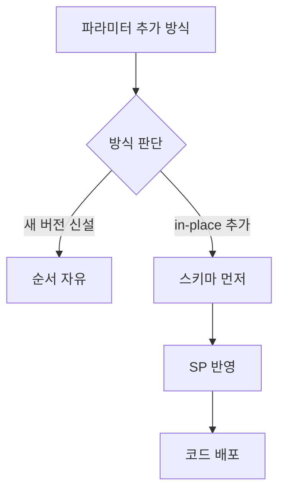

## 문제와 배경

[지난 글](/blog/2026/06/08/db-object-in-place-drift.html)에서 운영 DB 개체를 직접 고치면 형상 관리 저장소와 어긋난다는 문제를 다뤘습니다. 이번 글은 같은 배포 묶음에서 자주 겹치는 다른 문제입니다 — 저장 프로시저(SP)에 파라미터를 하나 추가하는, 겉보기에 사소한 변경이 스키마·SP·코드 세 가지를 배포해야 하는 순서까지 결정해 버리는 경우입니다.

MSSQL 기반 운영 환경에서 어떤 기능 확장 작업을 보면, SP에 파라미터를 늘리는 방법은 둘로 갈립니다. 하나는 기존 SP를 그대로 두고 새 버전을 만들어 신규 호출자만 그쪽으로 옮기는 방식이고, 다른 하나는 기존 SP 본문을 고쳐 파라미터를 그 자리에서 늘리는(in-place) 방식입니다. 이름만 보면 둘 다 "파라미터 하나 추가"로 보이지만, 배포 순서에 대한 제약은 정반대입니다. 이 차이를 구분하지 않고 작업하면, 새 코드가 아직 준비되지 않은 파라미터를 호출하거나 반대로 옛 코드가 바뀐 시그니처를 호출해 운영에서 바로 오류가 납니다.

## 접근: 두 방식의 순서 제약을 먼저 가릅니다

파라미터를 추가하는 두 방식 중 어느 쪽을 골랐는지에 따라 배포 순서가 자유로운지, 스키마를 먼저 올려야 하는지가 갈립니다.



| 방식 | 호출자 처리 | 배포 순서 제약 |
|---|---|---|
| 새 버전 신설 (`v2` → `v3`) | 구버전은 그대로 두고 신규 호출자만 새 버전 사용 | 자유롭습니다. SP를 먼저 올려도 아직 전환 안 한 코드는 계속 구버전을 부릅니다 |
| in-place 추가 (기존 SP 본문 수정) | 같은 이름, 같은 버전의 SP가 그대로 바뀜 | SP가 코드보다 먼저여야 합니다. 안 그러면 새 코드가 아직 없는 파라미터를 넘겨 호출이 실패합니다 |

in-place를 고르는 이유 자체는 합리적일 때가 많습니다. 반환 컬럼을 하나 더하거나 파라미터를 목록 끝에 붙이는 정도이고 호출하는 곳이 한두 군데뿐이면, 버전을 늘려 양쪽을 유지보수하는 비용이 더 크게 느껴집니다. 다만 그 선택은 "이 SP는 스키마·코드와 함께 순서를 지켜 배포해야 한다"는 제약을 같이 가져옵니다.

여기서 놓치기 쉬운 지점은 **한 배포 묶음 안에 두 방식이 섞일 때**입니다. 어떤 변경 작업 하나가 적재용 SP는 새 버전으로 신설하고, 등록·수정용 SP는 in-place로 고치는 식으로 양쪽을 다 쓰는 경우가 흔합니다. 이때 묶음 전체의 제약은 자유로운 쪽이 아니라 **더 엄격한 쪽**을 따라야 합니다. 신설 쪽이 순서에서 자유롭다고 해서 in-place 쪽의 제약까지 풀어 주지는 않기 때문입니다. 실제로 이런 묶음에서는 배포 순서를 "① 신규 컬럼 추가 → ② SP 반영(신설 + in-place 모두) → ③ 애플리케이션 배포"로 고정해야 했고, 순서가 뒤집히면 등록·수정 화면이 파라미터 개수 불일치로 실패하고 조회 화면이 서버 오류를 내는 증상이 그대로 나타났습니다.

## 구현: 결합을 끊는 설계와 환경별 체크리스트

### 핵심 코드

순서 제약 자체를 없애려면, in-place로 추가하는 파라미터를 목록 끝에 붙이고 기본값을 줘서 인자를 생략하는 기존 호출도 그대로 동작하게 만드는 방법이 있습니다. 아래는 이 글을 위해 새로 쓴 최소 예시이고, 실제 테이블·SP 이름과는 무관합니다.

```sql
-- 기존 호출(파라미터 3개)도, 새 호출(파라미터 4개)도 같은 SP로 받는다
CREATE PROCEDURE dbo.proc_updateItemOption
  @itemId      INT,
  @optionCode  VARCHAR(20),
  @optionValue VARCHAR(100),
  @displayType CHAR(1) = NULL  -- 끝에 추가, 기본값 NULL
AS
BEGIN
  UPDATE dbo.ItemOption
  SET optionValue = @optionValue,
      displayType = ISNULL(@displayType, displayType)
  WHERE itemId = @itemId AND optionCode = @optionCode;
END
```

새로 참조하는 컬럼이 있다면 그 컬럼도 `NULL` 허용이거나 기본값을 가져야, 아직 컬럼이 없는 환경에서 넘어온 옛 코드가 깨지지 않습니다.

```sql
ALTER TABLE dbo.ItemOption
  ADD displayType CHAR(1) NULL;  -- NOT NULL + 기본값 없는 컬럼은 즉시 순서를 묶는다
```

이렇게 해도 완전히 자유로워지지는 않습니다. 스키마가 적용되지 않은 환경에 새 코드를 올리면 여전히 실패합니다. 그래서 이 설계만으로는 부족하고, 환경별로 스키마·SP 적용 여부를 코드 승격과 별도로 확인하는 절차가 필요합니다. **코드는 Git 브랜치를 타고 환경 사이를 이동하지만, 스키마와 SP는 그렇지 않습니다.** 사람이 환경마다 다시 적용해야 합니다. 어떤 환경에서 로컬 검수를 통과했다는 사실은 다른 환경에 그 변경이 반영됐다는 근거가 되지 않습니다. 개발 환경에만 스키마를 적용해 두고 코드를 다음 환경으로 올리면, 개발에서는 통과한 검증이 다음 환경에서 그대로 재현됩니다.

| 승격 전 확인 항목 | 확인 방법 |
|---|---|
| 코드가 대상 환경 브랜치에 있다 | 브랜치·커밋 비교 |
| 대상 환경 DB에 스키마 변경이 적용돼 있다 | 변경 스크립트를 환경별로 직접 실행 여부 확인 |
| 대상 환경 DB에 SP가 반영돼 있다 | SP 정의를 환경별로 직접 비교 |
| 적용 스크립트가 다음 환경에서도 그대로 실행 가능한 형태로 남아 있다 | 스크립트 보관 위치 확인 |

이 체크리스트에서 한 가지 더 넓혀야 할 지점이 있습니다. 처음에는 "SP가 쓰는 컬럼"만 확인 대상으로 좁히기 쉬운데, 나중에 같은 테이블을 조회하는 경로를 SP 호출에서 애플리케이션 코드의 인라인 조회로 옮기는 변경이 들어오면, 그 조회 SQL이 참조하는 신규 컬럼도 똑같은 순서 결합을 만듭니다. 컬럼이 아예 없는 상태에서는 `ISNULL()`로 감싸도 조회 자체가 실패하기 때문입니다. 그래서 체크리스트의 확인 대상은 "적재 SP가 쓰는 컬럼"이 아니라 **"이번 배포본의 SQL이 이름을 부르는 모든 컬럼"**으로 넓혀 읽어야 빠지는 경로가 없습니다.

## 함정과 트레이드오프

| 선택 | 얻는 것 | 잃거나 주의할 것 |
|---|---|---|
| 새 버전 신설로 파라미터 추가 | 배포 순서 자유, 구버전 호출자 영향 없음 | SP 버전이 늘어나 관리 대상이 늘고, 어느 버전이 실제로 쓰이는지 버전 번호만으로 판단할 수 없음 |
| in-place로 파라미터 추가 | SP 버전 수를 늘리지 않음, 호출자가 적을 때 비용이 작음 | 스키마·SP가 코드보다 먼저 배포돼야 하는 제약이 생김 |
| 파라미터 끝에 기본값 추가 | 기존 호출(인자 생략)도 그대로 동작 | 조회 경로의 컬럼 참조까지는 막아주지 못함, 별도 확인 필요 |
| 환경별 적용 체크리스트 운영 | "한 환경에서 됐다"를 근거로 쓰는 실수를 막음 | 확인 항목이 늘어 승격 절차가 길어짐 |

새 버전을 신설하는 쪽이 항상 정답은 아닙니다. 호출자가 한 곳뿐이고 변경이 파라미터 하나를 끝에 붙이는 정도라면, in-place로 가고 순서 제약을 체크리스트로 관리하는 편이 전체 비용은 더 낮을 수 있습니다. 다만 그 선택을 할 때는 "이 변경은 순서가 자유롭지 않다"는 사실을 배포 계획에 명시적으로 적어 둬야, 나중에 같은 배포 묶음에 들어오는 다른 변경(새 버전 신설이라 순서가 자유로운 쪽)까지 자유로운 순서로 올려도 된다고 잘못 판단하는 일을 막을 수 있습니다.

## 정리

- 저장 프로시저 파라미터를 추가하는 두 방식(새 버전 신설 vs in-place)은 이름이 비슷해도 배포 순서 제약이 정반대입니다.
- 한 배포 묶음에 두 방식이 섞이면, 묶음 전체의 순서 제약은 더 엄격한 쪽(in-place)을 따라야 합니다.
- 파라미터를 목록 끝에 기본값과 함께 추가하면 결합을 줄일 수 있지만, 조회 SQL의 컬럼 참조까지 같은 함정을 만든다는 점은 별도로 확인해야 합니다.
- 코드는 브랜치로 환경을 이동하지만 스키마·SP는 그렇지 않으므로, 승격 체크리스트에 환경별 스키마·SP 적용 여부를 코드 승격과 별도 항목으로 넣어야 합니다.
