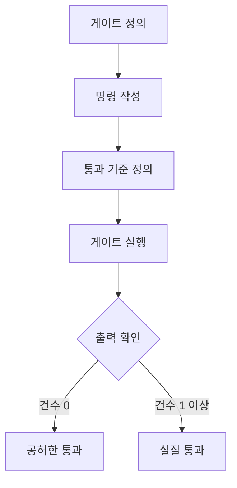

## 문제와 배경

배포 전에 여러 검증 단계를 두고, 전부 초록불이면 배포해도 된다고 판단했습니다. 그런데 이번에는 그 판단 근거 자체를 점검하다가, 초록불 두 개가 서로 다른 방식으로 비어 있다는 것을 발견했습니다.

하나는 회귀 테스트 게이트였습니다. 테스트 프레임워크를 아예 쓰지 않는 모듈에 프레임워크용 실행 태스크로 테스트 클래스 이름을 넘기자, 「테스트를 찾을 수 없음」으로 실패하거나 아무 테스트도 돌지 않은 채 통과 쪽으로 끝났습니다. 명령 자체는 오류 없이 끝났지만, 실행된 테스트 수는 0건이었습니다.

다른 하나는 구성 비교 게이트였습니다. 설계 문서가 변경 대상으로 잡은 저장 프로시저 몇 개가 실제로는 구현되지 않은 채 남아 있었는데, 배포 전 구성 비교는 전부 통과로 나왔습니다. 이 비교는 "배포된 것"과 "구성 파일"만 맞춰 보는 방식이어서, 애초에 구현되지 않은 항목은 양쪽 어디에도 없어 차이가 0으로 계산됐습니다. 통합 테스트를 준비하며 화면 경로를 따라 쿼리를 직접 만들다가 뒤늦게 드러났습니다.

두 사례는 원인이 다르지만 증상은 같습니다. 명령이 오류 없이 끝났다는 사실과, 그 명령이 확인하려던 것을 실제로 확인했다는 사실은 다른 문장입니다. 이 글은 그 둘을 가르는 게이트를 어떻게 적는지를 다룹니다. (이 구분은 업무 중 겪은 일을 바탕으로 한 관찰이며, 통계로 집계한 것은 아닙니다.)

## 접근

게이트를 "돌았다"와 "맞았다"로 가르려면, 통과 기준을 명령의 종료 코드가 아니라 명령이 내놓은 관측 가능한 출력으로 못박아야 합니다. 아래는 그 설계 흐름입니다.



통과 기준을 "오류 없이 끝남"으로 두면 건수 0인 경로와 건수 1 이상인 경로가 똑같이 "통과"로 보입니다. 통과 기준을 "표준출력에 성공 표식이 있고 건수가 1 이상"으로 바꾸면 두 경로가 갈라집니다.

| 증상 | 원인 | 조치 |
|---|---|---|
| 테스트가 0건 실행돼도 게이트가 통과 | 프레임워크 선언이 없는 모듈에 프레임워크 실행 태스크를 그대로 씀 | 테스트 클래스를 컴파일한 뒤 직접 실행하고, 실행 건수를 통과 기준에 넣음 |
| 구현되지 않은 대상이 구성 비교를 통과 | 비교가 "배포된 것 ↔ 구성 파일"만 보고, 애초에 없는 항목은 양쪽 다 없어 차이가 0 | 설계 목록과 구현·배포 완료 목록을 별도로 전수 대조 |

이 연재 [(1)편](/blog/2026/06/08/db-object-in-place-drift.html)에서 다룬 구성 드리프트도 "배포된 것 ↔ 구성 파일" 축으로 잡히는 문제였습니다. 이번 글의 두 번째 사례는 같은 축으로는 아예 걸리지 않는, 또 다른 종류의 공백입니다.

## 구현

### 핵심 코드

회귀 테스트 게이트는 프레임워크 실행 태스크 대신 테스트 클래스를 직접 실행하고, 표준출력에서 성공 표식 건수를 세어 통과 기준으로 삼습니다.

```bash
#!/usr/bin/env bash
set -euo pipefail

# 테스트 프레임워크가 없는 모듈은 컴파일된 테스트 클래스를 직접 실행한다.
OUTPUT=$(java -cp "build/test-classes:build/classes" com.example.regression.RegressionSuite)
echo "$OUTPUT"

PASS_COUNT=$(echo "$OUTPUT" | grep -c '^PASS ')
if [ "$PASS_COUNT" -eq 0 ]; then
  echo "게이트 실패: 실행된 테스트가 0건입니다" >&2
  exit 1
fi
echo "게이트 통과: ${PASS_COUNT}건 실행"
```

구성 비교 게이트는 "배포된 것 ↔ 구성 파일"과 별개로, 설계 문서가 선언한 대상 목록과 구현·배포 완료 목록을 전수 대조하는 게이트를 하나 더 둡니다.

```bash
#!/usr/bin/env bash
set -euo pipefail

# planned-objects.txt: 설계 문서가 변경 대상으로 선언한 개체 이름 목록
# done-objects.txt: 실제로 구현되고 배포까지 끝난 개체 이름 목록
MISSING=$(comm -23 <(sort planned-objects.txt) <(sort done-objects.txt))

if [ -n "$MISSING" ]; then
  echo "게이트 실패: 계획에만 있고 구현되지 않은 항목" >&2
  echo "$MISSING" >&2
  exit 1
fi
echo "게이트 통과: 계획 목록 전량 구현 확인"
```

`comm -23`은 정렬된 두 목록 중 첫 번째에만 있는 줄을 골라냅니다. 여기서는 "설계에는 있지만 구현 목록에는 없는 이름"이 됩니다. 의도적으로 뒤로 미룬 항목이 있다면 그 이름과 사유를 `planned-objects.txt`가 아니라 별도의 제외 목록에 적어, 다음 대조 때 "누락인가 제외인가"를 다시 판정하지 않게 합니다.

두 대조 축을 표로 정리하면 각자 잡는 것과 놓치는 것이 분명히 갈립니다.

| 대조 축 | 잡히는 것 | 놓치는 것 |
|---|---|---|
| 배포된 것 ↔ 구성 파일 | 운영에서 직접 고친 구성 드리프트 | 계획했지만 아예 만들지 않은 것 |
| 설계 목록 ↔ 구현·배포 목록 | 계획에만 있고 구현되지 않은 누락 | 계획에 없던 변경 |

두 축은 서로를 대신하지 못합니다. 구성 비교를 아무리 촘촘히 해도 두 번째 열은 비어 있고, 반대로 설계 대조만으로는 운영에서 임의로 바뀐 값을 잡지 못합니다.

## 함정과 트레이드오프

| 선택 | 얻는 것 | 잃거나 주의할 것 |
|---|---|---|
| 통과 기준에 건수를 넣음 | 0건 실행과 전건 통과를 구분 | 성공 표식 문자열 형식이 바뀌면 게이트도 같이 고쳐야 함 |
| 설계 목록 대조를 구성 비교와 별도로 둠 | 계획만 있고 구현되지 않은 누락을 발견 | 목록을 최신으로 유지하는 비용이 별도로 생김 |
| 의도적 제외를 제외 목록에 기록 | 다음 대조에서 재판정 비용이 줄어듦 | 기록을 누락하면 오히려 "왜 빠졌는지" 추적 비용이 더 늚 |
| 대조 시점을 구현 완료 직후로 당김 | 배포 창이 넓을 때 발견 | 구현 완료 선언 기준이 느슨하면 이 시점 자체가 늦어짐 |

대조 시점은 배포 직전이 아니라 구현 완료를 선언한 직후가 낫습니다. 늦게 발견할수록 남은 배포 창이 좁아지고, 급하게 끼워 넣은 수정이 또 다른 검증 공백을 만들 수 있습니다.

## 정리

- 게이트의 통과 기준을 "오류 없이 끝남"으로 두면, 아무것도 실행하지 않은 경로와 제대로 실행한 경로가 똑같이 통과로 보입니다. 통과 기준은 표준출력의 성공 표식이나 건수처럼 관측 가능한 값이어야 합니다.
- "배포된 것 ↔ 구성 파일" 비교는 운영에서 직접 고친 변경은 잡지만, 계획에만 있고 구현되지 않은 누락은 양쪽 모두에 없어서 놓칩니다. 이 누락은 설계 목록과 구현·배포 목록을 별도로 전수 대조해야 드러납니다.
- 의도적으로 미룬 항목은 제외 사유와 함께 별도 목록에 적어 둡니다. 적어 두지 않으면 다음 대조에서 같은 판정을 반복해야 합니다.
- 대조는 배포 직전이 아니라 구현 완료 직후에 하는 편이, 발견했을 때 남은 배포 창을 넓게 둡니다.
