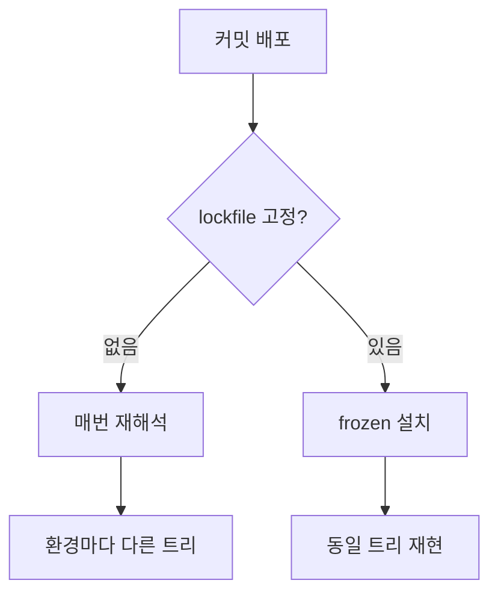

## 문제와 배경

같은 커밋을 배포했는데 환경마다 동작이 달랐습니다. dev에서 통과한 빌드가 stg에서는 다른 모듈 버전을 받아 들였고, 원인을 추적하려 해도 그 배포가 실제로 어떤 의존성 조합으로 떴는지 기록이 남아 있지 않았습니다. 의심 가는 지점은 하나였습니다. 배포 파이프라인이 매 빌드마다 `node_modules`를 지우고 `install`을 새로 돌리고 있었고, 저장소에는 그 설치를 고정할 lockfile이 없었습니다.

Node.js 프로젝트의 `package.json`은 의존성 버전을 대부분 `^`(minor·patch 유동)나 `~`(patch 유동) 범위로 선언합니다. lockfile(`pnpm-lock.yaml`, `package-lock.json`)은 이 범위를 실제로 설치된 버전 조합으로 못 박은 스냅샷입니다. lockfile이 없거나 배포가 그것을 무시하고 매번 새로 설치하면, `install`을 실행하는 시점에 존재하는 최신 버전이 그대로 들어옵니다. 직접 의존성 범위를 `~`로 좁혀 둬도 그 아래 전이 의존성(간접 의존성) 트리 전체가 여전히 유동이라 잠금 효과가 없습니다. 릴리스 주기가 짧은 패키지가 의존성 그래프 어딘가에 하나만 있어도 드리프트가 금방 드러납니다.

이 구조에서 벌어지는 일은 겹겹이 쌓입니다. 오늘 빌드와 다음 달 빌드가 다른 트리를 받고, dev·stg·운영을 서로 다른 시각에 빌드하면 세 환경이 서로 다른 의존성을 갖게 됩니다. "stg는 되는데 운영만 깨진다"는 증상 상당수가 여기서 나옵니다. 상류 패키지의 결함이나 악의적인 패치가 있어도 게이트 없이 다음 빌드에 자동으로 들어오고, 사후에 "그 배포가 실제로 어떤 버전 조합이었는지"를 추적할 방법도 없습니다.

## 접근

재현 가능한 빌드를 만드는 목표는 단순합니다. 버전 조합을 lockfile로 못 박고, 배포는 그 잠금 그대로만 설치하게 만드는 것입니다. 아래는 lockfile 유무에 따라 같은 커밋이 어떻게 다른 결과로 갈라지는지를 보여 줍니다.



lockfile이 없으면 매 배포가 `package.json` 범위를 처음부터 다시 해석하므로, 같은 커밋이라도 빌드 시점에 따라 다른 트리가 나옵니다. lockfile을 커밋하고 설치를 그 내용 그대로만 허용하는 모드(`--frozen-lockfile`, `npm ci`)로 바꾸면, 같은 커밋은 언제 어디서 빌드해도 같은 트리를 받습니다.

| 증상 | 원인 | 조치 |
|---|---|---|
| 환경마다 의존성 버전이 다름 | lockfile 없이 매번 install, 범위가 빌드 시점에 재해석됨 | lockfile 커밋 + frozen 설치 게이트 |
| lockfile이 있는데도 잠금 효과 없음 | 추적 중인 lockfile 형식과 실제 설치 도구가 다름(예: npm lockfile만 추적, 설치는 pnpm) | 실제 설치 도구가 쓰는 lockfile만 추적 |
| frozen 전환 직후 빌드 실패 | lockfile을 만든 로컬 도구 버전과 배포 서버 도구 버전이 어긋남 | 도구 버전 고정(아래 `packageManager`)을 선행 |

## 구현

### 핵심 코드

첫 단계는 실제로 설치에 쓰는 도구의 lockfile을 저장소에 커밋하는 것입니다. 설치 도구와 형식이 다른 lockfile(가령 npm lockfile만 추적하면서 설치는 pnpm으로 하는 조합)은 잠금 효과가 전혀 없는 죽은 파일이라, 있어도 없는 것과 같습니다.

```json
{
  "name": "sample-service",
  "packageManager": "pnpm@9.1.0",
  "engines": {
    "node": ">=20.11.0"
  }
}
```

`packageManager` 필드와 `engines.node`를 선언해 두면 corepack이 선언된 버전의 패키지 매니저를 그대로 받아 와, 로컬·CI·배포 서버가 같은 도구 버전으로 수렴합니다. 이 고정이 없으면 lockfile을 만든 pnpm 버전과 배포 서버의 pnpm 버전이 어긋나 frozen 설치가 곧바로 실패할 수 있습니다.

```yaml
# CI/배포 파이프라인의 설치 단계
- name: 의존성 설치(잠금 그대로만)
  run: |
    corepack enable
    pnpm install --frozen-lockfile
```

`--frozen-lockfile`은 `pnpm-lock.yaml`에 적힌 정확한 버전만 설치하고, `package.json`과 lockfile 내용이 어긋나면 설치 자체를 실패시킵니다. 의존성을 올리거나 내리는 변경은 로컬에서 `pnpm install`로 lockfile을 먼저 갱신해 커밋해야만 파이프라인을 통과하게 되므로, 버전 변경이 항상 리뷰 가능한 커밋으로 남습니다.

빌드 동작을 바꾸는 변경이라 한 번에 모든 환경에 걸지는 않았습니다.

```bash
# 1단계: lockfile만 커밋 (배포 스크립트는 그대로, 무효과)
git add pnpm-lock.yaml
git commit -m "chore: pnpm lockfile 커밋"

# 2단계: dev 파이프라인만 frozen 전환 후 기동·핵심 기능 스모크 테스트 확인
# 3단계: 이상 없으면 stg, 그다음 운영 순서로 같은 변경을 전파
```

lockfile 커밋은 저장소에 스냅샷을 추가할 뿐이라 무위험이지만, 파이프라인을 frozen 모드로 바꾸는 쪽은 도구 버전이 어긋나면 배포를 실패시킬 수 있습니다. 그래서 1단계와 2·3단계를 분리하고, dev에서 먼저 실패를 받아 본 뒤 stg·운영으로 순서대로 전파했습니다.

## 함정과 트레이드오프

| 선택 | 얻는 것 | 잃거나 주의할 것 |
|---|---|---|
| lockfile 커밋 + frozen 설치 게이트 | 같은 커밋이 언제 빌드해도 같은 트리를 재현 | 의도한 의존성 갱신도 lockfile을 먼저 손으로 갱신해야 통과함 |
| 도구 버전을 `packageManager`로 고정 | 로컬·CI·배포 pnpm 버전이 수렴, frozen 전환이 안정적 | 버전을 올릴 때마다 이 필드도 같이 갱신해야 함 |
| 첫 lockfile 커밋 | 지금부터 트리가 고정됨 | 첫 lockfile은 "지금 해석된 스냅샷"이라, 그동안 자동으로 유입되던 최신 버전 대신 그 시점 버전으로 고정되어 직전 배포와 미세하게 다를 수 있음 |
| dev → stg → 운영 순차 전환 | 도구 버전 불일치로 인한 실패를 영향이 작은 환경에서 먼저 받음 | 세 환경을 한 번에 바꾸는 것보다 롤아웃 기간이 늘어남 |

lockfile 고정과 자주 함께 나오는 별개 문제로 커밋된 `node_modules`가 있습니다. `.gitignore`에 제외 규칙을 추가해도 이미 추적 중이던 파일에는 적용되지 않으므로, 추적 해제(`git rm -r --cached`)를 따로 해야 합니다. 다만 이 추적 해제는 저장소 위생일 뿐 재현성과는 무관합니다. 배포가 매 빌드마다 `node_modules`를 지우고 새로 설치한다면, 커밋된 `node_modules`는 어느 배포에도 쓰이지 않는 dead weight라 지워도 배포에는 영향이 없고, 재현성은 어디까지나 위의 lockfile 고정으로 확보해야 하는 별개의 몫입니다.

## 정리

- `package.json`의 버전 범위는 유동이고, lockfile 없이 매번 install하면 배포 시점마다 의존성 트리가 새로 해석됩니다.
- 실제 설치 도구가 쓰는 lockfile만 커밋하고, 배포는 `--frozen-lockfile`(또는 `npm ci`)로 그 내용 그대로만 설치하게 만들면 같은 커밋이 재현됩니다.
- frozen 전환보다 도구 버전 고정(`packageManager`, corepack)을 먼저 해 둬야 lockfile 생성 환경과 배포 서버 버전이 어긋나 설치가 바로 실패하는 일을 막을 수 있습니다.
- 빌드 동작을 바꾸는 변경이므로 lockfile 커밋과 frozen 전환을 분리하고, dev → stg → 운영 순서로 영향이 작은 환경부터 검증합니다.
- 커밋된 `node_modules` 추적 해제는 저장소 위생 문제로, lockfile 고정이 맡는 재현성 문제와는 구분해서 다룹니다.
