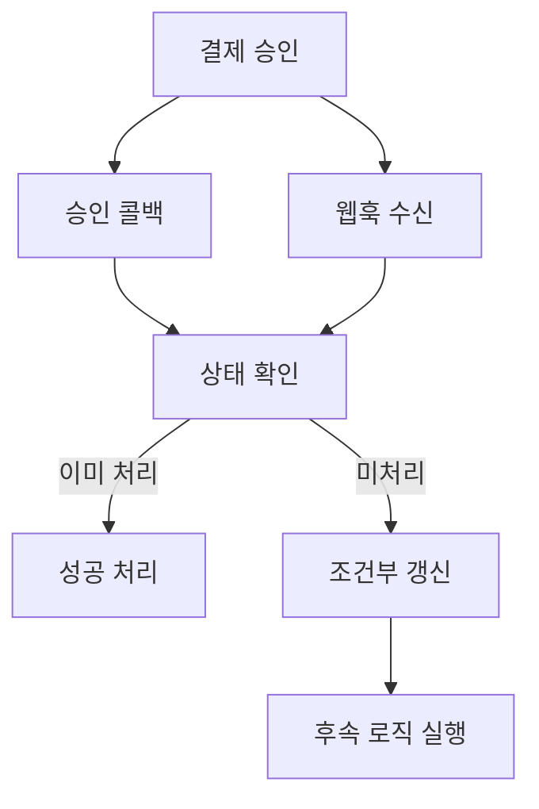

## 문제와 배경

빌링키(정기 결제용으로 저장해 둔 결제 수단 토큰)로 정기 결제를 승인하면, 결제 결과를 애플리케이션에 알려주는 경로가 두 개 있었습니다. 하나는 결제창이 닫히면서 브라우저로 돌아오는 즉시 응답(콜백)이고, 다른 하나는 결제 대행사가 별도로 보내는 웹훅입니다. 즉시 응답은 사용자에게 결과를 바로 보여주는 용도였고, 실제로 주문 상태를 바꾸고 후속 로직(적립 등)을 실행하는 쪽은 웹훅이었습니다. 두 경로가 순서대로 들어오면 문제가 없지만, 결제창이 닫히는 시점과 대행사가 웹훅을 전송하는 시점이 가까울 때는 둘이 거의 동시에 서버로 들어올 수 있는 구조였습니다.

실제로 재현해 보니, 먼저 도착한 요청이 같은 결제 건의 처리를 시작한 상태에서 뒤따라온 요청이 "이미 처리 중"이라는 거부 응답을 받는 경쟁 상태가 그대로 나타났습니다. 이 거부는 결제 대행사 쪽에서 같은 결제 건에 대한 두 번째 요청을 막아 주는 보호 장치가 동작한 결과였습니다. 다만 이 보호 장치는 대행사 쪽 경로에만 걸려 있었고, 애플리케이션 내부에서 같은 결제 건을 다시 처리하게 만드는 경로(수동 재처리, 배치 재시도 등)에는 적용되지 않았습니다. 그 경로에서 멱등성을 보장하지 않으면, 이미 반영된 결제 건의 상태를 다시 "처리 중"으로 되돌려 금액을 한 번 더 반영할 수 있는 구조였습니다. 이는 코드와 재현 로그로 확인한 경쟁 상태이고, 실제 운영에서 중복 청구로 이어진 사례를 센 것은 아닙니다.

거부 응답을 다루는 방식도 문제였습니다. 호출부가 이 거부를 실패로 처리하면, 사실은 다른 경로가 정상적으로 처리를 끝낸 결제 건인데도 재시도나 오류 알림이 발생합니다. 거부 응답 자체가 "다른 경로가 이미 처리 중"이라는 신호라는 점을 호출부가 알아야 했습니다.

## 접근: 두 경로를 같은 상태 전이로 묶습니다

승인 콜백과 웹훅 중 어느 쪽이 먼저 오든, 같은 결제 건은 한 번만 상태가 바뀌도록 만드는 게 목표였습니다. 아래는 그 전이를 결정하는 흐름입니다.



승인 콜백과 웹훅은 같은 결제 건에 대해 똑같이 "상태 확인 → 조건부 갱신" 경로를 탑니다. 어느 쪽이 먼저 이 결제 건의 상태를 바꾸는 데 성공하든, 나머지 한쪽은 "이미 처리"로 분기해 성공으로 간주하고 끝냅니다. 결제 건의 상태 전이 자체를 한 번만 허용하는 지점으로 두고, 그 지점을 먼저 통과한 쪽만 후속 로직(적립, 알림 등)을 실행하게 만드는 구조입니다.

| 증상 | 원인 | 조치 |
|---|---|---|
| 같은 결제 건에서 "이미 처리 중" 거부가 재현됨 | 승인 콜백과 웹훅이 같은 결제 건을 거의 동시에 처리하려 함 | 두 경로 모두 조건부 갱신을 거치게 하고, 거부·중복은 성공으로 간주 |
| 수동 재처리 후 결제가 한 번 더 반영될 수 있음 | 내부 재처리 경로에는 대행사의 중복 방지 장치가 걸리지 않음 | 결제 식별자에 유니크 제약을 걸어 DB 수준에서도 중복 반영을 차단 |
| 거부 응답을 오류로 알림 발송 | 호출부가 거부 응답과 처리 실패를 구분하지 않음 | 거부 응답은 "다른 경로가 이미 처리"로 해석하도록 분기 추가 |

## 구현

### 핵심 코드

결제 식별자(멱등 키)에는 유니크 제약을 걸어, 같은 건이 두 번 입력되는 것을 DB 레벨에서도 막습니다.

```sql
ALTER TABLE payments
  ADD CONSTRAINT uq_payments_payment_key UNIQUE (payment_key);
```

상태 전이는 조건부 `UPDATE`로 구현합니다. `READY` 상태인 행만 `PROCESSING`으로 바꾸고, 영향받은 행 수로 "내가 먼저 전이를 가져갔는지"를 판단합니다.

```sql
UPDATE payments
   SET status = 'PROCESSING'
 WHERE payment_key = :paymentKey
   AND status = 'READY';
```

서비스 코드는 이 조건부 갱신의 결과(영향받은 행 수)를 보고 분기합니다. 영향받은 행이 0이면 다른 경로가 이미 전이를 가져간 것이므로, 현재 상태를 조회해 성공으로 응답하고 후속 로직은 실행하지 않습니다.

```java
@Transactional
public PaymentResult apply(String paymentKey, String orderId, long amount) {
    int updated = paymentRepository.markProcessingIfReady(paymentKey);
    if (updated == 0) {
        // 다른 경로(콜백 또는 웹훅)가 먼저 READY -> PROCESSING 전이를 가져갔다
        Payment current = paymentRepository.findByPaymentKey(paymentKey)
                .orElseThrow(() -> new IllegalStateException("결제 건 없음: " + paymentKey));
        return PaymentResult.alreadyApplied(current);
    }

    ledgerService.applyCharge(orderId, amount);
    paymentRepository.markCompleted(paymentKey);
    return PaymentResult.applied(paymentKey);
}
```

대행사가 "이미 처리 중"으로 거부한 응답은 이 서비스 호출 이전 단계에서 걸러서, 실패가 아니라 `alreadyApplied`와 같은 성공 경로로 흘려보냅니다.

```java
public PaymentResult handleVendorCallback(VendorCallback callback) {
    if (callback.isDuplicateRejection()) {
        // 대행사가 같은 결제 건의 두 번째 요청을 거부한 것 -> 실패가 아니라 "다른 경로가 처리 중"
        return PaymentResult.alreadyApplied(callback.paymentKey());
    }
    return apply(callback.paymentKey(), callback.orderId(), callback.amount());
}
```

유니크 제약과 조건부 갱신을 함께 쓰는 이유는 역할이 다르기 때문입니다. 조건부 갱신은 애플리케이션이 같은 상태 전이를 두 번 실행하지 않게 막고, 유니크 제약은 그 조건부 갱신 자체가 생략되거나 다른 경로로 들어온 쓰기(배치 삽입 등)가 있을 때의 마지막 방어선입니다.

## 함정과 트레이드오프

| 선택 | 얻는 것 | 잃거나 주의할 것 |
|---|---|---|
| 조건부 `UPDATE` + 영향 행 수로 전이 판단 | 레코드 단위 잠금 없이도 두 번째 전이를 안전하게 차단 | 상태 컬럼을 거치지 않는 다른 쓰기 경로가 있으면 이 방어가 비켜 간다 |
| 결제 식별자에 유니크 제약 | 애플리케이션 로직이 놓친 중복도 DB가 막아 준다 | 제약 위반 시 던지는 예외를 호출부가 또 "오류"로 오인하지 않도록 별도 처리가 필요하다 |
| 대행사의 거부 응답을 성공으로 간주 | 정상 처리된 결제를 실패로 잘못 알리는 일을 막는다 | 거부 사유를 더 세분화해 구분하지 않으면, 실제 장애로 인한 거부까지 성공으로 삼킬 위험이 있다 |

이 구조는 "같은 상태 전이를 누가 먼저 가져가는가"만 해결합니다. 전이 이후에 실행하는 후속 로직(적립, 알림 발송) 자체가 멱등하지 않다면, 조건부 갱신을 통과한 단 한 번의 실행이라도 그 로직 내부에서 다시 중복을 만들 수 있습니다. 후속 로직 쪽의 멱등성은 이 글의 범위 밖이라 별도로 점검해야 합니다.

## 정리

- 즉시 응답과 웹훅처럼 같은 결제 건을 두 경로로 통지받는 구조에서는, 두 경로가 동시에 들어올 수 있다는 전제로 설계해야 합니다.
- 결제 상태 전이를 조건부 갱신으로 바꾸고 영향 행 수로 판단하면, 어느 경로가 먼저 와도 전이는 한 번만 일어납니다.
- 결제 식별자에 거는 유니크 제약은 애플리케이션 로직의 마지막 방어선입니다. 조건부 갱신과 역할이 다르므로 함께 둡니다.
- 외부 시스템이 보내는 "중복 거부" 응답은 실패가 아니라 다른 경로가 이미 처리했다는 신호일 수 있습니다. 호출부가 이를 구분하지 않으면 정상 처리를 오류로 취급하게 됩니다.
