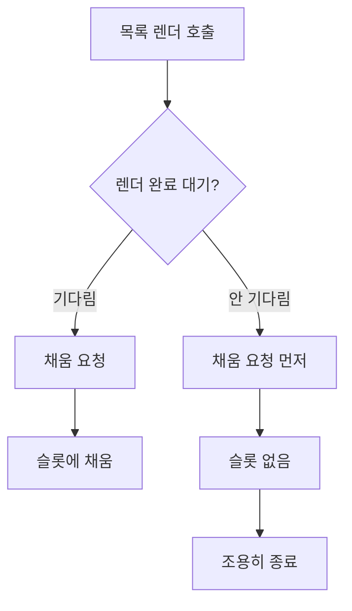

## 문제와 배경

목록 화면의 일부 항목에 붙어야 할 상태 배지가 간헐적으로 보이지 않았습니다. 배지가 원래 없는 항목도 섞여 있는 화면이라 눈으로는 정상과 결함을 구분할 수 없었고, 콘솔에는 에러가 없었으며 배지를 채우는 배치 API 응답도 200으로 떨어졌습니다. 새로고침하면 같은 항목에 배지가 다시 나타났습니다.

이 화면은 다음과 같은 흔한 패턴으로 짜여 있었습니다.

1. 목록을 그릴 때 항목마다 빈 슬롯을 함께 그립니다 — `<span id="status-slot-{id}"></span>`
2. 화면에 보이는 항목의 id를 모아 배치 요청을 한 번 보냅니다.
3. 응답으로 받은 `{id: 상태}` 를 각 슬롯에 채웁니다.

항목마다 API를 따로 부르지 않아도 되는 좋은 패턴이지만, 전제가 하나 있습니다. **슬롯을 그리는 렌더가 배치 요청보다 먼저 끝나야 합니다.** 이 전제가 깨진 경로가 하나 있었습니다. 페이지 이동 핸들러가 목록을 그리는 함수를 호출하면서 그 결과를 기다리지 않고 바로 다음 줄로 넘어갔고, 다음 줄이 배지 채움 요청을 보냈습니다. 목록을 그리는 함수는 내부에서 다른 배치 데이터를 한 번 더 기다린 뒤에야 DOM에 슬롯을 그리는 비동기 함수였기 때문에, 배지 채움 요청의 응답이 먼저 도착하면 그 시점에 슬롯이 아직 없었습니다.

## 접근: 실패 경로가 전부 침묵합니다

문제를 가르는 축은 "배치 요청이 슬롯보다 먼저 끝나는가"입니다. 아래 흐름은 같은 채움 함수가 호출부에 따라 정상과 결함으로 갈리는 지점을 보여줍니다.



같은 채움 함수를 호출하는 자리는 세 곳이었는데, 둘은 정상이고 하나만 결함이었습니다. 바로 앞 렌더가 동기냐 비동기냐가 갈랐습니다.

| 호출 경로 | 렌더 방식 | 결과 |
|---|---|---|
| 최초 진입 | 렌더를 끝낸 뒤 채움 함수 호출 | 정상 |
| 더보기(동기 삽입) | DOM 삽입 직후 곧바로 채움 함수 호출 | 정상 |
| 페이지 이동(렌더 결과를 기다리지 않음) | 채움 요청이 렌더보다 먼저 끝날 수 있음 | 슬롯 없음, 조용히 실패 |

더 성가신 부분은 실패 경로 자체가 조용하다는 점이었습니다. 슬롯을 못 찾은 채움 함수는 그냥 `return` 했고, 배지가 원래 없는 항목도 있으니 "안 보임"이 정상인지 결함인지 화면만 봐서는 구분되지 않았습니다. 그래서 판정은 육안이 아니라 수치로 했습니다. 배치 응답에서 상태가 있는 항목 수(기대 건수)와 화면에서 실제로 배지가 채워진 슬롯 수(렌더 건수)를 세어 비교했습니다. 수정 전 환경에서 같은 절차로 먼저 재현해 대조군을 만든 뒤, 수정 후 같은 조건에서 두 수가 같아지는지를 확인했습니다.

| 대상 | 기대 건수 | 렌더 건수 | 판정 |
|---|---|---|---|
| 수정 전 | 11 | 0 | 결함 재현 |
| 수정 후 | 11 | 11 | 통과 |

수정 후 통과만 보고 끝내지 않고 수정 전 재현을 먼저 만든 이유는, 통과가 우연히 나온 결과가 아니라는 것을 같은 절차로 보여 주기 위해서입니다.

## 구현: await 하나로 순서를 고정합니다

### 핵심 코드

아래는 이 글을 위해 새로 쓴 최소 예시이고, 식별자와 엔드포인트 이름은 모두 일반화했습니다.

목록 렌더 함수는 내부에서 다른 배치 데이터를 먼저 기다린 뒤에야 슬롯을 그립니다. 이 내부 대기 때문에 호출부가 결과를 기다리지 않으면 슬롯이 아직 없는 창이 생깁니다.

```javascript
// 목록 렌더 — 요약 데이터를 먼저 기다린 뒤에만 슬롯을 그립니다.
async function renderList(items) {
  const summaryById = await fetchBatchSummaries(items.map((item) => item.id));
  for (const item of items) {
    container.insertAdjacentHTML(
      "beforeend",
      `<div class="item">${summaryById[item.id]}<span id="status-slot-${item.id}"></span></div>`
    );
  }
}
```

채움 함수는 슬롯이 있다고 가정하고 동작합니다. 슬롯이 없으면 조용히 종료하는데, 바로 이 지점이 평소에는 "원래 배지가 없는 항목"과 구분되지 않습니다.

```javascript
// 배지 채움 — 슬롯이 이미 그려져 있다고 가정합니다.
async function fillStatusBadges(items) {
  const statusById = await fetchBatchStatus(items.map((item) => item.id));
  for (const [id, status] of Object.entries(statusById)) {
    const slot = document.getElementById(`status-slot-${id}`);
    if (!slot) return; // 슬롯이 없으면 로그 없이 종료
    renderBadge(slot, status);
  }
}
```

페이지 이동 핸들러가 바로 문제의 호출부였습니다. `renderList` 가 비동기 함수인데 그 결과를 기다리지 않고 `fillStatusBadges` 를 바로 이어 불렀습니다.

```javascript
// 결함 — renderList 를 기다리지 않아 순서가 보장되지 않습니다.
async function goToPage(pageNo) {
  const items = await fetchPageItems(pageNo);
  renderList(items);         // await 누락
  fillStatusBadges(items);   // 슬롯이 아직 없을 수 있음
}
```

수정은 `await` 두 글자를 추가하는 것으로 끝났습니다.

```javascript
// 수정 — 렌더가 끝난 뒤에만 채움 요청을 보냅니다.
async function goToPage(pageNo) {
  const items = await fetchPageItems(pageNo);
  await renderList(items);
  await fillStatusBadges(items);
}
```

같은 증상을 과거에도 보고받은 적이 있었고, 그때는 채움 함수를 한 번 더 호출하는 재시도 코드를 추가하는 방식으로 대응했습니다. 그 대응은 증상 일부를 가렸을 뿐, await 누락이라는 근본 원인은 그대로 남아 있었습니다. 같은 증상이 "이미 조치됨"으로 기록돼 있어도, 그 조치가 실제로 무엇을 고쳤는지는 따로 확인해야 한다는 교훈을 남겼습니다.

갈래마다 테스트를 하나씩 둬서 호출 순서가 다시 섞이는 일을 막았습니다.

```javascript
test("렌더 완료 후 채움 호출이면 모든 슬롯이 채워진다", async () => {
  const items = [{ id: 1 }, { id: 2 }];
  await renderList(items);
  await fillStatusBadges(items);
  expect(document.getElementById("status-slot-1").textContent).not.toBe("");
});

test("렌더를 기다리지 않으면 채움이 조용히 건너뛴다", async () => {
  const items = [{ id: 1 }];
  const renderPromise = renderList(items); // 의도적으로 await 하지 않음
  await fillStatusBadges(items);
  expect(document.getElementById("status-slot-1")).toBeNull();
  await renderPromise;
});
```

두 번째 테스트가 핵심입니다. 이 테스트가 없으면 다음에 누군가 호출부를 리팩터링하다가 `await` 를 다시 빠뜨려도 아무도 알아채지 못합니다.

## 함정과 트레이드오프

| 선택 | 얻는 것 | 잃거나 주의할 것 |
|---|---|---|
| 항목마다 호출하지 않고 배치로 한 번에 채움 | 요청 수가 항목 수에 비례하지 않음 | 렌더와 채움의 순서를 호출부마다 보장해야 함 |
| 슬롯이 없으면 조용히 종료 | 화면이 깨지지 않음(예외로 전체가 멈추지 않음) | 결함과 "원래 없음"이 화면상 구분되지 않음 |
| 건수 대조로 판정 | 육안으로 놓치는 간헐적 결함을 잡음 | 수정 전 재현이라는 별도 단계가 필요함 |
| 테스트로 호출 순서 고정 | 리팩터링 중 await 유실을 바로 잡아냄 | 비동기 경로마다 테스트를 추가해야 함 |

배포 쪽에도 비슷한 성격의 함정이 있습니다. 이런 수정은 코드 몇 줄짜리라 가볍게 반영하기 쉬운데, 축소(minify) 빌드를 별도로 서비스하는 환경이라면 원본과 축소본을 함께 올려야 하고, 정적 자산에 캐시 무효화용 버전 값을 붙이는 구조라면 그 버전 값도 같이 갱신해야 브라우저가 새 파일을 받습니다. 코드는 고쳤는데 축소본이나 버전 값 중 하나를 빠뜨리면 운영에서는 증상이 그대로 남습니다.

## 정리

- 빈 슬롯을 먼저 그리고 배치 응답으로 채우는 패턴은, 렌더가 배치 요청보다 먼저 끝난다는 순서 전제 위에 서 있습니다. 호출부가 늘어날수록 이 전제를 호출부마다 다시 확인해야 합니다.
- 슬롯이 없을 때 조용히 종료하는 방어 코드는 화면이 깨지는 것은 막아 주지만, 결함과 정상을 화면만으로 구분하지 못하게 만듭니다. 판정은 기대 건수와 렌더 건수를 세어 대조하는 방식으로 했습니다.
- 과거에 같은 증상을 "조치 완료"로 기록해 뒀더라도, 이번 원인까지 제거됐는지는 그 조치의 내용을 다시 확인해야 알 수 있습니다.
- 호출 순서를 보장하는 `await` 하나는 테스트로 고정해 둡니다. 없으면 다음 리팩터링에서 조용히 다시 빠질 수 있습니다.
