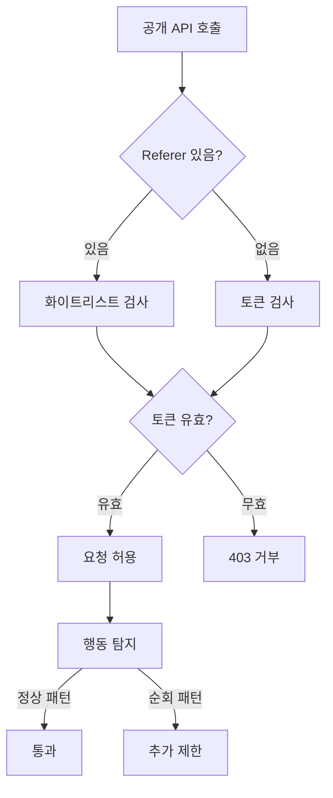

## 문제와 배경

인증 없이도 누구나 호출할 수 있는 공개 JSON 목록 API가 있었습니다. 주제별 인기 콘텐츠 목록처럼 제목·작성자·이용 수 같은 공개 메타데이터만 돌려주는 엔드포인트였고, 개인정보나 유료 본문은 포함하지 않았습니다. 그런데 같은 엔드포인트와 형제 엔드포인트 몇 종을 짧은 간격으로 반복 호출하는 트래픽이 늘어나면서, 응답은 틀리지 않는데도 같은 출처에서 과도하게 자주 불려 나가는 패턴이 보이기 시작했습니다.

이 상황을 "유출"이 아니라 "스크래핑"으로 규정하는 일이 먼저였습니다. 반환되는 값 자체가 공개 카탈로그 정보이므로 막아야 할 위협은 민감정보 노출이 아니라 서버 부하와 콘텐츠 대량 재수집이었고, 그래서 대응 강도도 거기에 맞춰 비례적으로 정해야 했습니다. 동시에 지켜야 할 제약이 셋 있었습니다. 같은 데이터를 보여 주는 HTML 상세 페이지는 검색엔진이 계속 색인할 수 있어야 하고, 내부 배치가 같은 공개 API를 호출하는 경로가 있다면 그 배치도 끊기면 안 되며, 해외 연구자나 기관처럼 정상적으로 대량 조회가 필요한 이용자도 오차단돼서는 안 됐습니다.

## 접근: 한 겹이 아니라 세 겹으로 막기

막는 지점을 하나로 두면 그 지점만 우회당하므로, 아래처럼 엣지·애플리케이션·행동 탐지 세 계층으로 나눠 순서대로 거치게 했습니다.



| 계층 | 조치 | 노리는 것 |
|---|---|---|
| 엣지(리버스 프록시/WAF) | IP별 속도 제한 | 고볼륨 단일 출처부터 부수효과 없이 차단. 저볼륨 브라우저, crawl-delay를 지키는 검색봇, 저빈도 배치는 그대로 통과 |
| 애플리케이션 | null-safe Referer 화이트리스트 + 시간 제한 토큰 | Referer는 빠른 1차 필터일 뿐이고 위조 내성의 본체는 토큰. 형제 엔드포인트 전부를 한 묶음으로 적용 |
| 행동 탐지 | IP별 파라미터 순회 패턴 추적 | 짧은 시간에 서로 다른 분류 코드를 과도하게 많이 순회하면 추가 제한 |

Referer 검사는 토큰 검사보다 먼저 걸어 빠른 경로로 쓰되, 판정의 근거는 토큰 쪽에 둡니다. Referer는 요청 헤더 한 줄로 위조할 수 있어 속도 방지턱 이상의 역할을 맡기면 안 됩니다.

## 구현: 토큰 게이트와 null-safe 검사

### 핵심 코드

아래는 이 글을 위해 새로 쓴 최소 예시이고, 실제 구현의 클래스·엔드포인트 이름을 그대로 옮긴 것은 아닙니다. 애플리케이션 계층에서 Referer를 먼저 보고, 없거나 화이트리스트 밖이면 토큰을 검사합니다.

```java
public class PublicListingApiGuard {

    private final Set<String> allowedReferers; // 형제 엔드포인트를 쓰는 화면 출처 전체
    private final TokenValidator tokenValidator;

    public boolean allow(HttpServletRequest request) {
        String referer = request.getHeader("Referer"); // null 가능
        if (referer != null && allowedReferers.stream().anyMatch(referer::startsWith)) {
            return true;
        }
        // Referer가 없거나(배치, 일부 봇) 화이트리스트 밖이면 토큰으로 판정한다
        String token =
            request.getHeader(API_TOKEN_HEADER_NAME);
        return token != null && tokenValidator.isValid(token);
    }
}
```

`Referer`가 없는 요청을 바로 거부하지 않는 점이 핵심입니다. Referer 없이 호출하는 주체에는 악성 크롤러만 있는 게 아니라, 헤더를 안 보내는 검색봇과 내부 배치도 섞여 있습니다. 이전에는 Referer가 없으면 곧바로 403을 내려주는 분기가 있었는데, 이 분기가 null을 역참조해 500으로 떨어지는 경로도 같이 있었습니다. null 가능성을 먼저 걸러 fail-closed(403)로 정리했습니다.

시간 제한 토큰은 발급 시각과 TTL을 같이 검증합니다.

```java
public class TokenValidator {

    private static final int VALID_MINUTES = 10;

    public boolean isValid(String token) {
        Optional<TokenPayload> payload = tokenCodec.decode(token);
        Duration validFor = Duration.ofMinutes(VALID_MINUTES);
        return payload
            .filter(p -> Duration.between(p.issuedAt(), Instant.now()).compareTo(validFor) <= 0)
            .isPresent();
    }
}
```

행동 탐지는 애플리케이션 계층을 통과한 요청만 대상으로, IP별로 최근 구간에서 서로 다른 분류 코드를 몇 종 순회했는지 센 뒤 임계값을 넘으면 추가 제한을 겁니다.

```java
public class ParameterTraversalThrottle {

    private static final int WINDOW_SECONDS = 60;
    private static final int MAX_DISTINCT_CODES = 20;

    public boolean exceedsLimit(String clientIp, String categoryCode) {
        String key = "traversal:" + clientIp;
        redis.sadd(key, categoryCode);
        redis.expire(key, WINDOW_SECONDS);
        return redis.scard(key) > MAX_DISTINCT_CODES;
    }
}
```

이 계층은 단일 코드를 반복 조회하는 정상 이용자나 느린 배치는 건드리지 않고, 짧은 시간에 넓은 범위를 훑는 순회만 추가로 좁힙니다.

## 함정과 트레이드오프

실제로 걸려 넘어지기 쉬운 지점은 방어 로직 자체보다 그 주변의 판단이었습니다.

| 함정 | 왜 문제인가 | 대응 |
|---|---|---|
| Referer만으로 차단 | 한 줄로 위조 가능하고, Referer 없이 호출하는 정상 주체(배치·일부 검색봇)까지 같이 끊깁니다 | 토큰·속도 제한·배치 예외를 반드시 같이 둡니다 |
| 공인 IP egress를 외부 크롤러로 오인 | 내부 배치가 NAT를 거쳐 나가는 공인 IP가 Geo-IP에 해외로 잘못 표기되는 경우가 있어, 로그 확인 없이 차단하면 자체 배치가 끊깁니다 | 차단 전에 접근 로그로 User-Agent·Referer·IP 소유자·호출 시각대를 먼저 확인합니다 |
| HTML까지 같이 제한 | HTML 상세 페이지는 검색엔진 색인 자산이라, JSON API와 같은 규칙으로 막으면 색인이 끊깁니다 | 제한은 JSON 엔드포인트에만 걸고 HTML 경로는 제외합니다 |
| 국가 단위 일괄 차단 | 해외의 정상 사용자까지 오차단할 위험이 커, 전역 서비스에는 맞지 않습니다 | 국가 기반 차단 대신 행동 패턴 기준으로 제한합니다 |
| robots.txt로 충분하다고 가정 | Robots Exclusion Protocol(RFC 9309)은 준수를 강제하지 않는 권고 규약이라, 악성 크롤러는 애초에 지킬 의무가 없습니다 | 기술적 통제(속도 제한·토큰·행동 탐지)로만 대응하고 robots.txt는 선량한 봇에 대한 안내로만 둡니다 |

엣지 속도 제한의 임계값은 낮을수록 안전해 보이지만, 너무 낮추면 정상적으로 여러 페이지를 빠르게 넘기는 이용자나 crawl-delay를 지키는 검색봇까지 걸립니다. 반대로 너무 높이면 고볼륨 단일 출처를 놓칩니다. 이 글에서 다룬 토큰 TTL(10분)과 순회 임계값(60초에 20종)도 서비스마다 정상 이용 패턴을 먼저 관찰하고 정할 값이지, 고정된 정답은 아닙니다.

인증 세션(로그인 사용자, 조직 단위 인증)은 속도 제한에서 예외로 둬야 하는 경우도 있습니다. 회사나 학교처럼 여러 사용자가 한 공인 IP로 나가는 조직은, 인증을 거치지 않은 트래픽과 같은 기준을 적용하면 정상 사용량만으로도 걸릴 수 있습니다.

목록 화면의 비동기 순서 문제를 다룬 [사용자 기능 뒤편에서 만난 함정 (2)](/blog/2026/07/07/placeholder-slot-race-condition.html)와, 크롤러 트래픽을 다른 각도(없는 문서 응답 코드)에서 줄인 [크롤러 부하 줄이기 (1)](/blog/2026/02/03/soft-404-gone-410-crawler.html)도 같은 "정상 트래픽을 지키며 막는다"는 제약을 공유합니다.

## 정리

- 공개 카탈로그 메타데이터만 반환하는 API라면 위협은 유출이 아니라 스크래핑이므로, 대응 강도도 그 전제에 맞춰 비례적으로 정합니다.
- 단일 조치는 우회되기 쉬우니 엣지 속도 제한, 애플리케이션 토큰 게이트, 행동 탐지를 계층으로 묶습니다.
- Referer는 위조가 쉬운 1차 필터일 뿐이고, Referer가 없는 요청에는 정상 배치와 검색봇도 섞여 있어 단독 차단 기준으로 쓰면 안 됩니다.
- 제한은 JSON 응답에만 걸고 HTML 색인 경로는 건드리지 않아야 SEO가 깨지지 않습니다.
- 차단 로직을 걸기 전에 접근 로그로 출처를 먼저 확인하면, 내부 배치나 조직 단위 세션을 외부 크롤러로 오인하는 일을 줄일 수 있습니다.

