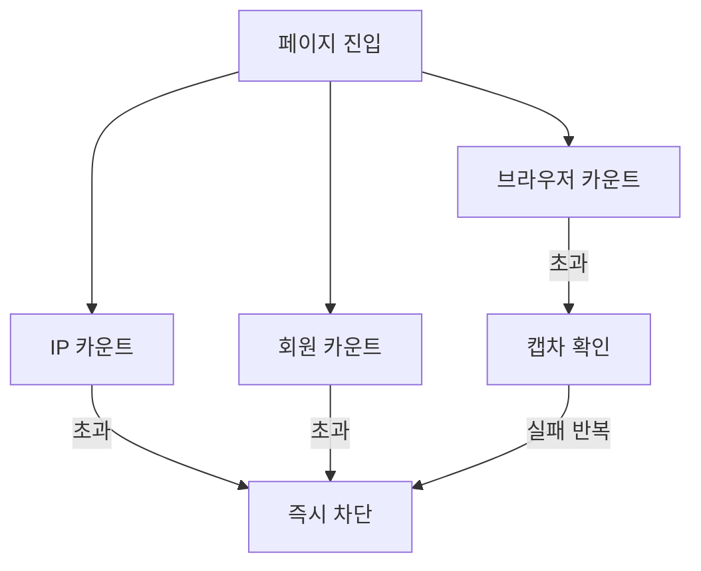

## 문제와 배경

기존 웹 애플리케이션(Spring MVC + JSP, JDK 8)에 본문 뷰어를 추가하면서, 열람을 세는 방식이 바뀌었습니다. 다운로드나 원문 보기 같은 기존 기능은 버튼을 눌러야 한 건으로 집계됐지만, 본문 뷰어는 상세 페이지에 **들어가기만 해도** 한 건으로 집계됩니다. 버튼 클릭보다 발생 빈도가 훨씬 높은 신호입니다.

집계 방식이 바뀌면 두 가지 문제가 동시에 생깁니다.

- 기존에 쓰던 차단 임계값을 그대로 두면, 강의실이나 도서관에서 여러 사람이 짧은 시간에 같은 기관 IP로 접속하는 정상 이용까지 임계값을 넘겨 차단될 수 있습니다.
- 그렇다고 임계값을 무작정 올리면, 본문을 긁어가는 자동화된 반복 열람을 걸러내지 못합니다.

막아야 할 것과 보호해야 할 것이 같은 신호(페이지 진입 횟수) 위에 있다 보니, 단일 임계값 하나로는 둘 다 만족시킬 수 없었습니다. 그래서 **누구의 열람인지를 가리키는 축을 여러 개 두고, 축마다 다른 임계값과 다른 대응**을 적용하는 쪽으로 방향을 잡았습니다.

여기에 더해 화면 쪽에도 보완 장치가 필요했습니다. 서버 쪽 집계는 요청이 쌓인 뒤에야 판단하므로, 본문을 통째로 드래그해 복사해 가는 경로는 화면 단에서 먼저 막아야 더 효과적입니다. 이 보완 장치를 모바일에 적용하는 과정에서 기기 판정 자체가 틀리는 별도 문제를 만났는데, 뒤에서 따로 다룹니다.

## 접근

세 키가 각자 카운트를 쌓고, 넘겼을 때의 대응도 키마다 다르게 갈라집니다.



### 세 가지 키로 나눠 추적합니다

같은 "페이지 진입"이라도 누가 진입했는지에 따라 정상/비정상을 가르는 기준이 다릅니다. 그래서 신호를 하나로 합치지 않고 세 키로 나눠 각각 따로 셉니다.

| 키 | 무엇을 가리키나 | 왜 따로 두나 |
|---|---|---|
| IP 대역 | 기관·단체의 접속 창구 | 대학 도서관처럼 한 IP 뒤에 여러 사람이 있는 경우를 기관 분류별로 다르게 다룰 수 있습니다 |
| 회원 ID | 로그인한 개인 | 로그인 여부가 확실한 신원이라 개인 단위로 한도를 둘 수 있습니다 |
| 브라우저 식별자 | 비로그인 이용자(쿠키·로컬 저장소에 심어 둔 UUID) | 로그인하지 않은 접속도 추적해야 하는데, 쓸 수 있는 신원이 이것뿐입니다 |

각 키는 "최근 N분 동안 몇 번 접속했는가"를 Redis에 카운터로 쌓고, 그 카운터에 윈도우 길이만큼 TTL을 겁니다. 윈도우가 지나면 TTL 만료로 카운터가 저절로 사라지므로, 집계를 리셋하는 배치가 따로 필요 없습니다. 기관 분류(대학·공공기관 등)에 따라 IP 대역의 임계값은 차등을 두어, 트래픽이 원래 많은 기관의 오차단 위험을 줄였습니다.

### 단계를 두고 대응합니다

세 키 모두 "넘으면 즉시 차단"으로 두지는 않았습니다. 브라우저 식별자 키는 익명 이용자를 가리키므로 오탐 가능성이 상대적으로 높아, 처음 몇 번 임계값을 넘기면 캡차를 띄워 사람인지만 확인하고, 캡차를 반복해서 넘기거나 실패하면 그때 차단합니다. 회원 ID와 IP 대역은 신원이 더 분명하므로 임계값을 넘기면 바로 일정 시간 차단합니다.

차단 중에는 다른 자료에 접속해도 본문이 노출되지 않도록 해서, 이용자 쪽에서도 지금 제한 상태라는 것을 알 수 있게 했습니다. 차단 해제는 운영자가 수동으로 처리하지 않고, Redis TTL이 끝나는 시점에 자동으로 풀리도록 했습니다. 해제 기준 시각은 클라이언트가 아니라 서버 시간을 기준으로 하므로, 기기 시간을 돌려도 우회되지 않습니다.

## 구현

### 핵심 코드

아래는 이 글을 위해 새로 쓴 예시이며, 실제 코드가 아니라 구조를 보여주는 뼈대입니다. 키 세 개를 같은 패턴으로 다루되, 윈도우 길이와 임계값, 넘었을 때의 동작만 다르게 설정합니다.

```java
public enum AbuseKeyType {
    IP_RANGE(RateLimitPolicy.of(Duration.ofHours(1), 800, Action.BLOCK)),
    MEMBER(RateLimitPolicy.of(Duration.ofMinutes(15), 150, Action.BLOCK)),
    BROWSER_UUID(RateLimitPolicy.of(Duration.ofMinutes(15), 40, Action.CAPTCHA));

    final RateLimitPolicy policy;
    AbuseKeyType(RateLimitPolicy policy) { this.policy = policy; }
}

public AbuseDecision checkAndCount(AbuseKeyType type, String identity) {
    String redisKey = "view-count:" + type.name() + ":" + identity;
    long count = redis.incr(redisKey);
    if (count == 1) {
        redis.expire(redisKey, type.policy.window());
    }
    if (count <= type.policy.threshold()) {
        return AbuseDecision.ALLOW;
    }
    if (type.policy.action() == Action.CAPTCHA) {
        return captchaStage.next(identity); // 넘긴 횟수에 따라 캡차에서 차단으로 넘어갑니다
    }
    return blockStore.block(identity, type, blockDurationFor(type));
}
```

`INCR` 뒤에 `EXPIRE`를 한 번만 거는 방식이라, 키가 없을 때(`count == 1`)만 TTL을 새로 겁니다. 그 뒤 들어오는 요청은 카운터만 올라가고 남은 TTL은 그대로 흘러갑니다. 첫 요청 시각부터 N분짜리 고정 윈도우가 열리는 셈이라 별도 정렬 자료구조가 필요 없습니다. 대신 윈도우가 끝나기 직전과 새로 열린 직후에 몰아서 요청하면 짧은 시간에 임계값의 두 배 가까이 통과할 수 있습니다. 또 `INCR`과 `EXPIRE`가 따로 실행되므로 그 사이에 연결이 끊기면 TTL 없는 카운터가 남을 수 있습니다. 운영에서는 두 명령을 Lua 스크립트나 `SET key 0 EX <초> NX` 뒤 `INCR`로 묶어 이 틈을 없애는 편이 안전합니다.

## 함정과 트레이드오프

### 모바일 판정에 터치 지원 여부만 쓰면 PC가 오탐됩니다

본문을 통째로 긁어가는 것을 막는 보완 장치로, 모바일 화면에서는 본문 영역의 텍스트 선택 자체를 막았습니다(`user-select: none`). 처음에는 "터치를 지원하는 기기인가"(`navigator.maxTouchPoints > 0`)만으로 모바일 여부를 판정했는데, 이렇게 하면 터치스크린이 달린 노트북이나 2-in-1 PC처럼 **마우스로도 조작하는 터치 지원 데스크톱**까지 모바일로 분류돼 텍스트 선택이 막혀 버립니다. 이 기기를 쓰는 PC 이용자 입장에서는 멀쩡한 글 선택 기능이 갑자기 사라진 것으로 보입니다.

막아야 하는 것은 "터치가 되는 기기"가 아니라 "주 입력이 터치이고 마우스 호버가 없는 기기"였습니다. 그래서 판정 조건을 다음 두 가지를 모두 만족할 때로 좁혔습니다.

- `window.matchMedia('(pointer: coarse)').matches` — 주 입력 장치가 정밀하지 않다(터치 등)
- `window.matchMedia('(hover: none)').matches` — 마우스 호버 같은 입력이 없다

```javascript
function isRealMobileOrTablet() {
  var ua = navigator.userAgent || '';
  var uaMobile = /Mobi|Android|iPhone|iPod/i.test(ua);
  var mm = window.matchMedia;
  var coarseNoHover = typeof mm === 'function' &&
    mm('(pointer: coarse)').matches && mm('(hover: none)').matches;
  return uaMobile || coarseNoHover;
}
```

태블릿 운영체제 중에는 브라우저가 데스크톱용 UA를 그대로 보내는 경우가 있어 UA 문자열만으로는 걸러지지 않지만, 주 입력이 터치이고 호버가 없다는 조건은 여전히 성립하므로 이 판정으로 잡힙니다. 반대로 터치스크린이 있어도 마우스로 호버가 되는 기기는 이 조건을 통과하지 못해 선택 차단에서 제외됩니다. 이 조건으로 바꾼 뒤에는 휴대폰과 태블릿에서만 선택이 막히고, 터치스크린이 달린 노트북에서는 다시 선택할 수 있게 됐습니다.

### 모바일에서는 드래그 기반 보조 기능을 포기했습니다

텍스트 선택 자체를 막으면 복사·크롤링은 억제되지만, 드래그로 특정 구간을 골라 쓰는 보조 기능(예: 인용 문구 뽑기, 오류 신고 범위 지정)도 같이 못 쓰게 됩니다. 모바일 운영체제의 기본 선택 메뉴(복사·검색·번역)는 브라우저가 개별 항목만 골라 숨길 수 없어서, 선택 자체를 막지 않으면 우리 쪽 커스텀 메뉴와 운영체제 기본 메뉴가 겹쳐서 뜹니다. 두 메뉴가 겹치는 혼란보다는 기능을 포기하는 쪽을 택했고, 이 모바일 범위는 데스크톱 드래그 팝오버와는 별개로 운영하고 있습니다. 데스크톱에는 영향이 없습니다.

### 임계값은 배포 후에도 계속 들여다봐야 합니다

세 키의 임계값은 과거 집계 방식의 수치를 그대로 옮긴 것이 아니라 새로 추정한 값입니다. 배포 직후 모니터링에서 오차단이나 우회 시도가 보이면 바로 조정할 수 있어야 하므로, 값 자체를 설정으로 분리해 두고 배포 뒤 실측치를 보며 다시 산정하는 과정을 거쳤습니다.

## 정리

- 집계 단위가 "버튼 클릭"에서 "페이지 진입"으로 바뀌면, 기존 차단 임계값은 그대로 두면 안 됩니다. 정상 이용과 비정상 이용을 가르는 축을 늘리는 쪽이, 단일 임계값을 조정하는 것보다 안전했습니다.
- IP 대역·회원·브라우저 식별자처럼 신뢰도가 다른 키는 따로 추적하고, 신뢰도가 낮은 키일수록 캡차 같은 중간 단계를 두는 편이 오차단을 줄입니다. Redis의 `INCR` + `EXPIRE`로 윈도우와 자동 만료를 함께 구현하면 별도 리셋 배치 없이 운영할 수 있습니다.
- 화면 단의 모바일 판정에 터치 지원 여부 하나만 쓰면 터치 지원 데스크톱이 오탐됩니다. "주 입력이 터치이고 호버가 없다"는 조건을 함께 요구해야 진짜 모바일·태블릿만 걸러집니다.
