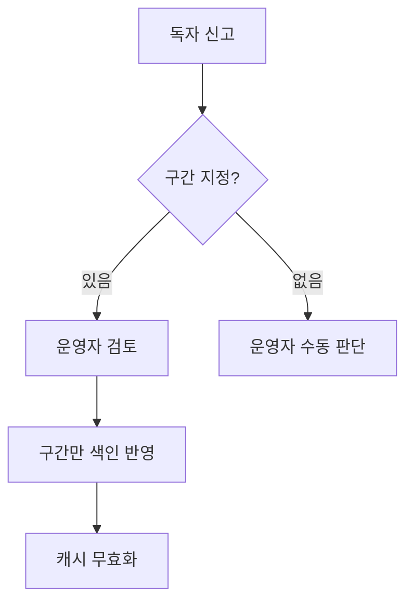

## 문제와 배경

논문 본문을 화면에 보여 주는 뷰어에는 OCR로 추출한 텍스트도 섞여 있어서, 글자가 잘못 인식되거나 번역이 어색한 부분이 나옵니다. 독자가 이런 오류를 신고하면 운영자가 검토해 고치고, 고친 내용을 검색 색인에 반영해 화면에 보이는 본문을 바꿉니다. 본문 전체가 아니라 신고된 구간만 바꾸는 부분 업데이트라서, 신고가 많아도 색인을 통째로 다시 만들 필요는 없습니다.

말은 간단하지만 이 흐름에는 세 단계가 있고, 단계마다 서로 다른 성격의 문제가 숨어 있었습니다.

1. **신고 접수** — 독자가 본문의 일부 구간을 드래그해 신고하거나, 구간을 특정하지 않고 전체를 신고합니다.
2. **운영자 검토** — 운영자 화면에서 신고된 원문과 현재 색인 내용을 나란히 보고 고칩니다.
3. **색인 반영** — 승인하면 고친 내용만 색인 문서의 해당 구간에 반영하고, 화면이 보는 캐시를 무효화합니다.

이 글은 출시 이후 이 세 단계를 거치며 실제로 만난 세 가지 문제—두 번째 승인이 화면에 반영되지 않는 레이스, 특정 문자가 저장 단계에서 깨지는 문제, 신고 원문과 색인 원문의 인코딩이 달라 구간을 못 찾는 문제—를 다룹니다. 코드는 이 글을 위해 일반 이름으로 새로 쓴 예시이며 그대로 실행해 보지는 않았습니다.

## 접근

신고 접수부터 색인 반영까지, 구간 지정 여부에 따라 경로가 갈라집니다.



### 신고 유형: 구간 신고와 전체 신고

독자가 본문 일부를 드래그해 신고하면, 그 구간의 위치 정보(문단 번호, 시작·끝 오프셋)가 함께 저장됩니다. 구간을 지정하지 않고 "본문 전체가 이상하다"로 신고하는 경우도 있는데, 이때는 어느 구간을 고쳐야 할지 특정할 수 없습니다.

그래서 신고 저장값에 위치 정보가 하나라도 있는지로 유형을 가릅니다.

- **구간 신고**: 위치 정보가 있습니다. 운영자가 해당 구간만 보고 고치고, 승인하면 그 구간만 색인에 반영합니다.
- **전체 신고**: 위치 정보가 없습니다. 자동 반영이 불가능하므로 운영자가 수동으로 판단해 승인·거절하거나, 문제가 심하면 해당 본문 노출 자체를 끕니다.

이 구분은 운영자 화면의 버튼 노출에도 그대로 씁니다. 구간 신고에는 "내용 수정" 버튼이 보이고, 전체 신고에는 보이지 않습니다.

### 검토 화면: 원문·신고 내용·수정 내용을 나란히

운영자 화면은 세 가지를 한 화면에 둡니다.

| 영역 | 내용 | 용도 |
|---|---|---|
| 원문 내용 | 현재 색인에 들어 있는 본문 구간 | 지금 화면에 보이는 값 |
| 신고 내용 | 독자가 제출한 신고 텍스트 | 참고용, 그대로 반영하지 않음 |
| 수정 내용 | 운영자가 편집한 결과 | 모달을 열면 원문을 자동으로 채워 두고 일부만 고치게 함 |

수정 내용이 원문과 같거나 비어 있으면 "유지"로, 실제로 달라졌으면 "교체"로 판정해서 바뀐 구간만 색인에 보냅니다. 신고 구간이 여러 문단에 걸쳐 있으면 해당 구간들을 이어 붙여 하나의 원문으로 보여 주고, 신고가 가리키는 범위를 표시해 운영자가 앞뒤 맥락 안에서 판단할 수 있게 합니다.

## 구현

### 핵심 코드: 구간만 바꿔 색인에 반영하기

승인 시점에 색인 문서 전체를 덮어쓰면 같은 문서의 다른 구간을 건드릴 위험이 있습니다. 그래서 색인 문서를 조회해 신고 구간의 원문을 찾고, 그 구간만 치환한 값을 부분 업데이트로 보냅니다.

```java
public UpdateResult applyCorrection(String docId, String reportedText, String correctedText) {
    String current = searchIndex.getField(docId, "body");

    int start = current.indexOf(reportedText);
    if (start < 0) {
        // 신고 원문을 현재 색인 내용에서 찾지 못하면 전체를 덮어쓰지 않고 중단합니다.
        return UpdateResult.spanNotFound();
    }

    String updated = current.substring(0, start)
            + correctedText
            + current.substring(start + reportedText.length());

    if (updated.equals(current)) {
        // 이미 반영된 내용이면 쓰기를 건너뛰고 승인만 진행합니다.
        return searchIndex.markApproved(docId);
    }

    return searchIndex.updateField(docId, "body", updated);
}
```

구간을 못 찾으면 전체 덮어쓰기로 물러나지 않고 승인을 중단합니다. 애매하게 고쳐 본문 전체를 망가뜨리는 것보다, 운영자가 다시 보게 하는 쪽이 안전합니다.

## 함정과 트레이드오프

### 함정 1 — 두 번째 승인이 화면에 반영되지 않는다

같은 문서에 신고를 연달아 승인했는데, 두 번째 승인분만 화면에 보이지 않는 현상이 있었습니다. 운영자 화면에서는 승인이 정상 처리된 것으로 보였기 때문에 더 헷갈렸습니다.

원인은 검색엔진의 새로고침 지연이었습니다. 검색엔진에 값을 쓰면 문서 ID로 직접 읽는 조회에는 바로 보이지만, 검색 질의에는 다음 새로고침 이후에야 보입니다. 대량 적재 성능 때문에 이 본문 색인은 새로고침 주기를 길게 잡거나 꺼 둔 상태였습니다. 승인 경로는 "이미 반영된 내용이면 쓰기를 건너뛴다"는 비교 기준값을 검색 질의로 읽고 있었고, 화면 쪽은 무효화된 캐시를 다시 만들 때 역시 검색 질의로 본문을 읽었습니다. 첫 승인 직후 두 번째 승인이나 캐시 재생성이 들어오면 아직 새로고침되지 않은 옛 값을 읽었고, 그 옛 값으로 캐시가 다시 만들어지면 이후에는 무효화할 계기가 없어 그대로 굳었습니다.

해결은 쓰기 요청에 새로고침 옵션을 붙이는 것이었습니다. 검색엔진의 update API는 쓰기 직후 해당 조각을 바로 새로고침하는 방식과, 다음 새로고침이 끝날 때까지 응답을 기다리는 방식을 둘 다 제공합니다. 앞의 방식은 응답이 빠른 대신 새로고침을 자주 일으키고, 뒤의 방식은 부담이 적은 대신 승인 응답이 그만큼 늦어집니다. 승인은 운영자 몇 명이 누르는 경로라 어느 쪽이든 부하는 문제가 되지 않았고, 다음 조회가 반드시 새 값을 읽는다는 보장이 더 중요했습니다.

```java
public UpdateResult updateField(String docId, String field, String value) {
    // 새로고침을 거친 뒤 응답하게 해, 뒤이은 비교 조회와 캐시 재생성이 항상 새 값을 읽게 합니다.
    return client.update(docId, Map.of(field, value), UpdateOptions.refreshBeforeReturn());
}
```

### 함정 2 — 특정 문자만 저장 단계에서 사라진다

운영자가 위첨자·아래첨자 같은 특수 문자를 넣어 저장했는데, 다시 열어 보면 물음표로 바뀌어 있는 경우가 있었습니다. 입력 직후에는 정상으로 보이고 다시 조회할 때만 깨지는 것이 단서였습니다.

원인은 저장 대상 컬럼이 유니코드가 아닌 문자 집합을 쓰는 컬럼이었던 데 있었습니다. 입력 경로는 유니코드로 정상 전달됐지만, 저장하는 순간 컬럼의 문자 집합 밖에 있는 문자는 오류 없이 다른 문자로 치환됐습니다. 컬럼 타입을 유니코드를 저장할 수 있는 타입으로 바꾸는 것이 유일한 해결책이었고, 이미 깨진 값은 되살릴 수 없어 다시 입력해야 했습니다. 이 문제의 더 자세한 손실 지점 추적 방법은 [전송 계층에서 문자가 조용히 사라지는 사례](/blog/2026/08/05/jdbc-silent-cjk-character-loss.html)에 정리해 두었습니다.

### 함정 3 — 신고 구간을 못 찾는다

운영자가 수정 없이 신고 내용을 그대로 승인("바로 승인")하면 간혹 "신고 구간을 찾지 못했습니다"로 중단되는 경우가 있었습니다. 운영자가 수정 화면을 거쳐 승인하면 문제가 없었습니다.

원인은 신고 원문이 저장되는 경로에서 일부 특수문자가 HTML 엔티티로 바뀌거나, 그마저도 지원하지 않는 문자는 다른 문자로 치환돼 저장된 데 있었습니다. 운영자가 수정 화면을 거치면 사람이 직접 글자를 입력하므로 이런 치환이 없지만, 신고 원문을 그대로 색인에서 찾으려 하면 엔티티나 치환 문자가 섞인 문자열과 실제 색인 값이 글자 단위로 어긋나 못 찾습니다.

더 까다로운 점은 치환이 한 글자 대 한 글자로 대응하지 않는다는 것이었습니다. 치환된 자리 하나가 색인 쪽에서는 여러 글자에 해당하는 경우가 있었습니다. 그래서 다음 순서로 매칭했습니다.

1. HTML 엔티티를 먼저 원래 문자로 되돌립니다.
2. 치환된 자리는 정확히 한 글자가 아니라 가변 길이로 보고, 앞뒤의 멀쩡한 글자를 기준점 삼아 그 사이를 느슨하게 매칭합니다.
3. 이 느슨한 매칭으로 찾은 위치가 두 군데 이상이면 모호하다고 보고 자동 반영을 포기하고, 운영자가 수정 화면에서 직접 고치도록 안내합니다.

안전장치를 하나 깨뜨리고 다른 안전장치로 메운 셈입니다. 글자 단위 정확 매칭을 포기한 대신, 모호하면 자동으로 멈추게 해서 엉뚱한 구간을 건드리는 일은 막았습니다.

## 정리

- 신고 검토는 구간 신고(자동 반영 가능)와 전체 신고(수동 판단)로 나누고, 운영자 화면은 원문·신고 내용·수정 내용을 나란히 보여 줘 승인 전에 비교할 수 있게 합니다.
- 색인 반영은 문서 전체가 아니라 신고 구간만 치환하는 부분 업데이트로 하고, 구간을 못 찾으면 전체 덮어쓰기로 물러나지 않고 중단합니다.
- 검색엔진의 비동기 새로고침과 캐시 재생성이 겹치면 반영이 눈에 보이지 않게 고착될 수 있습니다. 쓰기 요청에 새로고침 옵션을 붙여, 바로 다음 조회가 새 값을 읽도록 보장합니다.
- 유니코드가 아닌 컬럼은 오류 없이 문자를 치환해 버리므로, 특수 문자가 오가는 경로의 컬럼 타입은 먼저 점검합니다.
- 신고 원문과 색인 원문의 인코딩이 다르면 구간 매칭이 깨집니다. 느슨한 매칭으로 복구를 시도하되, 결과가 모호하면 자동 반영 대신 사람이 보게 합니다.
