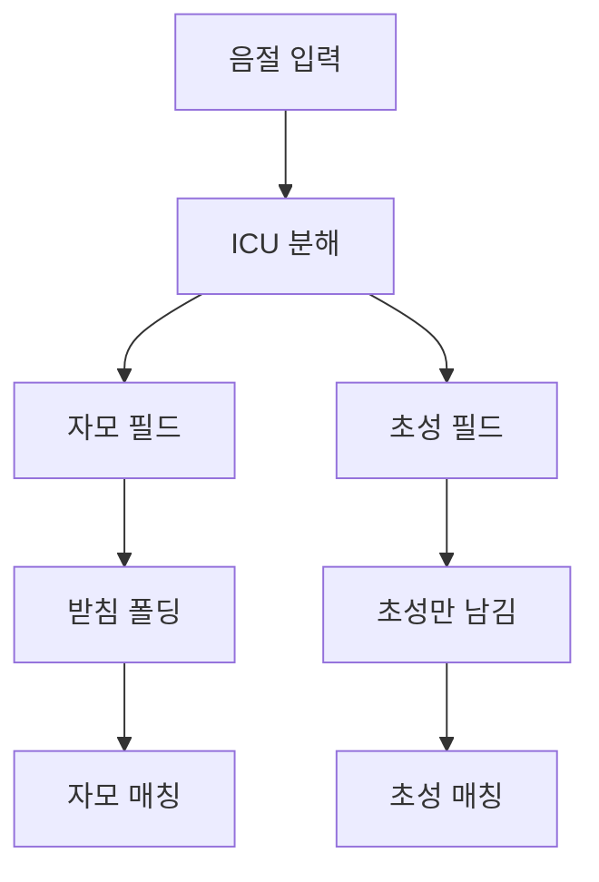

## 문제와 배경

이름이나 짧은 문자열을 검색어 일부만으로 찾게 하려면, 흔히 「초성으로 찾기」와 「자모 단위로 찾기」 두 가지가 요구됩니다. 이전 글([사용자 기능 뒤편에서 만난 함정 (3)](/blog/2026/07/10/public-api-scraping-defense.html))에서 다룬 공개 API 방어와는 결이 다른 문제지만, 같은 검색 기능의 한쪽 구석에서 터진 함정이라는 점은 비슷합니다.

이런 요구를 받으면 먼저 떠오르는 방법은 색인 파이프라인에서 초성·자모로 변환한 값을 미리 만들어 별도 필드에 넣는 것입니다. 배치나 색인 전처리 단계에서 변환 로직을 한 번 돌리고, 조회 쪽에서도 검색어를 같은 규칙으로 변환해 비교합니다.

문제는 이렇게 하면 변환 규칙이 색인 쪽과 조회 쪽에 두 번 존재한다는 점입니다. 양쪽 로직이 완전히 같아야 색인값과 검색어가 만나는데, 한쪽만 고치면 예외도 로그도 없이 결과가 0건이 되는 경로가 생깁니다. Elasticsearch의 `analysis-icu` 플러그인만 있으면 초성·자모 변환을 분석기 단계로 옮길 수 있고, `text` 필드는 색인값과 검색어에 같은 분석기를 적용하므로 조회 측은 입력 원문을 그대로 `match` 질의에 넣으면 됩니다. 이중 구현 자체를 없애는 선택이었습니다.

## 접근

분석기만으로 처리하기로 하면서, 하나의 음절이 자모 필드와 초성 필드 두 갈래로 어떻게 갈라지는지부터 정리했습니다.



ICU normalizer의 decompose 모드는 한글 음절을 자모 코드포인트로 분해합니다. 자모 필드는 이 중 자모 영역만 남기고, 초성 필드는 그중에서도 첫 자음(초성) 영역만 남깁니다. 사용자가 키보드로 직접 입력하는 호환 자모도 같은 분석기를 거치면 같은 코드로 정규화되므로, 조회 측에서 따로 변환할 코드가 필요 없다는 전제가 여기서 성립합니다.

문제는 분해된 코드포인트가 음절 안에서의 위치에 따라 달라진다는 점이었습니다. 한 음절의 받침(종성)과 다음 음절의 첫 자음(초성)은 눈으로는 같은 자음이라도 서로 다른 유니코드 블록에 속합니다. 그대로 두면 사용자가 입력한 자모 문자열이 색인된 자모 필드의 prefix와 맞지 않는 경우가 생깁니다.

| 비교 | 받침 폴딩 전 | 받침 폴딩 후 |
|---|---|---|
| 받침 있는 이름의 자모 prefix 매칭 | 실패 | 성공 |
| 겹받침이 있는 문자열의 자모 prefix 매칭 | 실패 | 성공 |

해결은 종성 코드포인트를 대응하는 초성 코드포인트로 바꿔 주는 매핑 char filter를 자모 필드의 분석기에 끼우는 것이었습니다. 겹받침은 첫 자음 하나로 접어, prefix 일치 정확도보다 매칭 성공률을 우선했습니다.

## 구현

### 핵심 코드

아래는 이 글을 위해 다시 쓴 최소 설정이며, 필드명과 인덱스명은 모두 일반화했습니다.

```json
{
  "settings": {
    "analysis": {
      "char_filter": {
        "jongseong_to_choseong": {
          "type": "mapping",
          "mappings": [
            "\\u11A8 => \\u1100",
            "\\u11AB => \\u1102",
            "\\u11AF => \\u1105"
          ]
        }
      },
      "filter": {
        "jamo_only": {
          "type": "pattern_replace",
          "pattern": "[^\\u1100-\\u11FF]",
          "replacement": ""
        },
        "choseong_only": {
          "type": "pattern_replace",
          "pattern": "[^\\u1100-\\u1112]",
          "replacement": ""
        }
      },
      "analyzer": {
        "jamo_analyzer": {
          "tokenizer": "keyword",
          "char_filter": ["icu_normalizer", "jongseong_to_choseong"],
          "filter": ["jamo_only"]
        },
        "choseong_analyzer": {
          "tokenizer": "keyword",
          "char_filter": ["icu_normalizer"],
          "filter": ["choseong_only"]
        }
      }
    }
  },
  "mappings": {
    "properties": {
      "display_name": {
        "type": "keyword",
        "fields": {
          "jamo": { "type": "text", "analyzer": "jamo_analyzer" },
          "choseong": { "type": "text", "analyzer": "choseong_analyzer" }
        }
      }
    }
  }
}
```

두 서브필드는 거의 대칭으로 보이지만, 걸려 있는 char filter 하나가 다릅니다. `jamo_analyzer`에는 `jongseong_to_choseong` 매핑이 들어가고 `choseong_analyzer`에는 들어가지 않습니다. 이 차이를 처음에는 실수로 지웠다가 되짚었습니다. 두 분석기 설정을 나란히 두고 작성하다 보니 자모 필드 쪽 매핑을 초성 필드에도 그대로 복사하고 싶어지는데, 그렇게 하면 받침까지 초성 문자로 바뀐 뒤 초성 필터를 통과해 버립니다. 그 결과 초성 필드에 받침 글자 하나가 더 끼어들어, 사용자가 입력한 초성 문자열보다 한 글자 긴 값이 색인됩니다.

| 필드 | 받침 폴딩 적용 | 이유 |
|---|---|---|
| 자모 필드 | 적용 | 받침·첫 자음 코드포인트 차이를 흡수해야 prefix가 맞음 |
| 초성 필드 | 미적용 | 적용하면 받침이 초성으로 오인돼 글자 수가 어긋남 |

이 차이를 코드 리뷰에서 놓치지 않도록, 두 분석기로 같은 입력을 색인한 뒤 기대한 길이와 비교하는 테스트를 분석기 단위로 추가했습니다.

```java
@Test
void 자모_필드는_받침을_접어_prefix를_맞춘다() {
    String analyzed = analyze("jamo_analyzer", "서현아");
    assertThat(analyzed).startsWith(choseongOnly("서현")); // 받침 포함 접두어와 일치
}

@Test
void 초성_필드는_받침을_접지_않는다() {
    String analyzed = analyze("choseong_analyzer", "서현아");
    assertThat(analyzed).hasSize(3); // 음절 수만큼만 남아야 함(접었다면 4가 됨)
}
```

두 번째 테스트가 없었다면, 다음에 누군가 두 분석기 설정을 통합하거나 리팩터링하면서 매핑을 똑같이 맞춰 버리는 실수를 다시 할 수 있었습니다.

## 함정과 트레이드오프

| 선택 | 얻는 것 | 잃거나 주의할 것 |
|---|---|---|
| 초성·자모를 색인 파이프라인이 아닌 분석기로 처리 | 조회 측 변환 코드가 없어짐, 규칙이 한 곳에만 존재 | `analysis-icu` 플러그인 설치가 전제, 분석기 체인을 디버깅하려면 `_analyze` API로 각 단계를 직접 확인해야 함 |
| 받침 폴딩을 자모 필드에만 적용 | 자모 prefix 매칭이 사용자가 기대하는 대로 동작 | 두 분석기가 비슷해 보여 복사·붙여넣기로 실수하기 쉬움, 필드별 테스트로 고정해야 함 |
| 겹받침을 첫 자음 하나로 접음 | 겹받침이 있는 문자열도 매칭됨 | 자모 단위의 엄밀한 prefix 정확도는 포기 |
| 이름에 형태소 분석기를 쓰지 않음 | 성과 이름이 중간에 쪼개지는 오탐을 피함 | 형태소 분석이 주는 다른 이점(복합어 분해 등)은 포기 |

이름 검색에 형태소 분석기(한국어 전용 토크나이저)를 쓰는 선택지도 검토했지만 제외했습니다. 짧은 고유명사는 일반 문장과 통계적 특성이 달라서, 대부분은 그대로 남아도 일부는 성과 이름 경계에서 쪼개집니다. 이름이 쪼개지면 그 조각이 들어간 다른 문서와 뜻하지 않게 매칭되므로, 2~3음절 고유명사에는 형태소 분석보다 정규화와 n-gram 조합이 더 정확했습니다. 자모 변환을 자동 생성하는 방식(유니코드 로마자 변환 등)도 실제 표기와 어긋나는 결과를 내는 경우가 있어, 변환은 분석기 체인 안에서 결정적인 규칙으로만 두는 편이 안전했습니다.

서브필드를 추가하면 저장 공간이 늘어나는 점도 짚어 둘 부분입니다. 기존 필드의 최상위 타입을 `keyword`로 유지하고 자모·초성은 서브필드로만 추가하면, 완전일치로 질의하던 기존 소비자는 영향을 받지 않습니다. 실측에서는 짧은 문자열 필드 기준으로 두 자리 퍼센트 초반대의 저장 공간 증가가 있었고, 본문처럼 긴 필드가 함께 있는 인덱스라면 이 비율은 상대적으로 더 낮아집니다.

## 정리

- 초성·자모 변환을 색인 파이프라인과 조회 코드 양쪽에 두면, 한쪽만 고쳤을 때 조용히 결과가 0건이 되는 이중 구현 문제가 생깁니다. `analysis-icu`로 분석기 단계에 몰아넣으면 조회 측 변환이 필요 없어집니다.
- 한글 음절을 자모로 분해하면 받침과 첫 자음은 눈에는 같아 보여도 서로 다른 코드포인트를 씁니다. 자모 필드에서 prefix 매칭을 쓰려면 받침을 첫 자음 코드로 접는 필터가 필요합니다.
- 그 접기 필터를 초성 필드에도 그대로 복사하면 받침이 초성으로 오인돼 글자 수가 어긋납니다. 두 필드는 비슷해 보이지만 적용할 필터가 다르고, 이 차이는 필드별 분석 결과를 검증하는 테스트로 고정해 둬야 합니다.
- 짧은 고유명사에는 형태소 분석기보다 정규화와 n-gram 조합이 낫고, 자동 로마자 변환은 실제 표기와 어긋날 수 있어 피했습니다.
