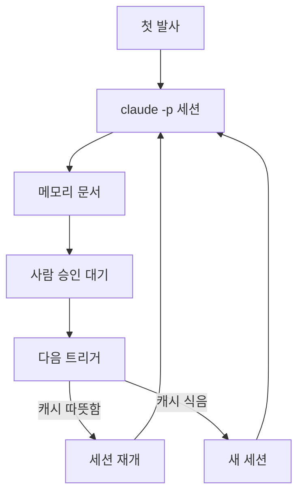

3편에서는 폴러가 Jira 상태로 트리거를 판정하고 프롬프트를 조립해 `claude -p` 세션을 띄우는 과정을 다뤘습니다. 이 편에서는 그 이슈별 세션을 여러 회차에 걸쳐 이어 가는 방법, 인증 모드와 사용량 계측, 헤드리스 환경에서 에이전트·스킬이 로드되는 경로, 그리고 무상태 폴러와 상주 오케스트레이터 중 무엇을 택할지의 아키텍처 선택을 다룹니다.

## 세션 이어가기와 계측

메모리 문서를 정본으로 두고 `--resume`을 캐시가 따뜻할 때만 쓰는 흐름은 다음과 같습니다.



### 1. 이슈별 세션 이어 가기: `session_id`와 `--resume`

초기 폴러는 트리거마다 완전히 새 대화로 세션을 띄웠습니다. 작업 디렉터리(이슈별 git worktree)는 이어졌지만, 앞 단계에서 Claude가 왜 그렇게 계획했는지, 설계에서 무엇을 버렸는지, 검수에서 무엇이 실패했는지는 대화에 남지 않았습니다.

그래서 이슈 키를 대화의 정체성으로 삼았습니다. Slack 봇이 스레드 ID로 세션을 이어 가는 것과 같은 방식입니다.

1. 첫 발사는 새 세션으로 띄우고, 끝나면 JSON 출력의 `session_id`를 꺼내 상태 파일의 그 이슈 항목에 저장합니다.
2. 다음 트리거부터는 그 값을 `--resume <session_id>`로 넘깁니다.
3. 재개가 실패하면(로그에 세션을 찾지 못했다는 오류가 남거나, 회수한 ID가 요청한 ID와 다르면) 저장해 둔 ID를 지웁니다. 즉시 다시 띄우지 않고 다음 트리거가 새 세션으로 시작하게 둡니다.

```python
import json

def harvest(proc, issue_state):
    try:
        out = json.loads(Path(proc["log"]).read_text(encoding="utf-8").strip().splitlines()[-1])
    except (ValueError, IndexError, OSError):
        issue_state.pop("session_id", None)   # 결과를 못 읽으면 다음 회차는 새 세션
        return None
    sid = out.get("session_id")
    if proc.get("resumed_from") and sid != proc["resumed_from"]:
        issue_state.pop("session_id", None)   # 재개가 조용히 새 대화가 된 경우
    elif sid:
        issue_state["session_id"] = sid
    return out
```

`--resume`만으로는 부족했습니다. 세션 기록에는 보존 기한이 있고, 기한이 지나거나 기록이 정리되면 재개가 실패합니다. 그래서 대화와 별개로 **이슈 메모리 문서**를 하나 둡니다. 세션이 단계를 마칠 때마다 요청 요약, 판정한 작업 유형, 계획, 설계 결정, 구현 요지, 되돌림 이력을 이 문서에 갱신하고, 폴러는 매 발사마다 이 문서를 프롬프트에 넣습니다. 이 문서는 git worktree 바깥(`~/issue-agent/runs/<이슈키>/memory.md`)에 둡니다. 저장소 안에 두면 작업 브랜치의 변경 목록이 지저분해집니다.

운영하면서 이 두 장치의 역할을 다시 정했습니다. 근거는 비용입니다.

- 세션을 이어 갈 수 있는 기한과 프롬프트 캐시가 따뜻한 기한은 다릅니다. 메모에 남은 관찰로는 구독 로그인에서 캐시 기한이 대략 1시간, 세션 재개 기한은 그보다 훨씬 깁니다. 공식 문서의 보장이 아니라 직접 관찰한 값입니다.
- 게이트 사이에는 사람의 승인이 끼어 있어 간격이 몇 시간에서 며칠입니다. 그 구간에서 `--resume`을 하면 세션은 살아 있지만 캐시는 식어 있어서, 쌓인 대화 전체를 할인 없이 다시 보내게 됩니다. 이슈가 길어질수록 이 값이 커집니다.
- 반면 메모리 문서는 길이 상한이 있어 비용이 일정합니다.

그래서 단계 사이의 맥락 복원은 **메모리 문서가 정본**이고, `--resume`은 직전 회차가 끝난 지 캐시 기한 안에 다시 깨어날 때만 쓰는 최적화로 내렸습니다. 인증을 API 키로 바꾸면 캐시 기한이 더 짧아지므로(관찰상 몇 분) `--resume`의 이점은 더 줄어듭니다. 한 이슈를 한 세션으로 끝까지 끌고 가는 그림은 매력적이지만, 사람이 끼는 워크플로에서는 짧고 독립적인 회차와 구조화된 인수인계 문서가 더 싸고 더 튼튼했습니다.

### 2. 회차별 산출물

이슈마다 디렉터리 하나를 두고, 회차마다 같은 이름 접두로 파일 네 개를 남깁니다.

```text
~/issue-agent/runs/<이슈키>/
├─ 20260818-101500.prompt   이번 회차에 실제로 넘긴 프롬프트 전문
├─ 20260818-101500.sh       그 프롬프트로 claude를 실행한 스크립트(플래그 포함)
├─ 20260818-101500.log      세션 출력(JSON)
├─ 20260818-101500.done     claude 프로세스의 종료 코드
├─ memory.md                이슈 메모리 문서
└─ session.json             session_id와 회차 이력
```

`.prompt`와 `.sh`가 있으면 어떤 회차든 같은 조건으로 다시 돌려 볼 수 있습니다. 무인 세션이 이상하게 행동했을 때 가장 먼저 여는 파일이 `.prompt`입니다. 에이전트 정의 파일을 고쳤는데 행동이 바뀌지 않는다면, 대개 프롬프트에 박힌 문장이 정의 파일보다 강하게 작용하고 있기 때문입니다(아래 「헤드리스에서 에이전트와 스킬이 로드되는 경로」 참고).

`.done`의 값이 0이라고 해서 일이 된 것은 아닙니다. 프롬프트 첫 줄이 등록되지 않은 명령이어서 세션이 아무 일도 하지 않고 끝났는데도 종료 코드는 0이었던 사례가 있습니다. 종료 코드만 보고 성공을 기록하면 안 된다는 점은 [종료 코드 0으로 끝나는 조용한 실패](/blog/2026/10/07/silent-failure-exit-code-fail-open.html)에서 따로 정리했습니다. 회수 단계에서는 최소한 JSON의 `is_error`와 `num_turns`까지 함께 봅니다.

### 3. 인증 모드와 사용량 계측

헤드리스 `claude -p`를 인증하는 방법은 두 가지를 놓고 비교했습니다.

| 방식 | 장점 | 주의할 점 |
|---|---|---|
| Console API 키(`ANTHROPIC_API_KEY`) | 자동화 용도가 약관상 명확하고, 쓴 만큼 과금됩니다 | 비용이 바로 청구됩니다. 프롬프트 캐시 기한이 짧습니다 |
| 구독 로그인(OAuth) | 사람 좌석과 같은 한도 안에서 돕니다 | 상시 자동화가 「개인의 통상 사용」 전제에 맞는지 회색지대가 남습니다 |

공식 문서에서 확인한 함정이 세 가지 있습니다.

- 비대화형(`-p`) 모드에서는 환경에 `ANTHROPIC_API_KEY`가 있으면 항상 그 키를 씁니다. 구독으로 돌리려던 스크립트가 남아 있던 키 때문에 API로 과금될 수 있으므로, 폴러는 발사할 때 어느 모드인지 로그에 한 줄 남깁니다.
- 브라우저 로그인이 불가능한 환경을 위해 `claude setup-token`으로 장기 OAuth 토큰(`CLAUDE_CODE_OAUTH_TOKEN`)을 발급할 수 있습니다. 구독 플랜이 전제입니다.
- CI용 `--bare` 모드는 OAuth와 키체인을 읽지 않습니다. API 키 방식과는 잘 맞지만, 구독 로그인에 기대는 스크립트에는 맞지 않습니다.

사용량은 세션 JSON 출력에서 읽어 이슈별로 한 줄씩 JSON Lines 파일에 쌓습니다.

```python
USAGE_KEYS = ("input_tokens", "output_tokens",
              "cache_read_input_tokens", "cache_creation_input_tokens")

def record_usage(issue_key, out, ledger=Path.home() / "issue-agent" / "usage.jsonl"):
    usage = out.get("usage") or {}
    row = {
        "ts": datetime.now().isoformat(timespec="seconds"),
        "issue": issue_key,
        "session_id": out.get("session_id"),
        "cost_usd": out.get("total_cost_usd"),
        "num_turns": out.get("num_turns"),
    }
    row.update({k: usage.get(k) for k in USAGE_KEYS})
    with ledger.open("a", encoding="utf-8") as f:
        f.write(json.dumps(row, ensure_ascii=False) + "\n")
```

기록을 보면 장기 이슈일수록 캐시 읽기 토큰이 입력 토큰보다 몇 자릿수 크게 쌓였습니다. 앞서 세션 이어 가기에서 `--resume`을 강등한 근거가 이 숫자였습니다.

필드 위치는 CLI 버전에 따라 달라질 수 있으니 직접 출력해 보고 맞추는 편이 안전합니다. 실제로 모델 이름을 최상위에서 읽도록 짰다가 그 자리에 키가 없어 모든 행이 `null`로 쌓인 적이 있습니다. 비용과 토큰 값은 정상이어서 한동안 아무도 알아채지 못했습니다. 계측이 조용히 틀어지는 경로는 7편에서 더 다룹니다.

### 4. 헤드리스에서 에이전트와 스킬이 로드되는 경로

폴러는 `claude -p`를 부를 때 특정 에이전트나 플러그인 디렉터리를 지정하는 인자를 쓰지 않았습니다. 그러면 무엇이 로드되는지는 Claude Code의 일반 탐색 규칙이 정합니다. 실행 디렉터리 기준의 프로젝트 설정, 사용자 설정의 활성 플러그인 목록, 사용자 전역 에이전트·스킬 디렉터리입니다.

이 구조에서 실제로 겪은 문제는 두 가지입니다.

1. **사본이 두 벌이면 로드되는 쪽이 최신이라는 보장이 없습니다.** 에이전트 정의가 설치 스크립트용 사본과 팀 공용 플러그인 사본으로 나뉘어 있었고, 개선은 한쪽에만 들어갔습니다. 점검해 보니 세션이 실제로 읽는 것은 플러그인 쪽의 오래된 정의였습니다. 그런데도 세션은 새 설계대로 움직였습니다. 행동 계약을 폴러가 매 회차 프롬프트에 직접 넣고 있었기 때문입니다. 결과는 맞았지만, 정의 파일을 고쳐도 아무 효과가 없는 상태였습니다.
2. **슬래시 명령으로 스킬을 부르는 방식은 저장소 정리 한 번에 끊깁니다.** 프롬프트 첫 줄에서 스킬을 슬래시 명령으로 불렀는데, 플러그인 쪽에서 스킬 디렉터리 배치를 바꾸자 그 명령이 미등록 상태가 됐습니다. CLI는 「알 수 없는 명령」으로 바로 끝났고 종료 코드는 0이었습니다. 지금은 스킬 문서를 절대 경로로 읽으라고 프롬프트에 적습니다. 파일만 있으면 성립하는 방식이 플러그인 배치, 캐시 버전, 이름공간 세 가지에 동시에 기대는 방식보다 덜 깨집니다.

정리하면, 헤드리스 세션에서 행동을 확실히 정하는 것은 **프롬프트에 직접 들어간 문장**입니다. 정의 파일과 스킬은 그 문장이 가리키는 참고 자료로 두고, 실제로 무엇이 로드됐는지는 `.prompt`와 세션 로그로 확인합니다.

## 함정과 트레이드오프: 폴러냐 에이전트냐

### 두 실행 모델

설계 초기에 두 실행 모델을 비교했습니다.

| | 무상태 헤드리스 | 상주 오케스트레이터 |
|---|---|---|
| 구조 | 주기 실행이 `claude -p`를 한 번씩 띄움 | 살아 있는 Claude 세션이 터미널 멀티플렉서에 워커 세션을 띄워 조율 |
| 강점 | 단순하고, 사람을 며칠 기다리는 구간에 강함 | 단계 안의 긴 멀티턴 작업, 워커 간 직렬·병렬 조율 |
| 약점 | 회차 하나 안에서만 생각함 | 상주 비용, GUI 세션 의존, 죽으면 스케줄도 함께 멈춤 |

결론은 둘 중 하나가 아니었습니다. 시간 척도가 다릅니다. 게이트 사이의 대기는 분에서 일 단위이고 그동안 세션을 붙잡아 두는 것은 낭비입니다. 반대로 구현과 검증 같은 단계 안의 작업은 멀티턴과 위임이 필요합니다. 그래서 **단계 사이는 무상태 폴러가, 단계 안의 깊은 작업은 세션 내부의 서브에이전트가** 맡는 혼합 모델로 갔습니다.

이 혼합이 성립하는 전제는 하나입니다. **상태는 항상 바깥에 둡니다.** 세션은 단계를 마칠 때마다 Jira 상태와 이슈 메모리 문서를 갱신합니다. 그러면 어떤 세션이 언제 죽어도 다음 폴링이 바깥 상태를 읽고 그 지점부터 이어 갑니다.

### 판정을 어디에 둘 것인가

폴러 코드가 커지면서 다시 한번 경계를 그었습니다. 폴러가 하는 일을 성격별로 나누면 두 층입니다.

- **배관(결정론)**: 주기 실행, 잠금, JQL 조회, 상태 파일 저장, heartbeat, HTTP 재시도. 매번 똑같이 동작해야 하므로 코드에 남깁니다.
- **판정(추론)**: 이번 회차가 어떤 성격의 단계인지, 어떤 댓글이 처리할 입력인지, 이슈 규모와 위험도가 어느 정도인지, 진행이 멈췄는지. 규칙이 늘수록 `if` 분기가 늘고 테스트가 어려워집니다.

보고 나니 판정의 상당 부분은 이미 프롬프트로 넘어가 있었습니다. 폴러가 단계를 판정하고 그 결과를 「이번 회차의 계약」으로 프롬프트에 써 주고 있었으니까요. 그래서 다음 설계는 판정의 위치를 파이썬에서 오케스트레이터 세션으로 옮기는 방향입니다. 폴러는 「이 이슈를 처리하라」만 넘기고, 오케스트레이터가 단계를 판정해 작업에 맞는 모델의 워커 서브에이전트에게 맡기고, 끝나면 Jira 정리를 합니다.

다만 판정을 모델에 넘기는 만큼 비결정성이 들어옵니다. 그래서 되돌리기 어려운 행위는 한곳에 모아 결정론적인 가드로 감쌉니다.

- 상태 전이는 허용 목록에 있는 전이만 합니다.
- Jira 쓰기는 오케스트레이터만, 정해진 래퍼 명령으로만 합니다. 워커가 각자 Jira를 건드리면 자기 댓글에 다시 깨어나는 고리가 되살아납니다.
- 서브에이전트 중첩은 얕게 둡니다. 허용 깊이와 그것을 제어하는 환경 변수는 Claude Code 버전마다 다르므로, 운영 장비의 `claude --version`부터 확인합니다.

모델은 서브에이전트 정의의 `model` 값이 CLI의 `--model`보다 우선합니다. 오케스트레이터를 가벼운 모델로 띄워도 구현 워커 정의에 상위 모델을 적어 두면 워커는 그 모델로 돕니다. 다만 오케스트레이터가 하는 일은 상태 전이와 사람 댓글의 의도 분류처럼 틀리면 영향이 큰 판단이라, 오케스트레이터를 가장 싼 모델로 내리는 것은 실측을 보고 결정하기로 했습니다. 비용은 오케스트레이터를 강등하는 쪽이 아니라 워커 모델을 작업에 맞게 고르는 쪽에서 먼저 줄입니다.

## 정리

- 단계 사이의 맥락은 길이 상한이 있는 이슈 메모리 문서로 복원하고, `--resume`은 캐시가 따뜻할 때만 쓰는 최적화로 둡니다.
- 회차마다 프롬프트, 실행 스크립트, 로그, 종료 코드를 남겨 어떤 회차든 같은 조건으로 다시 돌려 볼 수 있게 했습니다. 종료 코드가 0이어도 일이 됐다는 뜻은 아닙니다.
- 인증 모드(API 키 대 구독 로그인)에 따라 캐시 기한과 과금 방식이 다르므로, 폴러는 어느 모드로 떴는지 로그에 남깁니다.
- 헤드리스에서 행동을 확실히 정하는 것은 프롬프트에 직접 들어간 문장입니다. 정의 파일과 슬래시 명령은 배치가 바뀌면 조용히 끊길 수 있어, 실제로 무엇이 로드됐는지는 회차별 산출물로 확인합니다.
- 단계 사이는 무상태 폴러가, 단계 안은 세션 내부의 서브에이전트가 맡는 혼합 모델로 갔고, 그 전제는 상태를 항상 바깥에 두는 것입니다.

### 다음 편 예고

이 편에서 여러 번 「뒤에서 다룬다」고 미뤄 둔 것이 있습니다. 세션이 Jira에 댓글을 달고 상태를 옮기는 경로, 그리고 무인 세션이 해서는 안 되는 일을 막는 장치입니다. 5~6편에서는 Slack과 Jira로 사람에게 알리는 방식, 쓰기 명령을 래퍼 하나로 모은 이유, 허용 규칙이 적혀 있는데도 매칭되지 않던 사례, 설정 파일을 지키는 훅을 정리합니다. 훅 자체의 동작 함정은 [Claude Code 훅을 직접 써 보며 부딪힌 함정 6가지](/blog/2026/09/30/claude-code-hook-pitfalls.html)에 따로 정리해 두었습니다.
