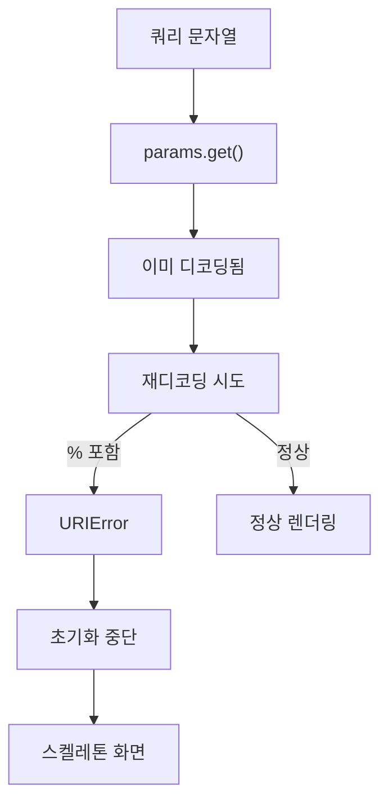

## 문제와 배경

검색어 끝에 `%`가 오는 검색만 결과 화면이 뜨지 않았습니다. 콘솔에는 `URIError: URI malformed`가 남아 있었습니다. 그 예외가 검색 화면 초기화 함수를 그 자리에서 멈춰 세웠고, 뒤에 이어질 렌더링 코드가 실행되지 않아 로딩 스켈레톤만 남았습니다.

원인은 같은 값을 두 번 디코딩한 데 있었습니다. 주소창의 쿼리 문자열을 읽을 때 쓰는 `URLSearchParams.get()`은 퍼센트 인코딩을 이미 풀어서 돌려줍니다. 그런데 이 코드는 그 반환값을 `decodeURIComponent`에 다시 넣고 있었습니다. 한 번 디코딩된 문자열 안에 `%`가 그대로 남아 있으면(검색어 자체에 `%`가 있었던 경우), 두 번째 디코딩은 이를 퍼센트 인코딩 시퀀스의 시작으로 해석하려다 실패합니다.

이 글은 디코딩이 어디서 몇 번 일어나는지를 짚고, 실패해도 멈추지 않는 안전한 디코딩 함수로 바꾼 과정과 그 선택이 기존 링크에 어떤 영향을 주는지를 정리합니다. URL 자체의 정규화나 전역 객체 초기화 순서 문제는 이미 다룬 적이 있어 이 글에서는 반복하지 않습니다([URL 정규화 301의 두 가지 부작용](/blog/2026/09/17/url-normalization-301-side-effects.html), [전역 객체 초기화 시점 가정](/blog/2026/09/01/global-object-init-time-assumption.html)).

## 접근

쿼리 문자열이 화면에 쓰이기까지 디코딩이 몇 단계를 거치는지부터 확인했습니다. 다음은 이번 코드에서 같은 값이 두 번 디코딩되는 경로를 보여줍니다.



`URLSearchParams.get()`이 퍼센트 인코딩을 디코딩해 돌려준다는 점은 MDN의 `URLSearchParams.get()` 문서에 나와 있는 계약입니다. 즉 주소창에 한글 검색어를 퍼센트 인코딩해 넣어도 `get('query')` 시점에는 이미 원래 문자열로 풀려 있습니다. 여기서 또 `decodeURIComponent`를 부르는 코드는, 디코딩된 결과 문자열에 우연히 `%`가 남아 있으면 그 뒤를 두 자리 16진수로 읽으려 시도합니다. MDN의 `decodeURIComponent` 문서는 이때 뒤에 올바른 16진수 두 자리가 따라오지 않으면 `URIError`를 던진다고 명시합니다. 검색어 끝에 `%`가 하나만 와도 정확히 이 조건에 걸립니다.

| 증상 | 원인 |
|---|---|
| 검색어 끝이 `%`일 때만 결과 화면이 스켈레톤에 멈춤 | `decodeURIComponent`가 뒤따르는 16진수 두 자리를 찾지 못해 `URIError`를 던짐 |
| 오류 화면도 없이 로딩 상태로 남음 | 예외가 초기화 함수 안에서 발생해 이후 렌더링 코드가 실행되지 못함 |
| 일반 검색어는 문제없이 동작함 | `%` 뒤에 올바른 16진수 두 자리가 있거나 `%`가 아예 없으면 디코딩이 그대로 성공함 |

왜 처음부터 디코딩이 두 번 들어갔는지는 코드 이력만으로는 단정할 수 없습니다. `URLSearchParams`가 디코딩까지 해 준다는 사실을 놓치고, 과거에 직접 쿼리 문자열을 파싱하던 시절의 `decodeURIComponent` 호출이 그대로 남아 있었던 것으로 보입니다 — 이 부분은 코드를 읽고 추정한 것이지 커밋 기록으로 확인한 사실은 아닙니다.

## 구현

### 핵심 코드

아래는 이 글을 위해 새로 쓴 최소 예시이며, 원래 코드를 옮긴 것이 아닙니다.

```javascript
// 실패해도 멈추지 않는 디코딩. 디코딩할 수 없으면 입력을 그대로 돌려준다.
function safeDecodeURIComponent(value) {
  if (typeof value !== 'string' || value === '') {
    return '';
  }
  try {
    return decodeURIComponent(value);
  } catch (e) {
    return value;
  }
}

function parseSearchQuery(queryString) {
  const params = new URLSearchParams(queryString);
  const raw = params.get('query'); // URLSearchParams가 이미 한 번 디코딩한 값
  if (!raw) {
    return '';
  }
  return safeDecodeURIComponent(raw);
}
```

이 코드에서 바뀐 것은 `decodeURIComponent(raw)` 호출을 `safeDecodeURIComponent(raw)`로 감싼 것뿐입니다. 디코딩 자체를 없애지 않은 이유는 따로 있습니다. 과거에 만들어진 링크 중에는 쿼리 값을 애초에 두 번 인코딩해 심어 둔 것이 있을 수 있고, 그런 링크는 정상적으로 동작하려면 두 번째 디코딩이 실제로 필요합니다. `try/catch`로만 감싸면 두 가지 경우를 모두 만족합니다.

- 검색어에 우연히 `%`가 들어 있어 두 번째 디코딩이 실패하면, 예외를 던지는 대신 이미 한 번 디코딩된 값(`raw`)을 그대로 씁니다. 이 값은 사용자가 입력한 검색어와 같으므로 검색 자체는 정상적으로 진행됩니다.
- 과거 방식으로 이중 인코딩된 링크는 두 번째 디코딩이 성공하므로 지금까지와 똑같이 풀립니다.

두 경우 모두 예외가 호출부로 올라가지 않으므로, 이 함수를 쓰는 초기화 코드는 더 이상 검색어의 내용 때문에 멈추지 않습니다. 다만 이 함수는 "디코딩에 실패하면 입력을 그대로 쓴다"는 선택이지, `%`로 시작하지만 우연히 뒤에 올바른 16진수가 와서 **다르게** 디코딩되는 경우까지 막지는 못합니다. 그 경우는 공식 문서의 계약이 아니라 이번 수정 범위 밖의 별도 문제입니다.

## 함정과 트레이드오프

| 선택 | 얻는 것 | 잃거나 주의할 것 |
|---|---|---|
| `decodeURIComponent`를 `try/catch` 없이 그대로 둠 | 코드가 단순함 | `%`로 끝나는 입력 하나로 초기화 전체가 멈춤 |
| 실패 시 원본을 그대로 반환 | 실패해도 흐름이 멈추지 않고, 이중 인코딩 링크도 그대로 동작함 | 디코딩이 "원래 뜻과 다르게" 성공하는 경우까지는 막지 못함 |
| 디코딩 전에 정규식으로 `%`를 검사해 건너뜀 | 예외 자체가 발생하지 않음 | `%XX` 형태까지 걸러내려면 규칙이 복잡해지고, `decodeURIComponent`가 이미 검증하는 조건을 중복 구현하게 됨 |
| `URLSearchParams.get()` 이후 재디코딩을 아예 제거 | 디코딩을 한 번만 해 가장 단순함 | 과거에 이중 인코딩해 둔 링크가 깨짐. 이번에는 영향 범위를 확인할 수 없어 보류 |

실제로 적용한 것은 두 번째 행입니다. 디코딩을 한 번만 하도록 코드를 정리하는 네 번째 선택이 더 근본적이지만, 이중 인코딩된 링크가 서비스 어디에 얼마나 남아 있는지 이번 수정 시점에는 확인할 방법이 없었습니다. 그래서 기존 동작을 깨지 않는 두 번째 행을 택했고, 재디코딩 자체를 없애는 정리는 별도 작업으로 미뤘습니다.

같은 패턴은 쿼리 파라미터를 파싱하는 곳마다 중복될 수 있습니다. 검색어 하나를 다루는 함수만 고치면, 같은 파라미터를 다른 화면 요소(관련 검색어 목록, 최근 검색어 등)에서 다시 읽어 독립적으로 디코딩하는 코드에는 똑같은 예외가 남습니다. 고칠 때는 디코딩 지점을 하나씩 찾아 전부 같은 안전한 함수로 바꿔야 합니다.

## 정리

- `URLSearchParams.get()`은 퍼센트 인코딩을 이미 디코딩해 돌려줍니다. 그 반환값을 `decodeURIComponent`로 또 디코딩하면, 값 안에 남은 `%` 뒤에 올바른 16진수 두 자리가 없을 때 `URIError`가 납니다.
- 이 예외가 초기화 함수 안에서 잡히지 않으면 이후 렌더링 코드가 실행되지 않아 로딩 스켈레톤에 멈춥니다.
- 디코딩을 `try/catch`로 감싸고 실패하면 원본을 그대로 돌려주면, 우연히 `%`가 들어간 입력도 막지 않으면서 과거에 이중 인코딩해 둔 링크도 그대로 동작합니다.
- 더 근본적인 해법은 재디코딩 자체를 없애는 것이지만, 기존 링크에 미치는 영향을 먼저 확인해야 하므로 범위를 나눠 처리했습니다.
- 같은 쿼리 파라미터를 다른 곳에서 각자 디코딩하는 코드가 있다면, 디코딩 지점을 모두 찾아 같은 방식으로 바꿔야 합니다.
