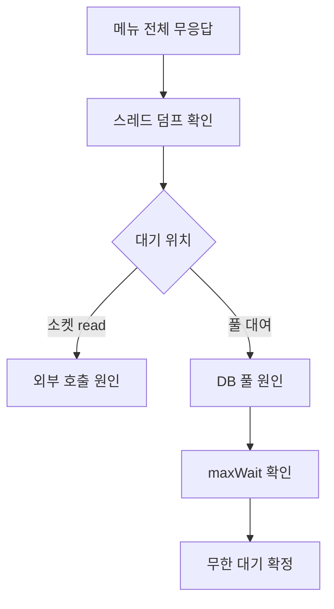

## 문제와 배경

레거시 Spring 애플리케이션에서 별도 데이터소스를 쓰는 메뉴 하나가 통째로 응답하지 않는 일이 있었습니다. 다른 메뉴는 멀쩡했고, WAS 로그에도 예외 스택트레이스가 없었습니다. 요청이 실패하는 게 아니라 그냥 끝나지 않았습니다. 같은 증상을 외부 HTTP 호출([레거시 Java 웹 애플리케이션에서 만난 함정 (1)](/blog/2026/08/11/http-client-no-timeout-thread-exhaustion.html))과 로컬 기동 지연([레거시 Java 웹 애플리케이션에서 만난 함정 (5)](/blog/2026/09/12/local-startup-connection-pool-bisect.html))에서도 다룬 적이 있는데, 이번에는 원인이 그 둘과 다른 자리, DB 커넥션 풀이었습니다.

데이터소스는 Apache Commons DBCP 1.x(`BasicDataSource`)로 설정돼 있었고, 커넥션 풀 관련 속성은 아무것도 지정돼 있지 않았습니다. DBCP 1.x 공식 문서(Commons DBCP `BasicDataSource` configuration)의 기본값은 `maxActive=8`(풀 전체 최대 커넥션 수), `maxWait=-1`(풀이 비었을 때 대여 대기 시간, 무한)입니다. 평소에는 8개로 충분했지만, 느린 집계 쿼리 하나가 커넥션을 오래 쥐고 있자 그 메뉴로 들어오는 다른 모든 요청이 빈 풀 앞에서 멈췄습니다. `maxWait=-1`이라 대여 시도는 예외를 던지지 않고 그냥 기다리므로, 로그에 남길 실패 자체가 없었습니다.

## 접근: 어디서 멈췄는지부터 가립니다

같은 "요청이 멈춘다"는 증상이라도 스레드가 멈춘 위치에 따라 원인이 완전히 다릅니다. 아래는 이런 증상을 원인별로 가르는 분기를 보여줍니다.



이 상황에서 스레드 덤프를 뜨면, 외부 호출 쪽 글처럼 소켓 읽기(`socketRead0`)에 걸린 스레드가 아니라 커넥션 풀 대여를 기다리는 스레드가 쌓여 보이게 됩니다. DBCP 1.x의 풀링은 Commons Pool의 `GenericObjectPool`이 맡는데, 풀이 비어 있고 `maxWait`가 설정돼 있으면 대여를 요청한 스레드는 그 시간만큼 `Object.wait(timeout)`으로 블로킹됩니다(Commons Pool `GenericObjectPool` 구현 기준; 실제로 이 모양 그대로의 덤프를 떠서 확인한 것은 아니고, 공개된 구현을 근거로 한 추정입니다). `maxWait=-1`이면 이 대기에 시간 제한이 없으므로, 스레드는 영원히 `WAITING` 상태로 남습니다. 외부 HTTP 호출에서 막힌 스레드가 `RUNNABLE` 상태로 보이는 것과 달리, 풀 대여 대기는 `WAITING`(또는 `TIMED_WAITING`)으로 보인다는 점이 두 유형을 구분하는 단서입니다.

같은 데이터소스를 쓰는 요청이 전부 같은 위치에서 멈춰 있는지, 다른 데이터소스를 쓰는 요청은 정상인지를 확인하면 범위를 좁힐 수 있습니다. 느린 쿼리 자체는 DB 쪽에서 실행 중인 쿼리 목록(PostgreSQL이라면 `pg_stat_activity`)으로 확인할 수 있습니다.

## 구현: 유한한 대기와 드라이버 타임아웃을 같이 둡니다

### 핵심 코드

아래는 이 글을 위해 새로 쓴 최소 예시이고, 식별자는 모두 일반화했습니다. 원래 설정값을 그대로 옮긴 것이 아니며, 이 형태 그대로 띄워 본 것은 아닙니다.

```xml
<bean id="boardDataSource" class="org.apache.commons.dbcp.BasicDataSource"
      destroy-method="close">
  <property name="driverClassName" value="org.postgresql.Driver" />
  <property name="url" value="jdbc:postgresql://db-host:5432/board_db?connectTimeout=10&amp;socketTimeout=120" />
  <property name="username" value="${board.db.username}" />
  <property name="password" value="${board.db.password}" />

  <!-- DBCP 1.x 기본값(maxActive=8, maxWait=-1)은 풀이 비면 대여 요청이 로그 없이 무한 대기한다 -->
  <property name="maxActive" value="20" />
  <property name="maxIdle" value="8" />
  <property name="maxWait" value="10000" />
  <property name="validationQuery" value="SELECT 1" />
  <property name="testOnBorrow" value="true" />
  <property name="testWhileIdle" value="true" />
  <property name="timeBetweenEvictionRunsMillis" value="60000" />
</bean>
```

세 종류의 타임아웃이 서로 다른 지점을 막습니다.

| 설정 | 막는 지점 | 유한 값으로 두지 않았을 때 |
|---|---|---|
| `maxWait`(DBCP) | 풀에서 커넥션을 빌리는 대기 | 풀이 비면 대여 요청이 무한 대기, 예외도 없어 로그가 없습니다 |
| `connectTimeout`(JDBC URL) | TCP 연결을 맺는 대기 | DB 호스트가 응답하지 않으면 연결 수립 자체가 무한 대기합니다 |
| `socketTimeout`(JDBC URL) | 쿼리 실행 중 응답을 기다리는 대기 | 느린 쿼리·죽은 연결에서 소켓 읽기가 끝나지 않습니다 |

`maxWait`를 유한 값으로 둔다고 해서 느린 쿼리 자체가 빨라지지는 않습니다. 대신 "커넥션을 아예 못 구해 무한 대기"하던 상태가 "정해진 시간 뒤 `SQLException`(DBCP 1.x에서는 `Cannot get a connection, pool error Timeout waiting for idle object` 메시지)을 던지고 실패"하는 상태로 바뀝니다. 실패는 로그로 남고, 원인 쪽(느린 쿼리)을 계속 추적할 수 있는 단서가 됩니다. `connectTimeout`·`socketTimeout`은 PostgreSQL JDBC 드라이버(pgjdbc) 공식 문서(Connection Parameters)에 설명된 URL 파라미터로, 연결 수립과 쿼리 응답 각각의 대기를 따로 막습니다. 풀 수준 타임아웃과 드라이버 수준 타임아웃은 막는 지점이 달라서 하나만 걸면 다른 쪽 구멍이 그대로 남습니다.

`validationQuery`·`testOnBorrow`·`testWhileIdle`은 이번 장애의 직접 원인은 아니지만 같이 거는 편이 안전합니다. DB 재시작이나 네트워크 단절로 죽은 커넥션이 풀에 남아 있으면, 그 커넥션을 빌린 요청이 쿼리 단계에서야 실패를 알게 됩니다. 대여 전에 `SELECT 1`로 살아있는지 확인하면 죽은 커넥션을 미리 걸러낼 수 있습니다.

## 함정과 트레이드오프

| 선택 | 얻는 것 | 잃거나 주의할 것 |
|---|---|---|
| `maxWait`만 유한 값으로 둠 | 풀 대여 무한 대기는 막습니다 | 연결 수립·쿼리 응답 쪽 무한 대기는 그대로입니다 |
| 드라이버 타임아웃만 둠 | 연결·쿼리 단계 무한 대기는 막습니다 | 풀이 비었을 때 대여 대기는 여전히 무한입니다 |
| `maxActive`를 크게 늘림 | 순간적인 쿼리 집중은 버팁니다 | DB 쪽 동시 연결 상한과 서버 자원을 먼저 확인해야 합니다. 느린 쿼리 자체는 그대로 느립니다 |
| `maxWait`를 아주 짧게 둠 | 실패 전환이 빠릅니다 | 정상적인 순간 집중까지 실패로 처리될 수 있습니다 |
| `validationQuery` 추가 | 죽은 커넥션을 미리 거릅니다 | 대여마다 쿼리 한 번이 늘어 약간의 지연이 붙습니다 |

레거시 애플리케이션에서는 데이터소스 설정 하나를 바꾸는 작업이라 변경 범위는 작지만, 영향 범위는 그 데이터소스를 쓰는 모든 메뉴입니다. 값을 바꾸기 전에 운영 중인 DB의 `max_connections`와 이 데이터소스가 이미 쓰고 있는 커넥션 수를 같이 확인해야, `maxActive`를 늘렸을 때 DB 쪽 상한에 먼저 걸리는 상황을 피할 수 있습니다.

## 정리

- DBCP 1.x를 기본값으로 쓰면 `maxWait=-1`이라 풀이 비어도 예외 없이 무한 대기하고, 예외가 없으니 로그도 남지 않습니다.
- 스레드 덤프에서 멈춘 위치가 소켓 읽기(`RUNNABLE`)인지 풀 대여(`WAITING`)인지를 가리면 외부 호출 문제와 DB 풀 문제를 구분할 수 있습니다.
- `maxWait`(풀 대여), `connectTimeout`(연결 수립), `socketTimeout`(쿼리 응답)은 막는 지점이 서로 달라 셋을 같이 걸어야 합니다.
- `validationQuery`와 `testOnBorrow`를 더하면 죽은 커넥션이 풀에 남아 있다가 실패를 뒤늦게 드러내는 일을 줄일 수 있습니다.
- 풀 크기를 늘리기 전에 DB의 동시 연결 상한을 먼저 확인합니다. 느린 쿼리 자체를 고치는 일과는 별개의 작업입니다.
